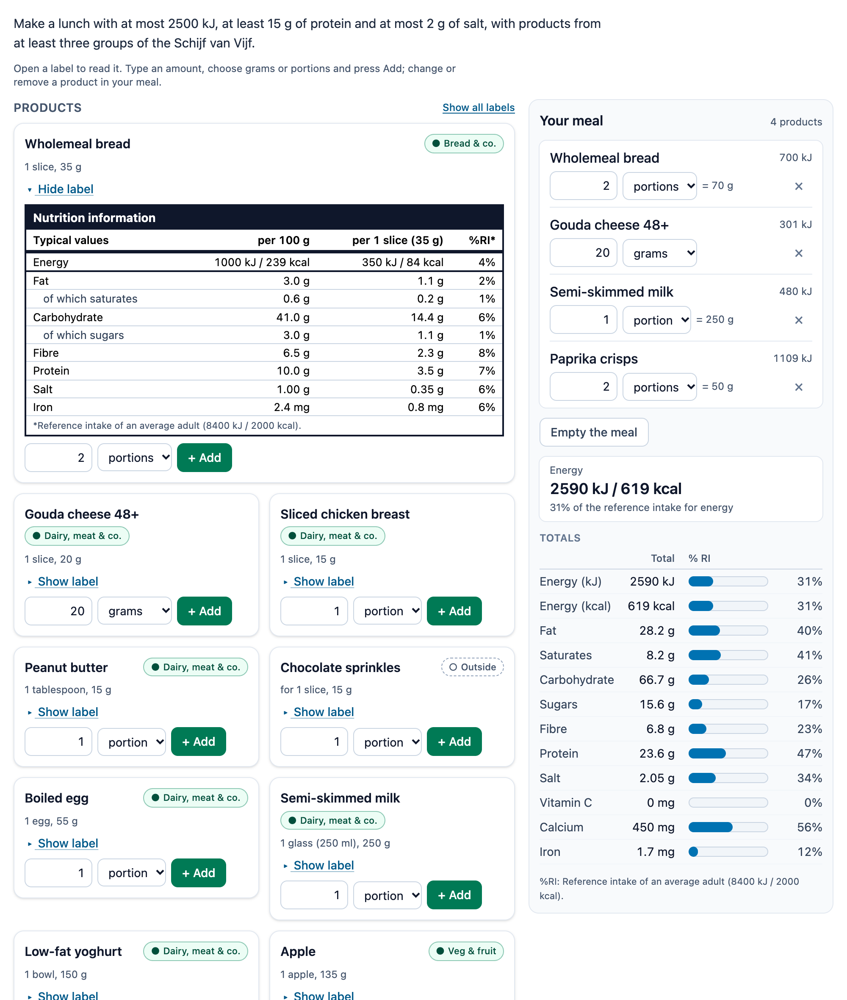

# @citolab/pci-nutrition-label

> [!WARNING]
> **Experimental (alpha). Just for inspiration.** This PCI is a technical showcase, made by software developers without
> much knowledge of the subject it could be used for. Its content, terms and scoring have not been checked by subject
> experts or assessment specialists, and it has never been used in an assessment. It is offered as is, without any
> warranty.

A QTI 3 Portable Custom Interaction (PCI) with products and their nutrition labels, for biology, care and welfare and
consumer studies ("voedingswaarde", "dagelijkse behoefte", "Schijf van Vijf"). The candidate reads EU-style nutrition
tables and puts together a meal or a day menu from products, in grams or portions. A running totals table with bars
compares the meal with the daily reference intakes. The PCI scores the meal with checks the author sets: at most 2500 kJ,
at least 15 g protein, no cola, three groups of the Schijf van Vijf. The same PCI can also be a "choose the product"
question (MATCH_CORRECT) or an unscored calculator next to a text entry. Made with [tspci](https://github.com/Citolab/tspci).

<p align="center">
  
</p>

## What it does

- **Products**: cards with the name, the group of the Schijf van Vijf (in text, ● in the schijf, ○ outside it) and the
  portion. "Show label" opens the nutrition table: a real `<table>` with a caption, column headers and row headers.
  It has the EU rows (energy in kJ and kcal, fat, of which saturates, carbohydrate, of which sugars, fibre, protein,
  salt), and vitamin C, calcium and iron when the product has them. Values are given per 100 g and per portion, with
  the %RI per portion and the footnote of the target group.
- **Composing a meal** (`data-mode="compose"` and `"tool"`): type an amount, choose grams or portions, press Add (or
  Enter). The same product again adds up. In "Your meal" each line stays editable (amount and unit, converted when the
  unit changes) and has a remove button; "Empty the meal" starts again. The amount fields refuse letters
  (`beforeinput`) and say so.
- **Totals**: energy in kJ / kcal and as a % of the reference intake, and a table with every nutrient: the total, the %
  of the reference intake and a bar. A total above the reference intake gets a striped vermillion bar, a ▲ and the
  words "above the reference intake" for screen readers, so colour is never the only signal. Blue/vermillion are
  colour-blind safe (Okabe–Ito).
- **Choosing a product** (`data-mode="select"`): all labels are open and every card has a radio button in one radio
  group. "Which product contains the most salt per portion?" is the soup in the example; per 100 g it is the chicken.
- **Reference intakes per target group**: adults (the EU reference intakes: 8400 kJ / 2000 kcal, 70 g fat, 20 g
  saturates, 260 g carbohydrate, 90 g sugars, 50 g protein, 6 g salt; fibre 30 g, the Dutch advice), teenagers 13–18 and
  children 4–8 (approximate values for practice), or values of the author's own.
- **Accessibility**: everything is a native button, field, select or radio, so it all works with the keyboard. Every
  change is announced in a live status line ("1 portion Apple added. Energy of the meal: 1776 kJ."). Transitions stop
  with `prefers-reduced-motion`.
- **Language**: `data-language="nl"` gives Dutch texts, Dutch label wording ("waarvan verzadigde vetzuren") and a
  decimal comma (`1,5`). The candidate may type `1,5` or `1.5`. The response is the same in every language.
- **Authoring mode**: the author sets up everything in the PCI itself (`getAuthoringInstance`), in four tabs:
  **Products** (paste a table from a spreadsheet, Dutch or English headers, with a preview and the problems per
  line), **Reference intakes** (target group or own values), **Task** (the mode; in select mode the correct product,
  with a helper "the product with the most salt per portion"; otherwise a model meal) and **Checks** (each one shows
  whether the model meal passes it). `validate()` reports problems in the author's language.
- **Delivery**: the meal is saved as the item's state, every change in the log, and restored. Several interactions
  of this type on one page each get an object of their own.

The example products are made up for this PCI. The values are approximate, rounded and not taken from a food
composition table (NEVO); replace them with your own.

## What can be configured

Every setting is a `data-` attribute of the interaction, as text. `dist/authoring.json` describes them for authoring
systems.

| setting                         | attribute            | default                 | what                                                                    |
| ------------------------------- | -------------------- | ----------------------- | ----------------------------------------------------------------------- |
| Instruction above the products  | `data-prompt`        | the example's lunch task | also the context for the candidate                                     |
| Task                            | `data-mode`          | `compose`               | `compose` (record, CUSTOM), `select` (identifier, MATCH_CORRECT), `tool` (JSON, not scored) |
| Products, reference, checks     | `data-plan`          | empty: the example      | written by the authoring mode, as JSON (below)                          |
| Amounts in                      | `data-amount-unit`   | `both`                  | `both`, `grams` or `portions`                                           |
| Running totals                  | `data-show-totals`   | `true`                  | `false`: the candidate calculates the totals themselves                 |
| Bars                            | `data-show-bars`     | `true`                  | bars next to the %RI                                                    |
| Per portion on the labels       | `data-show-portion`  | `true`                  | the per-portion and %RI columns                                         |
| Vitamins and minerals           | `data-show-extras`   | `true`                  | rows for vitamin C, calcium and iron when the products have them        |
| Labels open at the start        | `data-labels-open`   | `false`                 | always open in select mode                                              |
| Language                        | `data-language`      | `en`                    | `en` or `nl`: texts and numbers                                         |

```json
{
  "products": [
    { "id": "bread", "name": "Wholemeal bread", "group": "starch", "portion": 35, "portionLabel": "1 slice",
      "per100": { "energyKj": 1000, "energyKcal": 239, "fat": 3, "saturates": 0.6, "carbs": 41, "sugars": 3, "fibre": 6.5, "protein": 10, "salt": 1, "iron": 2.4 } }
  ],
  "reference": { "group": "adult" },
  "checks": [
    { "type": "nutrient", "nutrient": "energyKj", "max": 2500, "points": 1 },
    { "type": "nutrient", "nutrient": "protein", "min": 15, "points": 1 },
    { "type": "nutrient", "nutrient": "salt", "ri": true, "max": 33, "points": 1 },
    { "type": "groups", "min": 3, "points": 1 },
    { "type": "forbidden", "products": ["cola"], "points": 1 }
  ],
  "solution": { "bread": 70, "cheese": 20, "milk": 250, "apple": 135 },
  "answer": "soup"
}
```

- **Products**: `id` is a QTI identifier (the select response and the key in the composition); without one it is made
  from the name. Values are per 100 g. A missing kJ or kcal is calculated (1 kcal = 4.184 kJ). Nutrients: `energyKj`,
  `energyKcal`, `fat`, `saturates`, `carbs`, `sugars`, `fibre`, `protein`, `salt` (g), `vitaminC`, `calcium`, `iron`
  (mg). Groups: `fruitVeg`, `fats`, `protein` (dairy, nuts, fish, legumes, meat, egg), `starch`, `drinks`, `outside`.
- **Spreadsheet**: the Products tab takes a tab-separated (or `;`-separated) table with a header row. English or Dutch
  names, in any order: `naam`, `groep`, `portie (g)`, `energie (kJ)`, `vetten`, `waarvan verzadigde vetzuren`, `zout`,
  `ijzer (mg)` and so on. Without a header it uses the column order of "Copy as TSV".
- **Reference**: `{ "group": "adult" | "teen" | "child" }` or `{ "group": "custom", "values": { "energyKj": 9000, … } }`.
- **Solution**: the model meal (product → grams), shown in solution status. **Answer**: the select mode's product.

### The checks

At most 8, each worth `points` (default 1). The totals are checked as they are shown: energy in whole kJ/kcal,
nutrients to 0.1 g, salt to 0.01 g.

| check       | passes when                                                                     | rubric line                          |
| ----------- | ------------------------------------------------------------------------------- | ------------------------------------ |
| `nutrient`  | the total of `nutrient` is ≥ `min` and ≤ `max`; with `ri` in % of the reference intake | "at most 2500 kJ", "at least 15 g protein" |
| `count`     | the number of different products is between `min` and `max`                    | "at least 3 products"                |
| `groups`    | the number of groups of the Schijf van Vijf (not `outside`) is between `min` and `max` | "from three groups"           |
| `required`  | every product in `products` is in the meal                                     | "with a dairy product: milk"         |
| `forbidden` | none of `products` is in the meal                                              | "no soft drinks"                     |

## Scoring

**Compose mode** (default) is made for `custom` scoring (`authoring.json`: `"scoring": ["custom", "match_correct", "human"]`). The PCI evaluates the author's checks, and the item's response processing turns them into points. The
response is a record (`cardinality="record"`):

| field                                  | type      | what                                                         |
| -------------------------------------- | --------- | ------------------------------------------------------------ |
| `score`                                | `integer` | the points of the checks that pass                           |
| `maxscore`                             | `integer` | the points of all checks                                     |
| `correct`                              | `integer` | 1 when every check passes (and there is at least one)        |
| `check1` … `check8`                    | `integer` | 1 or 0 per check, in order; only the checks there are        |
| `items`                                | `integer` | the number of different products                             |
| `energyKj`, `energyKcal`, `fat`, `saturates`, `carbs`, `sugars`, `fibre`, `protein`, `salt` | `float` | the totals, rounded as shown (`tolerance: range`) |
| `composition`                          | `string`  | product id → grams, sorted by id, as JSON: `{"apple":135,"bread":70}` |
| `totals`                               | `string`  | every total, vitamins and minerals too, as JSON              |

The same meal gives the same response however it was entered (2 slices or 70 g of bread). Until the candidate adds a
product, `getResponse()` reports nothing.

```xml
<qti-response-declaration identifier="RESPONSE" cardinality="record"/>
<qti-outcome-declaration identifier="SCORE" cardinality="single" base-type="float">
  <qti-default-value><qti-value>0</qti-value></qti-default-value>
</qti-outcome-declaration>
<qti-outcome-declaration identifier="MAXSCORE" cardinality="single" base-type="float">
  <qti-default-value><qti-value>4</qti-value></qti-default-value>
</qti-outcome-declaration>
…
<qti-response-processing>
  <qti-response-condition>
    <qti-response-if>
      <qti-not><qti-is-null>
        <qti-field-value field-identifier="score"><qti-variable identifier="RESPONSE"/></qti-field-value>
      </qti-is-null></qti-not>
      <qti-set-outcome-value identifier="SCORE">
        <qti-field-value field-identifier="score"><qti-variable identifier="RESPONSE"/></qti-field-value>
      </qti-set-outcome-value>
    </qti-response-if>
  </qti-response-condition>
</qti-response-processing>
```

- **Your own rules**: test one field (`<qti-field-value field-identifier="check2">` equal to 1), or a total with a
  margin (`<qti-equal tolerance-mode="absolute" tolerance="50 50">` on `energyKj`), and give points as you like.

**Select mode** (`data-mode="select"`): the response is `cardinality="single" base-type="identifier"`, the chosen
product's id. Score it with `match_correct`. `getCorrectResponse(properties)` gives the author's answer
(`config.tspci.correctResponse: "settings"`), so an authoring system can fill in the correct response itself.

```xml
<qti-response-declaration identifier="RESPONSE" cardinality="single" base-type="identifier">
  <qti-correct-response><qti-value>soup</qti-value></qti-correct-response>
</qti-response-declaration>
<qti-response-processing template="https://purl.imsglobal.org/spec/qti/v3p0/rptemplates/match_correct.xml"/>
```

**Tool mode** (`data-mode="tool"`, `human`): a calculator next to, say, a text entry ("calculate the energy of 150 g").
The response is `single string`: `{"composition":{"bread":150},"totals":{"energyKj":1500,…}}`, for review only.

**State and response.** `getState()` holds the meal as entered (grams or portions) and the log. `setResponse` (and
`boundTo` without a state) reads the `composition` field of a record, a tool JSON string, or an identifier in select
mode. In `status: "solution"` the PCI shows the declared correct response (an identifier, or a record value with a
`composition` field), or else the author's model meal or answer, read-only.

## Using it

```sh
npm install @citolab/pci-nutrition-label
```

| file                                          | what                                                                      |
| --------------------------------------------- | ------------------------------------------------------------------------- |
| `dist/index.js`                               | the PCI (AMD module, everything bundled: the package has no dependencies) |
| `dist/authoring.json`                         | settings, response, scoring and the authoring mode, for authoring systems |
| `dist/sbom.cdx.json`                          | CycloneDX SBOM of the bundle                                              |
| `dist/tao-pci-nutritionLabel_<version>.zip`   | the PCI for TAO: Settings → Portable Custom Interactions → Add            |
| `nutritionLabel.svg`, `example.png`           | icon and screenshot                                                       |

In a QTI 3 item, with `index.js` at `resources/pci/index.js` of the package:

```xml
<qti-response-declaration identifier="RESPONSE" cardinality="record"/>
…
<qti-portable-custom-interaction response-identifier="RESPONSE" module="pci" custom-interaction-type-identifier="nutritionLabel"
  data-language="nl" data-mode="compose" data-plan="{&quot;products&quot;:[…],&quot;checks&quot;:[…]}">
  <qti-interaction-modules>
    <qti-interaction-module id="pci" primary-path="../resources/pci/index"></qti-interaction-module>
  </qti-interaction-modules>
  <qti-interaction-markup></qti-interaction-markup>
</qti-portable-custom-interaction>
```

Source and the other examples: [Citolab/tspci-examples](https://github.com/Citolab/tspci-examples).
