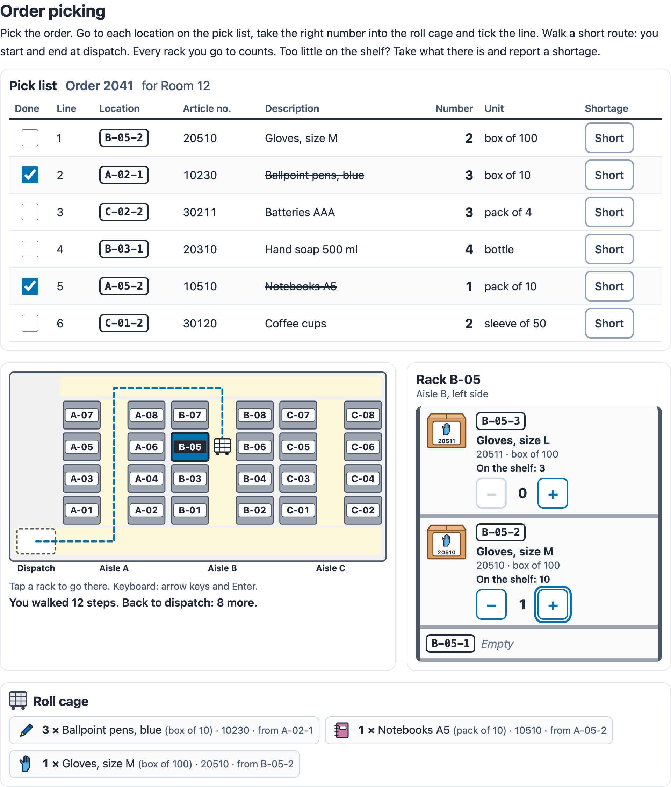

# @citolab/pci-order-picking

> [!WARNING]
> **Experimental (alpha). Just for inspiration.** This PCI is a technical showcase, made by software developers without
> much knowledge of the subject it could be used for. Its content, terms and scoring have not been checked by subject
> experts or assessment specialists, and it has never been used in an assessment. It is offered as is, without any
> warranty.

A QTI 3 Portable Custom Interaction (PCI) for order picking (Dutch: *orderpicken*) in a small warehouse, for logistics
in praktijkonderwijs (the industry certificate *Beheren van het schoolmagazijn*, mbo-1 assistent logistiek medewerker).
The pupil gets a pick list and picks the order into a roll cage: they go to a location on a map of the warehouse, see
the shelves of the rack with the products on them, take the right number with **+** and tick the line. Or they check a
roll cage someone else picked, and find the mistakes. Made with [tspci](https://github.com/Citolab/tspci).

<p align="center">
  
</p>

## What it does

- **The warehouse from above** (SVG): aisles A, B, … going up from the front corridor, a rack on both sides of every
  position, and dispatch (*expeditie*) at the front on the left, where the roll cage starts. Odd rack numbers are on
  the left of an aisle and even ones on the right, so A-01 and A-02 face each other, as in many warehouses. Every
  rack has its code written on it.
- **Location codes** such as `A-03-2`: aisle A, rack 03, shelf 2 (shelf 1 at the bottom). The code is always written:
  on the pick list, on the map, on every shelf, in the roll cage. Colour is never the only cue: the rack where the
  pupil is is dark with white text, has a heavy outline and the roll cage next to it, and is read as the current
  location.
- **The shelves of a rack**: tap a rack, and its shelves appear next to the map, the top shelf on top. Each product is a
  cardboard box with a label (a simple picture and the article number), its description and its unit ("box of 100").
  **+** takes one into the roll cage, **−** puts one back.
- **The pick list**: line, location, article number, description, number, unit, and a big tick box per line. On a
  narrow screen the article number, number and unit go under the description.
- **The roll cage** shows what is in it: the number, the description, the unit, the article number and where it came
  from.
- **Variations** (settings):
  - `route`: also walk a short route. Every rack the pupil goes to counts, from dispatch and back; the way walked is
    drawn as a dashed line and the steps are counted ("You walked 12 steps. Back to dispatch: 8 more."). The response
    compares it with the shortest route along every location of the pick list.
  - `stock`: stock counts. The shelf shows how many there are ("On the shelf: 2"), **+** stops there, and a line with
    too little stock is a shortage: take all there is and press **Short** on the pick list.
  - `task: check`: a picked roll cage with a tote per line. The pupil compares every tote with its line and chooses
    **Right**, **Wrong article**, **Wrong number** or **Missing** (each with a sign as well: ✓ ≠ # ∅).
- **Simple language** for pupils of praktijkonderwijs, in English and Dutch (`language`): *stelling*, *plank*, *gang*,
  *rolcontainer*, *bak*, *expeditie*, *picklijst*, *tekort*.
- **No feedback** on whether a line is right: the response says so.
- **Touch**: every action is a tap (on a rack, on + and −, on a tick box or a check), with targets of 44 px. Nothing is
  dragged, so a finger scrolls the page everywhere.
- **Keyboard**: Tab goes from the pick list to the map, to the shelves. The map is one tab stop: the arrow keys move
  between the racks (left and right across the aisles, up and down along them), Enter or Space goes there. When − puts
  back the last one and disables itself, the focus moves to + (and the other way round at the stock).
- **Screen readers**: every rack is a button named "Rack B-05, aisle B left", the shelves and the steppers have names
  ("Take 1: B-05-2 Gloves, size M"), and a live region says what changed ("2 × Gloves, size M in the roll cage.").

### The example

Without a `warehouse` setting, the PCI shows a school warehouse (*schoolmagazijn*) in its language: office supplies in
aisle A, cleaning and hygiene in B, canteen and spare parts in C, 22 products in 3 aisles of 4 racks on each side and 3
shelves. Order 2041 for room 12 has six lines. With `stock` on, the batteries AAA run short (3 asked, 2 on the shelf).
The roll cage of the check task has a wrong article (gloves L for M), a wrong number (2 packs of AAA for 3) and an
empty tote. There are look-alikes next to each other (gloves M and L, pens blue and red, AA and AAA, A4 and A3 paper),
because those are the mistakes order pickers make.

## Settings

| setting | editor | what it does |
| --- | --- | --- |
| `title`, `question` | `text`, `textarea` | above the PCI; an empty question shows the instruction of the task in the language of the PCI |
| `language` | `enum` | `en` or `nl`: the PCI's own texts, and the language of the example warehouse |
| `task` | `enum` | `pick` (default): pick the order into the roll cage; `check`: check a picked roll cage for mistakes |
| `route` | `boolean` | pick: also walk a short route, compared with the shortest route; default off |
| `routeMargin` | `number` | route: the steps more than the shortest route that still count as short (for `correct`); default 0 |
| `stock` | `boolean` | pick: stock counts, and a line with too little stock is a shortage to report; default off |
| `warehouse` | `pci` | the warehouse, its products, the order and the roll cage of the check task, as JSON (below); empty: the example |

`warehouse` is written by the authoring mode:

```json
{
  "aisles": 3, "depth": 4, "shelves": 3, "back": true,
  "products": [{ "loc": "B-05-2", "article": "20510", "name": "Gloves, size M", "unit": "box of 100", "picture": "gloves", "stock": 11 }],
  "order": { "number": "2041", "for": "Room 12", "lines": [{ "loc": "B-05-2", "qty": 2 }] },
  "cart": [{ "loc": "B-05-3", "qty": 2 }]
}
```

`depth` is the number of racks on each side of an aisle (racks 01 to 2 × depth), `back` a corridor at the back as well.
One product per location; an order line names a location and the article is the one there. `cart` has a tote per
order line (`null` is an empty tote). Limits: 1–6 aisles, 1–8 racks on each side, 1–4 shelves, 10 order lines, 99 per
line. A warehouse that cannot be read, or has no order line with a product, is the example; products outside the
layout and lines without a product are left out.

### Authoring mode

"Set up the warehouse and the order…" (`getAuthoringInstance`) opens the editor in the author's language. The author
sets the number of aisles, racks and shelves and the back corridor; clicks a rack on the map (or uses the arrow keys and
Enter) to put products on its shelves: article number, description, unit, a picture (17 simple ones) and the stock; the
map shows how many products each rack has. Below: the order number and who it is for, the pick list (a location from a
list of the products, a number, remove and add lines), and the roll cage of the check task: per tote the location it
was taken from (or empty) and the number, with the check that follows from it ("Wrong number"). A new line gets a
right tote, so a mistake is always one the author made on purpose. The status shows the shortest route, the lines that
run short with stock on, and what keeps **Done** from finishing: no lines, a line at a location without a product, two
lines with the same article, a product without an article number or description, products outside the warehouse, a
tote at an empty location. Two notes do not stop it: stock on without a line that runs short, and a check task whose
roll cage has no mistakes. The authoring mode writes only `warehouse`; `task`, `route` and `stock` are ordinary
settings.

## Response and scoring

The PCI does not score: it reports a `record`, and the item's scoring decides what counts. Nothing is reported until
the pupil took something, ticked a line or reported a shortage (pick), or checked a tote (check): only walking around
and looking is no answer.

| field | type | when | what it is |
| --- | --- | --- | --- |
| `correct` | `boolean` | always | pick: every line right, no wrong article, and with `route` a walk of at most `shortestRoute + routeMargin`; check: every tote judged right |
| `lines` | `integer` | always | pick: order lines with the right number of their article in the roll cage (and a shortage reported exactly where stock is short); check: totes judged right |
| `linesTotal` | `integer` | always | the order lines on the pick list |
| `wrongItems` | `integer` | always | pick: articles in the roll cage that are not on the pick list; check: wrong articles the pupil found |
| `quantityErrors` | `integer` | always | pick: lines whose article is in the roll cage in a wrong number; check: wrong numbers the pupil found |
| `shortagesReported` | `integer` | pick with `stock` | shortages reported on lines that really run short |
| `routeLength` | `float` | pick with `route` | the steps walked, from dispatch along every rack the pupil went to, and back |
| `shortestRoute` | `float` | pick with `route` | the steps of the shortest walk from dispatch along every location of the pick list and back |
| `picked` | `string` | always | pick: `cart: A-02-1=3, B-05-2=2; short: 3`, the roll cage sorted by location and the lines reported short; check: `check: 1=article, 2=ok, 3=quantity, 4=?, 5=missing, 6=ok` |

- **A line is right** when the roll cage holds the number ordered of its article, from wherever it lies. With `stock`
  on, a line that runs short is right when the roll cage holds all there was and the shortage is reported; a shortage
  reported on a line with enough stock makes that line wrong. A line with nothing in the roll cage is missing: it
  counts in neither `wrongItems` nor `quantityErrors`.
- **The route** is walked on the aisle graph: one step per rack position along an aisle, 3 steps between two aisles
  (two racks and an aisle wide), 2 from dispatch to aisle A, through the front corridor and, when there is one, the
  back corridor. The two racks that face each other are one stop. The shortest route is exact (Held–Karp over the
  locations of the order, at most ten).
- **The check of a tote**: empty is missing; another article than the line's is a wrong article (whatever the number);
  the right article in another number is a wrong number; else right.
- **`getCorrectResponse`** gives the correct response from the settings, always: every check right, every line picked
  (all there is of a short one, reported), the shortest route, every tote judged right, and the `picked` of it. With it
  `match_correct` scores "everything right". The walk and the ticks are not in the response (two shortest routes, one
  the other in reverse, are the same answer), so a pupil who picked everything along a shortest route matches it.
- **Partial credit** with a rule (`custom`): `lines` against `linesTotal` ("at least 5 of the 6 lines"), minus
  `wrongItems`; `routeLength - shortestRoute` for the route; `shortagesReported`.
- In status **solution** the PCI shows the correct response of the item, read-only: the roll cage, every line ticked,
  the shortages, and the shortest route drawn on the map. Without a correct response in the item, it shows the right
  answer of its settings.
- `setResponse` and `boundTo` restore the roll cage and the shortages (or the checks) from `picked`; the walk then is the
  shortest one along those locations. The state keeps everything (the walk, the ticks, where the pupil is), but only for
  the same warehouse and task: an item whose author changed it starts afresh.

## Logic and tests

`src/picking.ts` has the logic without imports: location codes, the warehouse setting and the example, the aisle graph
(Floyd–Warshall) and the shortest route (Held–Karp), the checks of a pick list and of a roll cage, the response and the
correct response, and the problems of an author's warehouse. `npm test` runs `test/picking.test.ts` on it in node,
without a build (among others: the shortest route equals trying every order). The stories
(`src/orderPicking.stories.ts`) test the PCI as a player and an authoring system use it: picking with a mouse, a finger
and the keyboard, stock and the route, the check task, Dutch, restoring, status solution and review, the correct
response, two instances on one page, and the authoring mode.

## Development

```bash
npm install
npm run dev           # the dev page, with the settings
npm test              # the node tests of src/picking.ts
npm run test:stories  # the Storybook tests
```
