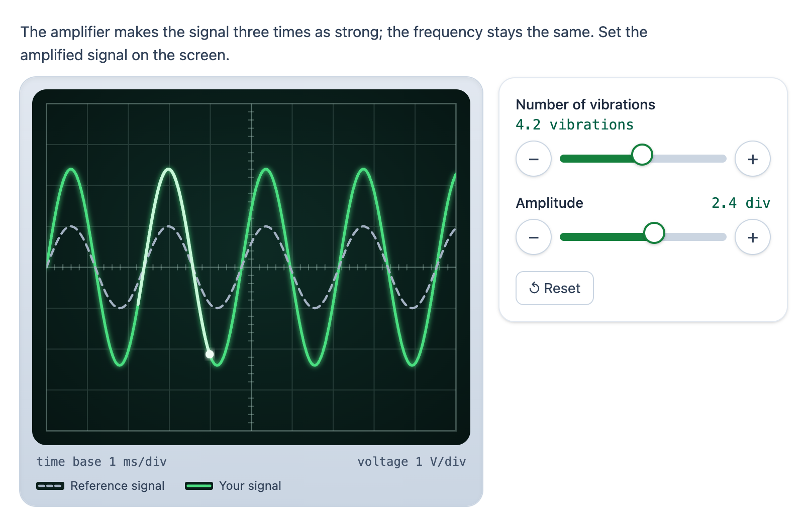

# @citolab/pci-oscilloscope

> [!WARNING]
> **Experimental (beta).** This PCI takes the idea of an interaction in an existing exam; it is not a copy of it. It is
> offered as is, without any warranty, and has never been used in an assessment. Try it out with candidates and check
> its content and scoring before you use it in one.

A QTI 3 Portable Custom Interaction (PCI) with an oscilloscope: a screen with a grid shows a reference signal, and the
candidate sets their own signal with two knobs, frequency (or the number of vibrations on the screen) and amplitude.
"The amplified signal has the same frequency and three times the amplitude: show it on the screen", "set the higher
tone with less loudness". The response is the setting, as numbers, so the item scores it with a margin or a
comparison. Made with [tspci](https://github.com/Citolab/tspci).

<p align="center">
  
</p>

## What it does

- **The screen**: a grid (10 × 8 divisions by default) with ticks on the centre lines, the reference signal grey and
  dashed, the candidate's signal green and solid, so they differ in line style and brightness too, not only in colour.
  The reference lies over the candidate's trace, so a match still shows both. Sine, square or triangle wave; every
  signal starts on the centre line at the left edge, going up, so the candidate compares like with like. What does
  not fit on the screen is cut off, as on a real scope.
- **Running beam**: a bright dot runs along the candidate's trace, lighting up a short stretch behind it; the whole
  trace stays on the screen all the time, so it stays readable. Off with `data-animate="false"`, and never when the
  system asks for reduced motion (`prefers-reduced-motion`).
- **Knobs**: native range inputs, so dragging, clicking, the arrow keys (one step), Page Up/Down, Home and End all
  work, with a `−` and `+` button for one fine step. Every turn redraws the trace. **Reset** goes back to the start.
- **Values at the knobs or not**: with `data-show-values="false"` the knobs show no numbers and the candidate reads
  the screen; a screen reader then hears the position of a knob ("position 21 of 91"), not its value.
- **Scale**: optionally the time base (ms/div) and volts/div under the screen.
- **Units**: the frequency as vibrations on the screen, or in hertz (with the time base: 10 divisions of 1 ms are
  10 ms, so 500 Hz is 5 vibrations); the amplitude in divisions or in volts (with volts/div).
- **Accessible**: the screen is an image with a description (the grid, that the reference is there, and the
  candidate's own setting when the knobs show it; never the numbers of the reference, which the candidate has to read
  from the screen); the knobs are labelled inputs with a text value; focus rings; colours that work for colour blindness.
- **Dutch** (`data-language="nl"`): the texts and `4,2` instead of `4.2`. The response is the same in every language.
- **Authoring mode**: the item author sets up the signals in the PCI itself (`getAuthoringInstance`), via "Configure…"
  ("Set up the signals…") in an authoring system that supports it: the reference, the candidate's start and the correct
  setting, each with the same screen and knobs. "No correct setting" leaves the correct setting out. Without the
  authoring mode, these are six numbers as `data-` attributes.
- **Delivery**: every turn of a knob is saved as the item's state (with a log) and restored. In review
  (`status: "solution"`) the PCI sets the knobs to the correct response when the delivery system passes it, and the
  knobs are disabled in `solution`, `review` and `closed`. Several oscilloscopes in one item or on one page each get an object of their own
  (`getInstance` returns a new instance), with their own response and state.

## What can be configured

Every setting is a `data-` attribute of the interaction, as text. `dist/authoring.json` describes them for authoring
systems. Frequencies are in the frequency unit, amplitudes in the amplitude unit.

| setting                         | attribute                  | default          | what                                                              |
| ------------------------------- | -------------------------- | ---------------- | ----------------------------------------------------------------- |
| Instruction above the screen    | `data-prompt`              | the example's    |                                                                   |
| Waveform                        | `data-waveform`            | `sine`           | `sine`, `square` or `triangle`                                    |
| Divisions across / up           | `data-grid-columns`, `data-grid-rows` | `10`, `8` | 2–20 across, 2–16 up                                     |
| Frequency as                    | `data-frequency-unit`      | `vibrations`     | `vibrations` on the screen, or `hertz` (uses the time base)       |
| Amplitude as                    | `data-amplitude-unit`      | `divisions`      | `divisions`, or `volts` (uses volts/div)                          |
| Time base (ms/div)              | `data-time-per-div`        | `1`              |                                                                   |
| Volts/div                       | `data-volts-per-div`       | `1`              |                                                                   |
| Show the time base and volts/div | `data-show-scale`         | `false`          | under the screen                                                  |
| Show the reference signal       | `data-show-reference`      | `true`           |                                                                   |
| Reference signal                | `data-reference-frequency`, `data-reference-amplitude` | `4.2`, `1` | authoring mode, or numbers               |
| Candidate's start               | `data-start-frequency`, `data-start-amplitude` | `2`, `2` | put on the nearest step of the knobs                     |
| Correct setting                 | `data-correct-frequency`, `data-correct-amplitude` | `4.2`, `3` | empty: none; for `getCorrectResponse` (below)  |
| Frequency knob                  | `data-frequency-min`, `-max`, `-step` | `0.5`, `8`, `0.1` | the step is also the fine step of `−`/`+`        |
| Amplitude knob                  | `data-amplitude-min`, `-max`, `-step` | `0.2`, `4`, `0.1` |                                                  |
| Show the values at the knobs    | `data-show-values`         | `true`           | `false`: the candidate reads the screen                           |
| Running beam                    | `data-animate`             | `true`           | never with reduced motion                                         |
| Language                        | `data-language`            | `en`             | `en` or `nl`                                                      |

Attributes in lower case (`data-referencefrequency`, as some delivery systems pass them) work too. A knob range that
cannot be used (max not above min) falls back to the default; without a usable step a knob has 100 steps.

## Scoring

The PCI is made for `custom` scoring, and `match_correct` works too (`authoring.json`:
`"scoring": ["custom", "match_correct", "human"]`). The response is the candidate's setting,
`cardinality="ordered" base-type="float"`: **[frequency, amplitude]**, in the units of the settings.

- `[4.2, 3]`: 4.2 vibrations on the screen, an amplitude of 3 divisions. In hertz and volts: `[800, 1.5]`.
- **The values of the knobs**: a knob only stops on its steps and the values are rounded to the decimals of the step
  (`0.1 + 0.2` is `0.3`), so an exact comparison (`match_correct`, `qti-match`) works. A margin
  (`qti-equal tolerance-mode="absolute"`) does no harm.
- **No response** until the candidate turns a knob; **Reset** takes the response away again.
- **The correct response from the settings**: `"correctResponse": "properties"`, so an authoring system can fill
  `qti-correct-response` from `data-correct-frequency` and `data-correct-amplitude` (`getCorrectResponse`). Or answer
  the PCI in a preview and take that as the correct response.

**Example 1, the amplifier**: the reference has 4.2 vibrations on the screen and an amplitude of 1 division; the
amplified signal has the same frequency and three times the amplitude. Settings: the defaults. One point when both are
right (or score each with its own condition, as in example 2):

```xml
<qti-response-declaration identifier="RESPONSE" cardinality="ordered" base-type="float">
  <qti-correct-response><qti-value>4.2</qti-value><qti-value>3</qti-value></qti-correct-response>
</qti-response-declaration>
<qti-outcome-declaration identifier="SCORE" cardinality="single" base-type="float">
  <qti-default-value><qti-value>0</qti-value></qti-default-value>
</qti-outcome-declaration>
…
<qti-response-processing>
  <qti-response-condition>
    <qti-response-if>
      <qti-and>
        <!-- the same number of vibrations -->
        <qti-equal tolerance-mode="absolute" tolerance="0.05">
          <qti-index n="1"><qti-variable identifier="RESPONSE"/></qti-index>
          <qti-base-value base-type="float">4.2</qti-base-value>
        </qti-equal>
        <!-- three times the amplitude of the reference: 1 → 3 -->
        <qti-equal tolerance-mode="absolute" tolerance="0.05">
          <qti-index n="2"><qti-variable identifier="RESPONSE"/></qti-index>
          <qti-base-value base-type="float">3</qti-base-value>
        </qti-equal>
      </qti-and>
      <qti-set-outcome-value identifier="SCORE"><qti-base-value base-type="float">1</qti-base-value></qti-set-outcome-value>
    </qti-response-if>
  </qti-response-condition>
</qti-response-processing>
```

With `match_correct` the standard template
(`https://purl.imsglobal.org/spec/qti/v3p0/rptemplates/match_correct.xml`) scores the same, without a margin.

**Example 2, the hearing test**: set the device to a higher tone with less loudness; a point for each. Settings in
hertz: `data-frequency-unit="hertz" data-time-per-div="1"` (10 ms on the screen), the reference
`data-reference-frequency="500" data-reference-amplitude="2"`, the knobs `data-frequency-min="100"
data-frequency-max="1000" data-frequency-step="10"`, and perhaps `data-show-values="false"` so the candidate looks at
the screen. There is no single correct response; leave `data-correct-frequency` and `data-correct-amplitude` empty,
or give an example answer such as `[800, 1]`:

```xml
<qti-response-processing>
  <qti-set-outcome-value identifier="SCORE"><qti-base-value base-type="float">0</qti-base-value></qti-set-outcome-value>
  <!-- higher tone: a higher frequency than the reference (500 Hz) -->
  <qti-response-condition>
    <qti-response-if>
      <qti-gt>
        <qti-index n="1"><qti-variable identifier="RESPONSE"/></qti-index>
        <qti-base-value base-type="float">500</qti-base-value>
      </qti-gt>
      <qti-set-outcome-value identifier="SCORE">
        <qti-sum><qti-variable identifier="SCORE"/><qti-base-value base-type="float">1</qti-base-value></qti-sum>
      </qti-set-outcome-value>
    </qti-response-if>
  </qti-response-condition>
  <!-- less loudness: a smaller amplitude than the reference (2 divisions) -->
  <qti-response-condition>
    <qti-response-if>
      <qti-lt>
        <qti-index n="2"><qti-variable identifier="RESPONSE"/></qti-index>
        <qti-base-value base-type="float">2</qti-base-value>
      </qti-lt>
      <qti-set-outcome-value identifier="SCORE">
        <qti-sum><qti-variable identifier="SCORE"/><qti-base-value base-type="float">1</qti-base-value></qti-sum>
      </qti-set-outcome-value>
    </qti-response-if>
  </qti-response-condition>
</qti-response-processing>
```

Without a response `qti-index` is NULL, the comparisons are NULL and no condition holds: 0 points.

## Using it

```sh
npm install @citolab/pci-oscilloscope
```

| file                                      | what                                                                      |
| ----------------------------------------- | ------------------------------------------------------------------------- |
| `dist/index.js`                           | the PCI (AMD module, everything bundled: the package has no dependencies) |
| `dist/authoring.json`                     | settings, response, scoring and the authoring mode, for authoring systems |
| `dist/sbom.cdx.json`                      | CycloneDX SBOM of the bundle                                              |
| `dist/tao-pci-oscilloscope_<version>.zip` | the PCI for TAO: Settings → Portable Custom Interactions → Add            |
| `oscilloscope.svg`, `example.png`         | icon and screenshot                                                       |

In a QTI 3 item, with `index.js` at `resources/pci/index.js` of the package:

```xml
<qti-response-declaration identifier="RESPONSE" cardinality="ordered" base-type="float">
  <qti-correct-response><qti-value>4.2</qti-value><qti-value>3</qti-value></qti-correct-response>
</qti-response-declaration>
…
<qti-portable-custom-interaction response-identifier="RESPONSE" module="pci" custom-interaction-type-identifier="oscilloscope"
  data-reference-frequency="4.2" data-reference-amplitude="1" data-start-frequency="2" data-start-amplitude="2"
  data-show-scale="true" data-language="nl">
  <qti-interaction-modules>
    <qti-interaction-module id="pci" primary-path="../resources/pci/index"></qti-interaction-module>
  </qti-interaction-modules>
  <qti-interaction-markup></qti-interaction-markup>
</qti-portable-custom-interaction>
```

The settings, the knobs' rounding and the traces are plain functions (`src/settings.ts`, `src/signal.ts`); `npm test`
runs their tests in node.

Source and the other examples: [Citolab/tspci-examples](https://github.com/Citolab/tspci-examples).
