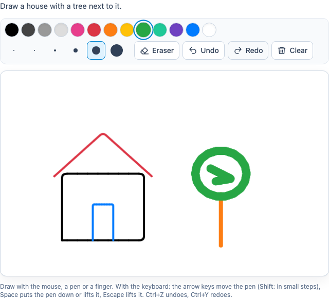

# @citolab/pci-paint

A QTI 3 Portable Custom Interaction (PCI) in which the candidate draws the answer on a canvas: "draw a house with a
tree next to it". Colours, brush sizes, an eraser, a fill (paint bucket), undo, redo and clear; mouse, pen (with pressure) and touch, and the
keyboard. The response is the drawing as a PNG image. Made with [tspci](https://github.com/Citolab/tspci).

<p align="center">
  
</p>

## Source and licence

This PCI is a port of [paint](https://github.com/openPCI/openPCIs/tree/master/paint) from
[openPCI/openPCIs](https://github.com/openPCI/openPCIs), by Jeppe Bundsgaard and the openPCI project (Aarhus
University and Aalborg University). The original is licensed under the GNU General Public License version 3; the
repository has the GPL v3 text as its `LICENSE` and does not say "or any later version", so this port is
**GPL-3.0-only** as well (see [LICENSE](LICENSE)), unlike the MIT examples in this repository. The original's runtime
included the jQuery plugin *Basic Canvas Paint* (bcPaint, © Alexandre Bobkov, MIT); none of its code is used here, its
default palette and brush sizes are.

What changed, by Stichting Cito Instituut voor Toetsontwikkeling, 2026:

- **Ported** from TAO's older (pre-IMS) PCI format (`define`, jQuery, `getSerializedState`) to the IMS PCI v1.0 API
  (`getInstance`, `getResponse`, `getState`) with tspci, Preact and Tailwind, in a shadow DOM. Runs in any QTI 3
  delivery system and, via `npm run package-tao`, in TAO.
- **Rewritten drawing**: pointer events instead of mouse events and simulated touch, smooth strokes (curves through
  the points instead of straight pieces), the width following a pen's pressure. The eraser really erases along the
  stroke instead of clearing squares.
- **New**: a fill (paint bucket) for closed areas, undo and redo (also Ctrl+Z / Ctrl+Y), clear (undoable), drawing with the keyboard, labels and a live region
  for screen readers, English and Dutch texts, a fixed canvas size that scales to the screen.
- **State**: the original did not restore a drawing; this one saves the strokes (and undo history) as its state and
  restores them, and shows a response it is handed back.
- **Same response**: a PNG data URL of the canvas (`single` `string`), as before. An empty canvas gives no response.

## What it does

- **Draw**: with the mouse, a pen or a finger; the page does not scroll while drawing on the canvas. A pen draws
  thinner or thicker with less or more pressure.
- **Toolbar**: the colours and the brush sizes are radio groups (arrow keys move within a group, each colour has a
  name for screen readers: "dark grey"), the eraser and fill are toggle buttons (a click, or Space at the keyboard
  cursor, fills the area of about the same colour), undo, redo and clear are buttons.
- **Keyboard**: the canvas is focusable. The arrow keys move a pen cursor (Shift: small steps), Space or Enter puts the
  pen down or lifts it, Escape lifts it; with the pen down, moving draws.
- **Delivery**: the drawing is saved as the item's state (the strokes, not the image) and restored, with its undo
  history. Without a state, a response the delivery system passes (`boundTo`) is shown and can be drawn on.

## What can be configured

Every setting is a `data-` attribute of the interaction, as text. `dist/authoring.json` describes them for authoring
systems.

| setting                       | attribute             | default                         | what                                                  |
| ----------------------------- | --------------------- | ------------------------------- | ----------------------------------------------------- |
| Instruction above the canvas  | `data-prompt`         | `Make a drawing.`               | also the canvas's accessible name                     |
| Colours                       | `data-colors`         | the 13 colours of the original  | separated by commas or new lines (as in the original) |
| Colour at the start           | `data-default-color`  | `#000000`                       | added to the colours when it is not one of them       |
| Brush sizes in px             | `data-strokes`        | `1, 2, 4, 8, 16, 24`            | comma separated                                       |
| Brush size at the start       | `data-default-stroke` | `2`                             |                                                       |
| Canvas width, height (px)     | `data-width`, `data-height` | `800`, `600`              | the size of the image; on screen it scales to fit     |
| Language                      | `data-language`       | `en`                            | `en` or `nl`: the toolbar and screen reader texts     |

`colors`, `defaultColor`, `strokes` and `defaultStroke` are the settings of the original TAO PCI. Its creator form
showed settings of another openPCI PCI (topics, categories); those had no effect on paint and are left out.

## Scoring

The PCI is made for `human` (`authoring.json`: `"scoring": ["human"]`): a drawing is scored by a human rater.

**The response** is a string (`cardinality="single" base-type="string"`): the drawing as a PNG data URL,
`data:image/png;base64,…`, at the size of the canvas, with a transparent background (as in the original).

- **No response**: until the candidate draws something (or after clearing), `getResponse()` reports nothing.

## Using it

```sh
npm install @citolab/pci-paint
```

| file                                 | what                                                                      |
| ------------------------------------ | ------------------------------------------------------------------------- |
| `dist/index.js`                      | the PCI (AMD module, everything bundled: the package has no dependencies) |
| `dist/authoring.json`                | settings, response and scoring, for authoring systems                     |
| `dist/sbom.cdx.json`                 | CycloneDX SBOM of the bundle                                              |
| `dist/tao-pci-paint_<version>.zip`   | the PCI for TAO: Settings → Portable Custom Interactions → Add            |
| `paint.svg`, `example.png`           | icon and screenshot                                                       |
| `LICENSE`                            | GNU General Public License v3                                             |

In a QTI 3 item, with `index.js` at `resources/pci/index.js` of the package:

```xml
<qti-response-declaration identifier="RESPONSE" cardinality="single" base-type="string"/>
…
<qti-portable-custom-interaction response-identifier="RESPONSE" module="pci" custom-interaction-type-identifier="paint"
  data-prompt="Draw a house with a tree next to it." data-width="640" data-height="400">
  <qti-interaction-modules>
    <qti-interaction-module id="pci" primary-path="../resources/pci/index"></qti-interaction-module>
  </qti-interaction-modules>
  <qti-interaction-markup></qti-interaction-markup>
</qti-portable-custom-interaction>
```

Source and the other examples: [Citolab/tspci-examples](https://github.com/Citolab/tspci-examples).
