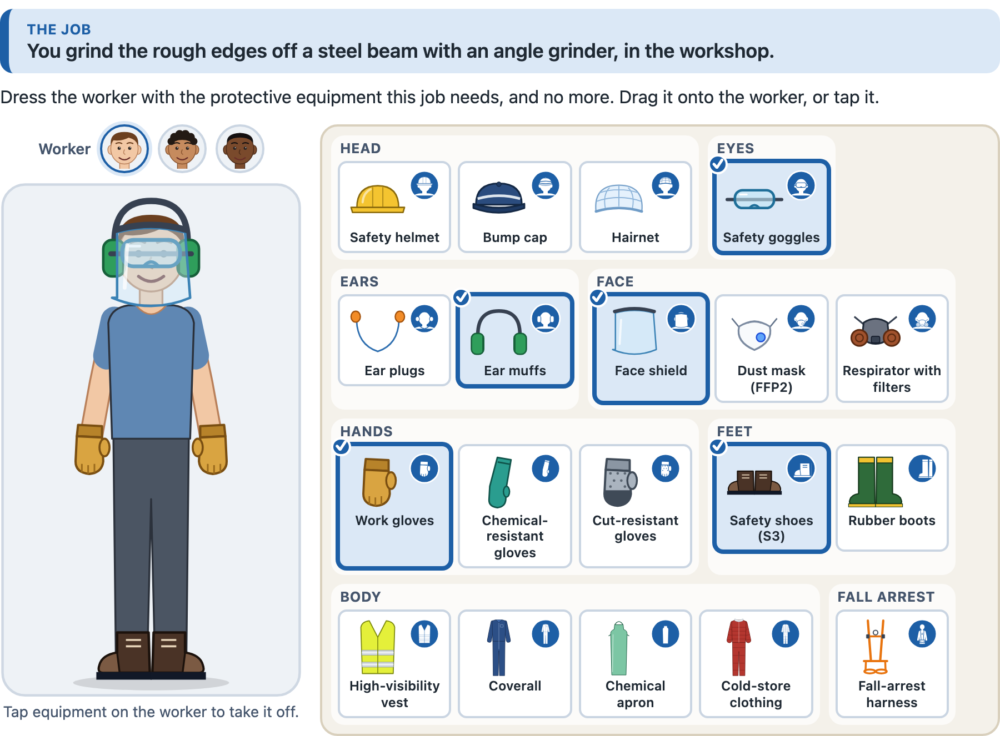

# @citolab/pci-protective-equipment

> [!WARNING]
> **Experimental (alpha). Just for inspiration.** This PCI is a technical showcase, made by software developers without
> much knowledge of the subject it could be used for. Its content, terms and scoring have not been checked by subject
> experts or assessment specialists, and it has never been used in an assessment. It is offered as is, without any
> warranty.

A QTI 3 Portable Custom Interaction (PCI) for personal protective equipment (Dutch: *persoonlijke beschermingsmiddelen*,
PBM), for VCA safety training and praktijkonderwijs. A job is described, such as grinding a steel beam, cleaning with a
corrosive agent or working on a roof. The candidate dresses a drawn worker with the protective equipment that job
needs, and no more. They drag items from a rack onto the worker, where each item snaps to its place, or tap an item to
put it on or take it off. Optionally they also say, for each item, what it protects against. The author picks one of
seven jobs or writes an own one in an authoring mode. Made with [tspci](https://github.com/Citolab/tspci).

<p align="center">
  
</p>

## What it does

- **The job** is on a card above the worker: a preset in English or Dutch, or the author's own text. The question is
  the PCI's own instruction unless the author writes one.
- **The worker** stands next to the rack. The pupil can choose one of three workers, with different skin tones and
  hair; the author can also fix one (`worker`). They have the same friendly pose and plain work clothes.
- **The rack** has 19 items, grouped by the zone of the body they go on: head (safety helmet, bump cap, hairnet), eyes
  (safety goggles), ears (ear plugs, ear muffs), face (face shield, dust mask FFP2, respirator with filters), hands
  (work gloves, chemical-resistant gloves, cut-resistant gloves), feet (safety shoes S3, rubber boots), body
  (high-visibility vest, coverall, chemical apron, cold-store clothing) and fall arrest (fall-arrest harness). Each
  item has its blue mandatory sign next to it.
- **Putting it on**, in three ways:
  - drag an item from the rack onto the worker. While it is dragged, its zone is outlined on the worker, and wherever
    it is dropped on the worker, it snaps to that zone;
  - tap or click the item in the rack;
  - press Enter or Space on it: every item is a toggle button (`aria-pressed`).
- **Taking it off**: tap the item in the rack again, tap it on the worker, or drag it off the worker.
- **One of a kind at a time.** Gloves, footwear, a hat (helmet or bump cap), a mask (dust mask or respirator) and a suit
  (coverall or cold-store clothing) can not be worn twice: putting on cut-resistant gloves takes the work gloves off.
  Ear plugs and ear muffs can be worn together, and so can a vest over a coverall, an apron, a face shield over
  goggles.
- **Explain** (`explain`): below the rack, for each item worn, a choice list "Why the safety goggles?" with three to five
  hazards: the ones the item protects against and a few it does not (a dust mask does not protect against vapours, a
  bump cap not against falling objects). A reason is right when the item protects against it **and** the job has that
  hazard: goggles are worn against flying particles when grinding, and against splashes when cleaning.
- **Read-only** (review, solution): the worker and a list of what is worn, without the rack; the reasons are shown but
  can not be changed.
- **The author sees what is wrong** with the settings above the job: an own job that can not be read, without text or
  without anything required, or (with `explain`) an item without a hazard of the job it can be worn for.

### Touch, keyboard, screen reader

- A tap counts when the finger moves less than 10 px; a longer move is a drag, and a second finger cancels it (a
  pinch). Only the picture of an item and, once the worker wears something, the worker stop the page from scrolling
  (`touch-action: none`): a swipe on the name of an item scrolls the page. Checked with Playwright on an emulated iPad
  (tap, finger drag on and off, tap on the worker, swipe).
- Every rack item is a button of at least 44 × 44 px, named by the item ("Safety goggles", pressed or not). The tab
  order is the choice of the worker, then the rack from head to toe, then the choice lists. The worker choice is a
  radio group (arrow keys, Home, End). The focus stays on an item after Enter.
- The worker is an image named by what it wears ("The worker wears: safety goggles, ear muffs and work gloves."), and a
  live region says it again after every change.
- Colour is never the only cue: a worn item has a check mark and a ring, and the zone outline while dragging is dashed.

### The drawings

Everything is drawn for this PCI in SVG (2D; no three.js). Every item is drawn once, in the coordinates of the worker,
exactly where it sits on the body; the rack shows the same drawing, cut out. So what the pupil picks is what appears on
the worker. Clothing goes under the vest, the vest under the harness, the goggles under the face shield.

The **mandatory signs** are drawn in the spirit of the blue mandatory signs (a white pictogram on a blue disc: a head
with a helmet, goggles or ear protection, a glove, a boot, a body with a harness), but they are **not** the ISO 7010
artwork. Real mandatory signs share one pictogram between some items (one sign for any hearing protection, one for any
gloves); here each item has its own, so the pupil can match sign and item.

## Jobs

| `job` | the job | required (`/` = one of them is enough) | allowed (not needed, not wrong) |
| --- | --- | --- | --- |
| `grinding` (default) | grinding the edges off a steel beam with an angle grinder | safety goggles; ear plugs / ear muffs; work gloves / cut-resistant gloves; safety shoes | face shield, dust mask, respirator, coverall |
| `cleaning` | cleaning a factory floor with a strong, corrosive agent | safety goggles; chemical-resistant gloves; rubber boots; chemical apron | face shield, respirator |
| `roof` | replacing roof tiles on a sloping roof, 8 m high, without a guard rail | safety helmet; safety shoes; fall-arrest harness | goggles, work gloves, cut-resistant gloves, coverall |
| `coldStore` | driving a forklift truck in a cold store at −25 °C, with colleagues on foot | safety shoes; high-visibility vest; cold-store clothing | safety helmet, bump cap, work gloves |
| `circularSaw` | sawing planks with a circular saw | safety goggles; ear plugs / ear muffs; dust mask; safety shoes | face shield, respirator, coverall. **No gloves**: they can be caught by the blade |
| `kitchen` | preparing food in a professional kitchen | hairnet | cut-resistant gloves, safety shoes |
| `roadside` | repairing a pavement next to a busy road | safety shoes; work gloves / cut-resistant gloves; high-visibility vest | safety helmet, goggles, ear plugs, ear muffs, dust mask, coverall |

Everything else is not needed and counts as wrong. These follow common practice, not one rule book; a VCA teacher may
well disagree on some (is a helmet needed in a cold store, a face shield when grinding?). The authoring mode lets an
author change any of it.

Each job also has its hazards (for `explain`), such as flying particles, noise, dust, sharp edges and heavy objects for
grinding. The hazards an item protects against are fixed (`src/equipment.ts`): a helmet against falling objects and
bumping, ear plugs against noise, a harness against falling from a height.

## Settings

| setting | editor | what it does |
| --- | --- | --- |
| `title`, `question` | `text`, `textarea` | above the job; an empty question shows the PCI's own instruction |
| `job` | `pci` | a preset (above) or `custom` for the author's own job |
| `customJob` | `pci` | the own job, as JSON (below); only with `job` `custom` |
| `explain` | `boolean` | the pupil also says why, for each item worn |
| `worker` | `enum` | `choice` (default: the pupil picks one of three), or `1`, `2`, `3` |
| `language` | `enum` | `en` or `nl`: the PCI's own texts and the preset jobs |

The `pci` settings are written by the [authoring mode](#authoring-mode). An authoring system without it shows them as
text fields (type `roof`), and the PCI works without them: the grinding job.

**`customJob`** is JSON:

```json
{ "text": "You weld two steel pipes together.", "required": ["faceShield", "workGloves"], "allowed": ["coverall"], "hazards": ["particles", "rough"] }
```

Item ids: `helmet`, `bumpCap`, `hairnet`, `goggles`, `earPlugs`, `earMuffs`, `faceShield`, `dustMask`, `respirator`,
`workGloves`, `chemicalGloves`, `cutGloves`, `safetyShoes`, `rubberBoots`, `hiVis`, `coverall`, `chemicalApron`,
`coldClothing`, `harness`. Hazard ids: `particles`, `splashes`, `noise`, `dust`, `vapours`, `falling`, `bumping`, `cuts`,
`rough`, `crushing`, `wet`, `traffic`, `cold`, `height`, `hygiene`. Unknown ids are left out; an item both required and
allowed is required.

**Required items of one kind are alternatives**: the ones that can not be worn together (gloves, footwear, a hat, a
mask, a suit) and ear plugs and ear muffs. Requiring both ear plugs and ear muffs means "hearing protection": one of
them is enough. A job requiring both work gloves and cut-resistant gloves accepts either pair.

## Authoring mode

"Job and equipment…" (`getAuthoringInstance`, AUTHORING.md section 6), for an authoring system that supports it. The
author:

- **starts from** one of the presets, or "Own job";
- edits **the job's text** as the pupil reads it (a preset starts with its text in the item's `language`);
- sets per item **Required**, **Allowed** or **Not needed**, each row a radio group (arrow keys, Home, End), with the
  item and its sign drawn as the pupil sees them;
- ticks **the hazards** of the job, for `explain`.

Below the items: what the pupil must wear ("safety goggles; ear plugs or ear muffs; …") and whether the job has one
correct answer. A job that equals a preset (text, items and hazards) is written as that preset (`job: "grinding"`),
unless the author chose "Own job"; anything else as `job: "custom"` with `customJob`.

What keeps Done from finishing (`validate()`): no text, nothing required, and with `explain` an item that is required
or allowed but protects against none of the ticked hazards (the pupil could not give a right reason).

## Response and scoring

The PCI reports a `record`. Nothing is reported while the worker wears nothing.

| field | type | what it is |
| --- | --- | --- |
| `required` | `integer` | requirements met: required items worn, where one of a set of alternatives counts once |
| `requiredTotal` | `integer` | the number of requirements of the job |
| `wrong` | `integer` | items worn that the job does not need (neither required nor allowed) |
| `correct` | `boolean` | every requirement met and nothing wrong |
| `items` | `string` | the items worn, ids in rack order, comma separated: `goggles,earMuffs,workGloves,safetyShoes` |
| `reasons` | `string` | `explain` only: `item:hazard` per item worn that has a reason: `goggles:particles,earMuffs:noise` |
| `reasonsRight` | `integer` | `explain` only: items worn with a reason that fits the job |
| `reasonsCorrect` | `boolean` | `explain` only: every item worn has a reason that fits |

- **`custom`** (the default): a rule on the fields. Full marks for `correct`, or partial credit, such as
  `required` − `wrong`, or 1 point for `correct` and 1 for `reasonsCorrect`:

  ```xml
  <qti-response-processing>
    <qti-response-condition>
      <qti-response-if>
        <qti-field-value field-identifier="correct"><qti-variable identifier="RESPONSE"/></qti-field-value>
        <qti-set-outcome-value identifier="SCORE"><qti-base-value base-type="float">1</qti-base-value></qti-set-outcome-value>
      </qti-response-if>
      <qti-response-else>
        <qti-set-outcome-value identifier="SCORE"><qti-base-value base-type="float">0</qti-base-value></qti-set-outcome-value>
      </qti-response-else>
    </qti-response-condition>
  </qti-response-processing>
  ```

- **`match_correct`**: only for a job with one correct answer: no alternatives, nothing allowed, and with `explain` one
  hazard of the job per item. Then `getCorrectResponse` gives it from the settings. Every preset has alternatives or
  allowed items, so `getCorrectResponse` returns nothing for them: answering in a preview would fix one of the right
  dressings (`items`), and a pupil with ear plugs instead of ear muffs would score 0.
- **`human`**: a rater looks at the worker in review.

In status **solution** the PCI shows the item's correct response (its `items` and `reasons`). Without one, or one
without `items` (an item scored with a rule), it shows a correct dressing of its own: the first item of every
requirement, nothing allowed, each with a reason that fits.

## Development

```bash
npm install
npm run dev           # the dev page, with the settings
npm test              # the logic in node (test/equipment.test.ts)
npm run test:stories  # the Storybook tests
```

`src/equipment.ts` has the logic, without imports: the items, their zones and the hazards they protect against, the
preset jobs, an own job as JSON, putting on and taking off (one of a kind), the requirements and their alternatives,
the response, the correct response and the problems of the settings. The node tests check every preset (a right reason
possible for every item it accepts, the correct dressing correct) and the scoring against a count of its own for 3500
random dressings. `src/drawings.tsx` draws the workers, the items and the signs, `src/interaction.tsx` is the rack and
the worker, `src/authoring.tsx` the authoring mode, `src/texts.ts` the English and Dutch texts.
