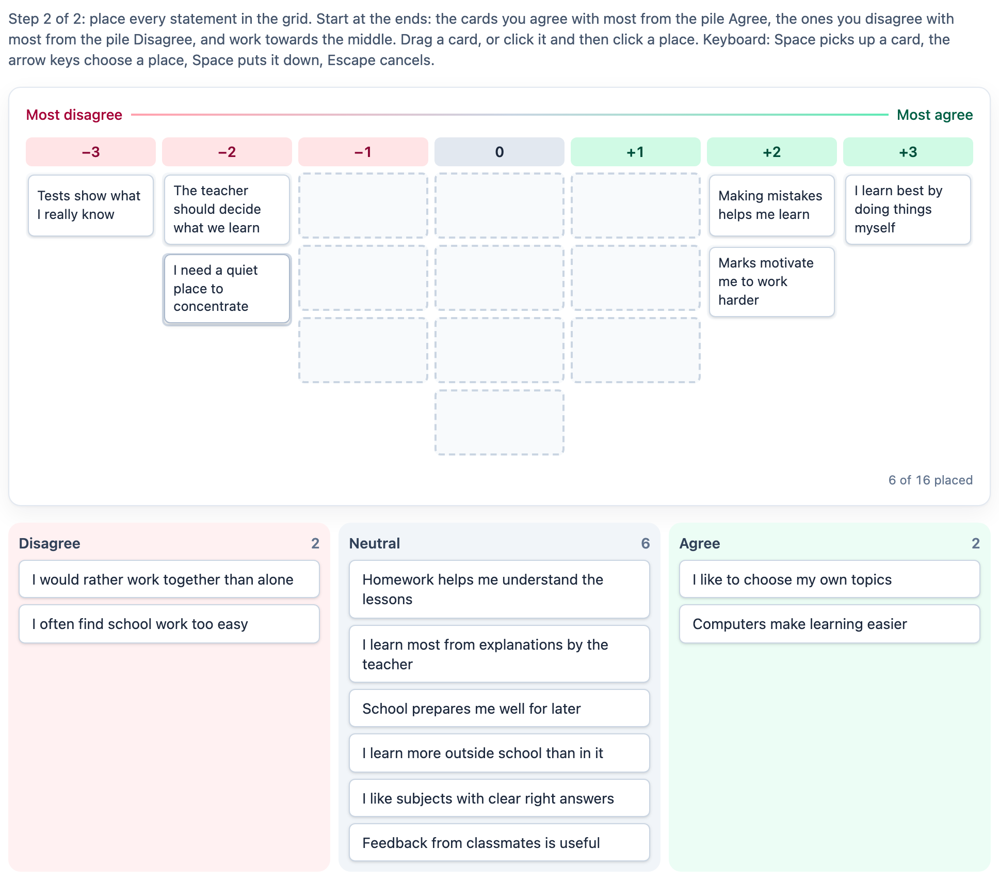

# @citolab/pci-q-sort

A QTI 3 Portable Custom Interaction (PCI) for a **Q-sort**, the data collection of
[Q methodology](https://en.wikipedia.org/wiki/Q_methodology). The candidate places every statement of a Q-set in a
forced, quasi-normal grid: columns from the lowest value ("most disagree", −3) to the highest ("most agree", +3),
with few places at the ends and most in the middle. As in Brown's procedure, the cards can first be pre-sorted one by
one into three piles (disagree, neutral, agree); the grid appears once every card is on a pile. The grid is horizontal (columns left to right) or vertical (rows top
to bottom). Made with [tspci](https://github.com/Citolab/tspci).

<p align="center">
  
</p>

## Source and licence

This PCI started as a port of [WordRank](https://github.com/openPCI/openPCIs/tree/master/wordrank) from the
[openPCI](https://github.com/openPCI/openPCIs) project of Aarhus University and Aalborg University, by Elias J.T. Hansen,
Anna Rusmann and Jeppe Bundsgaard. openPCIs is licensed under the GNU General Public License version 3 (the
repository's `LICENSE`; it names no "or any later version"), so this PCI is too: **GPL-3.0-only**, see
[LICENSE](LICENSE). That differs from the MIT licence of the other examples in this repository.

What changed, by Stichting Cito Instituut voor Toetsontwikkeling (2026):

- ported from TAO's older PCI format (AMD hook, `qtiCustomInteractionContext.register` with `initialize`, jQuery, a
  TAO creator widget) to the IMS PCI v1.0 API (`getInstance`, `getResponse`, `getState`, …) with tspci, Preact and
  Tailwind;
- turned from a word ranking into a Q-sort: a grid of value columns (`distribution`, `values`), the two ends of the
  scale, a horizontal or vertical layout and an optional pre-sort into three piles; WordRank's rows, descriptions on
  four sides and random sample are gone;
- a new interface: smooth pointer dragging (mouse, pen, touch), click-to-pick-up-and-put-down, a card dropped on
  another card swaps places with it, and full keyboard use with screen reader announcements;
- a new response: the value of each statement and the pile it was pre-sorted onto (below), which is what Q analysis
  needs; WordRank's response (rows of
  words) is not compatible;
- en/nl texts; the settings are described in `config.json` for authoring systems; the order of the cards and the
  piles are saved in the state; `setResponse` and showing a given response work.

## The Q-sort

- **The grid** is a forced distribution: `distribution` says how many places each column has, from the lowest value
  to the highest (`1,2,3,4,3,2,1` holds 16 statements, `2,3,4,5,6,5,4,3,2` holds 34). The places should add up to the
  number of statements; the PCI counts "8 of 16 placed" and reports `valid` only when every statement is in the grid.
- **The values** are −3 … +3 around 0 by default (an even number of columns skips 0), or set with `values`
  (`1,2,3,4,5,6,7`, say). The column of the lowest value carries `lowLabel`, the highest `highLabel`.
- **The layout**: `horizontal` (the classic grid, columns left to right, the cards of a column top to bottom) or
  `vertical` (rows with the highest value on top, the cards of a row side by side), for instance for a narrow screen or
  a "most important on top" ranking.
- **The pre-sort** (`presort`, on by default) makes it two steps. Step 1: the shuffled cards come one at a time from a
  stack ("To sort"); the candidate puts each on one of three piles (`presortLabels`). The grid is not shown yet, so a
  card cannot go from the stack straight into the grid. Step 2: once every card is on a pile, the grid appears and the
  candidate moves the cards from the piles into it, starting at the ends (the hint says so): the strongest of the
  agree pile at the highest value, of the disagree pile at the lowest, towards the middle. Cards can still move between
  the piles; a card taken out of the grid goes back to its pile. Without a pre-sort all cards are shown
  together.
- **Order within a column** has no meaning in a Q-sort: a candidate may put the cards of a column anywhere in it, and
  the response does not record it.

## Using it

- **Drag** a card to a place in the grid or to a pile. A card on a place that holds a card swaps with it.
- **Click or tap** a card to pick it up, then click a place, another card (they swap) or a pile.
- **Keyboard**: Tab to a card, Space or Enter picks it up, the arrow keys choose a place, Space or Enter puts it down,
  Escape cancels. Horizontal: left and right through the columns, up and down within a column; down from the last
  place of a column reaches the piles. Vertical: up and down through the rows, left and right within a row; down from
  the bottom row reaches the piles. On the piles, left and right choose a pile and up goes back to the grid (in step 1 of the pre-sort the arrow
  keys only choose the stack or a pile). Delete or
  Backspace puts a placed card back on its pile. Each step is announced in a live region ("Homework helps me
  understand the lessons picked up. Now at column +2, place 1 of 2, empty"); every card says where it is.
- **Tooltips**: a line `statement:explanation` shows the explanation as a tooltip (and to screen readers).

## What can be configured

Every setting is a `data-` attribute of the interaction, as text. `dist/authoring.json` describes them for authoring
systems; attributes are matched case-insensitively.

| setting            | attribute             | default                     | what                                                              |
| ------------------ | --------------------- | --------------------------- | ----------------------------------------------------------------- |
| Statements         | `data-statements`     | 16 statements about school  | the Q-set, one per line; `statement:explanation` adds a tooltip   |
| Distribution       | `data-distribution`   | `1,2,3,4,3,2,1`             | places per column, lowest value first                             |
| Values             | `data-values`         | (empty: −3 … +3)            | one number per column, lowest first                               |
| Layout             | `data-orientation`    | `horizontal`                | `horizontal` (left to right) or `vertical` (top to bottom)        |
| Low end            | `data-low-label`      | `Most disagree`             | the label at the lowest value                                     |
| High end           | `data-high-label`     | `Most agree`                | the label at the highest value                                    |
| Pre-sort           | `data-presort`        | `true`                      | first sort the cards one by one into three piles                  |
| Pile names         | `data-presort-labels` | `Disagree, Neutral, Agree`  | the three piles, low to high                                      |
| Shuffle the cards  | `data-random-order`   | `true`                      | a new order per candidate                                         |
| Language           | `data-language`       | `en`                        | `en` or `nl`: the instructions and screen reader texts            |

## Scoring

A Q-sort is an opinion: it has no correct answer. The PCI is made for no scoring (`authoring.json`:
`"scoring": ["none"]`); the sorts of all candidates are analysed together afterwards (by-person factor analysis, with
for instance PQMethod, KADE or the R package `qmethod`).

**The response** is a string (`cardinality="single" base-type="string"`): JSON with, per statement in the order of the
statements as authored (not the shuffled order the candidate saw):

- `sort`: the value of its column in the grid, `null` for a statement that is not in the grid;
- `presort` (only with a pre-sort): the pile it was sorted onto, `-1` low (disagree), `0` neutral, `1` high (agree),
  `null` for a statement still on the stack. A card moved to another pile in step 2 reports its last pile.

```json
{
  "sort": [-3, 2, 0, 1, -1, 3, 0, -2, 1, 0, -1, 2, 0, -2, 1, -1],
  "presort": [-1, 1, 0, 1, -1, 1, 0, -1, 0, 0, -1, 1, 0, -1, 1, 0]
}
```

`sort` is one row of the data matrix of a Q study (statements × candidates). Nothing is reported until the candidate
puts a card on a pile or in the grid. Restoring a response puts each statement in the first free place of its column
and on its pile; a plain array (`[-3, 2, …]`, a response without a pre-sort) is read as `sort`, and a statement in the
grid without a pile then gets the pile of its side of the grid. Changing the statements or the values of an item that
has responses changes their meaning.

## Using it in an item

```sh
npm install @citolab/pci-q-sort
```

| file                               | what                                                                      |
| ---------------------------------- | ------------------------------------------------------------------------- |
| `dist/index.js`                    | the PCI (AMD module, everything bundled: the package has no dependencies) |
| `dist/authoring.json`              | settings, response and scoring, for authoring systems                     |
| `dist/sbom.cdx.json`               | CycloneDX SBOM of the bundle                                              |
| `dist/tao-pci-qSort_<version>.zip` | the PCI for TAO: Settings → Portable Custom Interactions → Add            |
| `qSort.svg`, `example.png`         | icon and screenshot                                                       |
| `LICENSE`                          | GNU GPL version 3                                                         |

In a QTI 3 item, with `index.js` at `resources/pci/index.js` of the package:

```xml
<qti-response-declaration identifier="RESPONSE" cardinality="single" base-type="string"/>
…
<qti-portable-custom-interaction response-identifier="RESPONSE" module="pci" custom-interaction-type-identifier="qSort"
  data-distribution="1,2,3,2,1" data-orientation="horizontal"
  data-statements="I like homework&#10;I like tests&#10;I like group work&#10;I like reading&#10;I like sports&#10;I like music&#10;I like maths&#10;I like art&#10;I like science"
  data-low-label="Most disagree" data-high-label="Most agree" data-presort="true">
  <qti-interaction-modules>
    <qti-interaction-module id="pci" primary-path="../resources/pci/index"></qti-interaction-module>
  </qti-interaction-modules>
  <qti-interaction-markup></qti-interaction-markup>
</qti-portable-custom-interaction>
```

Source and the other examples: [Citolab/tspci-examples](https://github.com/Citolab/tspci-examples).
