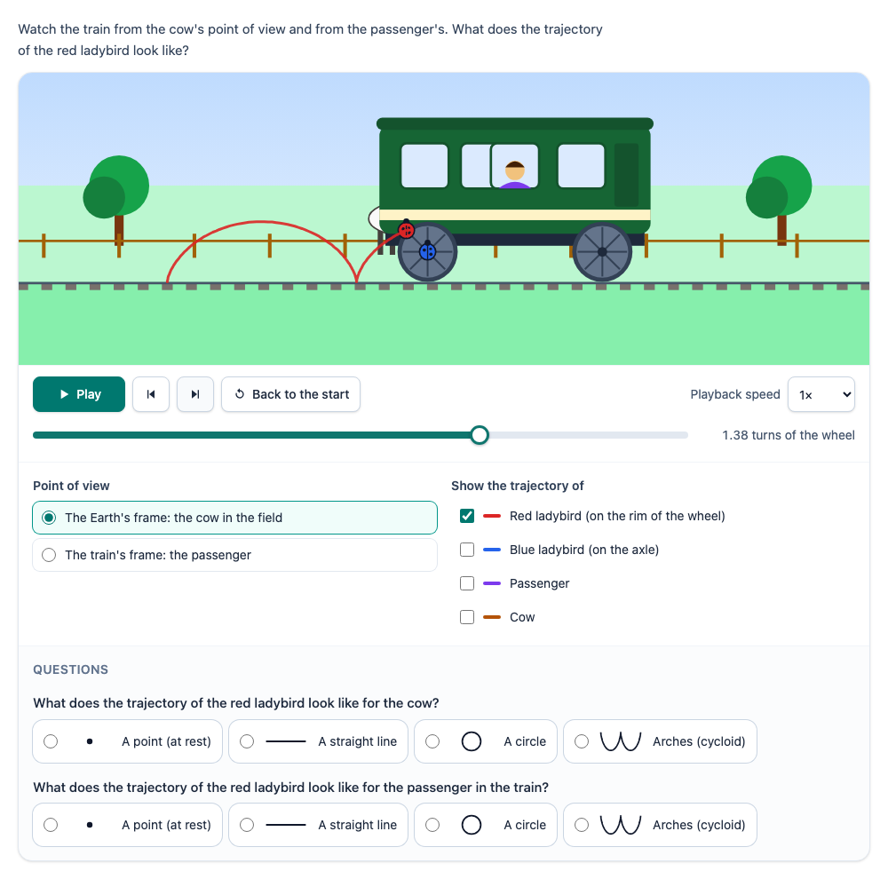

# @citolab/pci-reference-frames

> [!WARNING]
> **Experimental (alpha).** This PCI takes the idea of two existing PCIs; it is not a copy of them. It is offered as
> is, without any warranty, and has never been used in an assessment. Try it out with candidates and check its content
> and scoring before you use it in one.

A QTI 3 Portable Custom Interaction (PCI) about the relativity of motion: a train passes a cow (with two ladybirds on
a wheel), or Zoé rides a motorbike past Marc on his rock. The candidate chooses whose point of view they see the scene
from (the ground, the vehicle, optionally a second moving observer), plays or steps the motion, and traces the
trajectories of points as they move: a point on the rim of a wheel draws arches (a cycloid) for the cow and a circle
for the passenger. Optionally the candidate answers questions about it ("what does the trajectory look like for …",
"for Zoé, Marc moves / is at rest"), which the PCI scores. Made with [tspci](https://github.com/Citolab/tspci).

<p align="center">
  
</p>

## Source and licence

This PCI is a derivative work of two PCIs in
[janfix/extension-wiquid-depp](https://github.com/janfix/extension-wiquid-depp), made for the DEPP (Direction de
l'évaluation, de la prospective et de la performance, Ministère de l'Éducation nationale) by Jean-Philippe Rivière
(Wiquid), 2017-2023:

- [`Trainpci`](https://github.com/janfix/extension-wiquid-depp/tree/master/views/js/pciCreator/ims/Trainpci),
  "Relativité des trajectoires": a cow in a field, a train with two ladybirds on a wheel; the candidate views the
  scene "in the train's frame" (the background scrolls) or "in the Earth's frame" (the train moves), and afterwards
  shows the trajectory (a circle or a cycloid, as a pre-drawn image).
- [`Relatempci`](https://github.com/janfix/extension-wiquid-depp/tree/master/views/js/pciCreator/ims/Relatempci),
  "Relativité du mouvement": Zoé on a motorbike on a desert road, Marc on a rock; buttons for Zoé's point of view,
  Marc's and a global view (CSS animations).

That extension is licensed under the GNU General Public License version 2 only (`GPL-2.0-only`, as stated in its
`composer.json` and in the headers of its files), so this PCI is too: see [LICENSE](LICENSE). This differs from the MIT
licence of most other examples in this repository.

What changed, by Stichting Cito Instituut voor Toetsontwikkeling (2026):

- A rewrite, not a translation: TypeScript, Preact and Tailwind in a shadow DOM, an IMS PCI v1.0 module built with
  tspci, instead of jQuery and AMD modules for TAO. The two PCIs are one, with a setting for the scene.
- **Computed motion instead of pre-drawn images and CSS animations.** Every point has a position in the ground frame at
  every moment (`src/model.ts`); a frame that moves with velocity *v* sees it shifted by *v·t*. The scene, the wheels,
  the scrolling background and the traced trajectories all follow from that, at any moment and in any frame. A second
  moving observer (a car, a cyclist) at a speed the author sets, also the other way, gives loops or a wavy line.
- All drawing is new, inline SVG; none of the original images is used and no picture contains text.
- Play, pause, step back and forward (a sixteenth of a turn), a time slider, playback speed, back to the start;
  switching the point of view keeps the moment, so the same motion can be compared from both sides.
- Optional questions with a key, and scoring (the originals had no task and no scoring).
- Keyboard and screen reader access: real buttons, radio buttons, checkboxes and a range input; the picture has a text
  alternative that says who is watching, how far the run is and what is traced; a live region for changes.
  `prefers-reduced-motion`: the PCI never starts by itself (also not with `autoplay`) and says to use the buttons.
- English, Dutch and French, with a decimal comma in Dutch and French (the originals were French only).
- A structured response (a record), the full state and an event log saved and restored, review and solution status,
  `qti-interaction-changed` events. See "Response" for how it relates to what the originals logged.

## What it does

- **The scenes**: `train` (default): a train car passes a cow in a field; a red ladybird sits on the rim of the rear
  wheel, a blue one on its axle, a passenger looks out of a window. `motorbike`: Zoé rides past Marc, who sits on a rock
  beside a desert road; the valve on the rim of the rear wheel and the axle are marked. The second observer, when it is
  used, is a car on a road in front of the track or a cyclist in front of the road.
- **Points of view**: the ground (the cow, Marc), the vehicle (the passenger, Zoé) and the second observer. The
  observer's surroundings stay put on the screen, everything else moves: in the train's frame the trees and the fence
  scroll by and the train stands still while its wheels turn.
- **Trajectories**: a checkbox per point (`rim`, `hub`, `passenger`, `bystander`, `second`); the trajectory from the
  start up to now is drawn in the point's colour, in the chosen frame. Units: the wheel radius is 1, the vehicle
  covers one radius per second at 1×, so a turn of the wheel takes 2π ≈ 6.3 s.

| point \ frame | ground | vehicle | second (speed *v*, as a multiple of the vehicle's) |
| --- | --- | --- | --- |
| rim | cycloid | circle | loops for 0 < *v* < 1 (or 1 < *v* < 2), a wavy line for *v* < 0, a cycloid for *v* = 2, a circle for *v* = 1 |
| hub, passenger | straight line | at rest | straight line (at rest for *v* = 1) |
| bystander | at rest | straight line | straight line (at rest for *v* = 0) |
| second | straight line (at rest for *v* = 0) | straight line (at rest for *v* = 1) | at rest |

- **The questions** (optional): a trajectory question asks for the shape of a point's trajectory for an observer, with
  the shapes as drawn options; a motion question asks whether the point moves or is at rest for the observer. Writing
  a question as `point@frame` is enough: the key follows from the motion (the table above). The description of the
  picture names the shape of a trace only when no question is about that point in that frame.

## What can be configured

Every setting is a `data-` attribute of the interaction, as text; `dist/authoring.json` describes them for authoring
systems.

| setting | attribute | default | what |
| --- | --- | --- | --- |
| Instruction | `data-prompt` | an example | above the simulation |
| Scene | `data-scene` | `train` | `train` or `motorbike` |
| Points of view | `data-frames` | `ground;vehicle` | the frames the candidate can choose, in this order: `ground`, `vehicle`, `second` |
| Point of view at the start | `data-start-frame` | `ground` | one of the frames |
| Points to trace | `data-points` | `rim;hub;passenger;bystander` | `rim`, `hub`, `passenger`, `bystander`, `second` |
| Traced at the start | `data-traced` | `rim` | some of the points |
| Speed of the second observer | `data-second-speed` | `0.5` | a multiple of the vehicle's speed, −1 to 2; negative is the other way. The second observer is in the scene when a frame, a point or a question uses it |
| Length of the run | `data-turns` | `2` | 1 to 4 turns of the wheel |
| Playback speed | `data-rate` | `1` | `0.25`, `0.5`, `1` or `2` (the candidate can change it) |
| Autoplay | `data-autoplay` | `false` | start playing at once; never with reduced motion or in review |
| Trajectory questions | `data-trajectory-questions` | `rim@ground;rim@vehicle` | `point@frame`, separated by `;` or new lines; `rim@ground=cycloid` sets the key yourself. Empty: none |
| Motion questions | `data-motion-questions` | empty | `passenger@vehicle;bystander@vehicle`; `…=moves` or `…=rest` sets the key |
| Shapes to choose from | `data-shape-options` | `rest;line;circle;cycloid` | `rest`, `line`, `circle`, `cycloid`, `loops`, `wave`; the shape of every key is added |
| Language | `data-language` | `en` | `en`, `nl` or `fr` |

Unknown points, frames, shapes or answers are left out; numbers out of range are clamped.

## Response

A `record` (`authoring.json`: `"scoring": ["custom", "human"]`):

| field | base type | what |
| --- | --- | --- |
| `score` | integer | questions answered with the key (only with questions) |
| `maxscore` | integer | the number of questions (only with questions) |
| `correct` | integer | 1 when every question is answered with the key (only with questions) |
| `answers` | string | `rim@ground=cycloid;rim@vehicle=circle`: the answered questions in order; a motion question has `moves` or `rest`. When the same `point@frame` is both a trajectory and a motion question, the motion question's id is `point@frame:motion` |
| `viewed` | string | `ground:rim,hub;vehicle:rim`: every frame the candidate saw move (the time past 0 in it), with the points traced in it at that time; a frame without traces is only its name (`ground;vehicle:rim`) |

Nothing (`getResponse()` is undefined) until the candidate saw something move or answered. Score in response
processing with the `score` field (`custom` scoring: the PCI applies the key), or have a rater look at `answers` and
`viewed`. `setResponse` restores the answers and what was viewed; the state (`getState`) also has the point of view,
the traces, the moment and the playback speed, and the log of every action (frame, trace, time with how — play,
pause, step, seek, end, reset —, speed, answer).

**The originals** logged booleans of the buttons pressed, as a JSON string: Trainpci
`{"situerCocci", "refTrain", "refTerre", "trajectoirTerre", "trajectoirTrain"}` (located the ladybirds, viewed the
train's frame, the Earth's frame, the trajectory in each), Relatempci `{"animFille", "animGars"}` (played Zoé's view,
Marc's view). `viewed` holds the same information in a compact form: `refTerre` and `trajectoirTerre` are `ground:rim`,
`refTrain` and `trajectoirTrain` are `vehicle:rim`; `animFille` is `vehicle`, `animGars` is `ground` in the motorbike
scene. "Locating the ladybirds" is not needed: they are always visible.

## Using it

```sh
npm install @citolab/pci-reference-frames
```

| file | what |
| --- | --- |
| `dist/index.js` | the PCI (AMD module, everything bundled) |
| `dist/authoring.json` | settings, response and scoring, for authoring systems |
| `dist/sbom.cdx.json` | CycloneDX SBOM of the bundle |
| `dist/tao-pci-referenceFrames_<version>.zip` | the PCI for TAO (`npm run package-tao`) |
| `referenceFrames.svg`, `example.png` | icon and screenshot |

```xml
<qti-response-declaration identifier="RESPONSE" cardinality="record"/>
…
<qti-portable-custom-interaction response-identifier="RESPONSE" module="pci" custom-interaction-type-identifier="referenceFrames"
  data-scene="motorbike" data-frames="ground;vehicle;second" data-second-speed="-0.5"
  data-trajectory-questions="rim@second" data-motion-questions="bystander@vehicle;passenger@vehicle" data-language="fr">
  <qti-interaction-modules>
    <qti-interaction-module id="pci" primary-path="../resources/pci/index"></qti-interaction-module>
  </qti-interaction-modules>
  <qti-interaction-markup></qti-interaction-markup>
</qti-portable-custom-interaction>
```

## Development

```sh
npm run storybook     # the stories of this PCI
npm test              # the motion, the settings and the scoring in node (test/)
npm run test:stories  # the play functions of the stories, headless
npm run prod          # both tests, then dist/index.js
```

Source and the other examples: [Citolab/tspci-examples](https://github.com/Citolab/tspci-examples).
