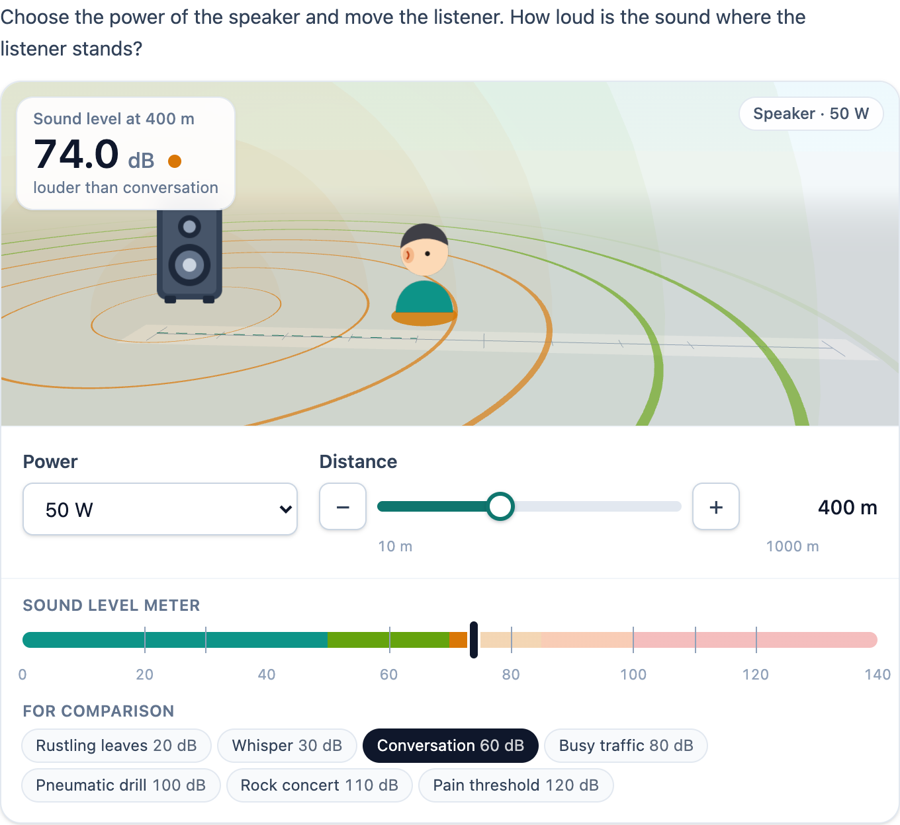

# @citolab/pci-sound-level

> [!WARNING]
> **Experimental (beta).** This PCI takes the idea of an interaction in an existing exam; it is not a copy of it. It is
> offered as is, without any warranty, and has never been used in an assessment. Try it out with candidates and check
> its content and scoring before you use it in one.

A QTI 3 Portable Custom Interaction (PCI) with a sound simulation: a sound source with a power, a listener at a
distance, and the sound level in dB where the listener stands, with sound waves that spread out and fade. The candidate
uses it as a tool ("is the walrus's power smaller than, equal to or larger than 25 W? Use the simulation"), or sets a
value that is the answer ("set the distance where you hear 70 dB"). Made with [tspci](https://github.com/Citolab/tspci).

<p align="center">
  
</p>

## What it does

- **Physics**: a point source sends its power out evenly in all directions. The intensity at distance *r* is
  *I* = *P* / (4π*r*²) and the sound level *L* = 10 · log10(*I* / *I0*) dB, with *I0* = 1·10⁻¹² W/m². Twice as far
  is 6 dB less, twice the power 3 dB more. `src/physics.ts`, tested in node with `npm test`.
- **The 2025 vmbo exam**: the simulation in the Dutch vmbo exam of 2025 used *I0* = 1,2·10⁻¹² W/m², which gives
  levels 0,8 dB lower (25 W at 400 m: 70,2 dB instead of 70,9 dB). `data-reference-intensity="1.2e-12"` gives the same
  numbers. With either, a source that gives 58 dB at 400 m has a power of about 1,3 to 1,5 W: far less than 25 W, which
  gives more than 58 dB everywhere on a slider up to 900 m.
- **Controls**: the power from a list (a select) or with a slider, the distance with a slider. A slider is a native
  range input: the arrow keys move one step, Page Up and Page Down ten percent, Home and End to the ends; the − and +
  buttons move one step. While the candidate drags, the picture and the readout follow; letting go (or a key) puts the
  value in. Which of the two the candidate may change is a setting; the other is shown as fixed.
- **Readout**: the level at the listener, large, with "louder than conversation" from the levels for comparison. A
  screen reader hears every new setting through a live region ("70.9 dB at 400 m from a source of 25 W."), and the
  slider's value text has the level too ("400 m, 70.9 dB").
- **The picture**: a small 3D scene (three.js) with the source, the listener at the chosen distance on a ruler, and
  sound waves that spread out as half spheres with a ring on the ground. A wave fades and changes colour as the level
  drops where it is (teal under 50 dB, green, amber, orange, red from 100 dB). Without WebGL, or with
  `data-view="2d"`, the same picture in 2D (SVG). With `prefers-reduced-motion` the waves stand still. The source is a
  speaker, a walrus, a whale, a bird, a dog or a siren, drawn in SVG in `src/sources.ts`.
- **Meter**: a scale from 0 to 140 dB in the same colours, with a mark for every level for comparison and, with a
  target level, a mark for the target. The levels for comparison are listed below it; the loudest one the sound
  exceeds is highlighted.
- **Dutch** (`data-language="nl"`): the texts, and a decimal comma (70,9 dB).
- **Delivery**: every setting the candidate stops at is saved as the item's state (every change in the log) and
  restored. In review (`status: "solution"`) the PCI shows the correct response in answer mode when the delivery
  system passes it.

## What can be configured

Every setting is a `data-` attribute of the interaction, as text. `dist/authoring.json` describes them for authoring
systems. The PCI has no authoring mode of its own: every setting is a plain field.

| setting                        | attribute                   | default        | what                                                                                    |
| ------------------------------ | --------------------------- | -------------- | --------------------------------------------------------------------------------------- |
| Instruction                    | `data-prompt`               | an example     | above the simulation                                                                    |
| Use of the simulation          | `data-mode`                 | `tool`         | `tool`: a tool, the answer goes elsewhere; `answer`: the value the candidate sets is the answer |
| Tool: what the candidate changes | `data-control`            | `both`         | `both`, `distance` or `power` (tool mode)                                               |
| Answer: the quantity           | `data-answer`               | `distance`     | `distance` or `power` (answer mode): only that one can be changed, the other stays at its setting |
| Target level                   | `data-target-level`         | empty          | dB: marked on the meter; in answer mode the source of the correct response (below)     |
| Power: list or slider          | `data-power-input`          | `select`       | `select` or `slider`                                                                    |
| Powers in the list             | `data-powers`               | `25;50;100`    | separated by `;` (a comma is then a decimal comma: `0,5;1;2`)                           |
| Power slider                   | `data-power-min`, `-max`, `-step` | `1`, `100`, `1` |                                                                                   |
| Power at the start             | `data-power`                | `25`           | also the power when the candidate cannot change it                                      |
| Unit of power                  | `data-power-unit`           | `W`            | `mW`, `W` or `kW`                                                                       |
| Distance slider                | `data-distance-min`, `-max`, `-step` | `10`, `1000`, `10` | the minimum more than 0                                                       |
| Distance at the start          | `data-distance`             | `100`          | also the distance when the candidate cannot change it                                   |
| Unit of distance               | `data-distance-unit`        | `m`            | `cm`, `m` or `km`                                                                       |
| Decimals                       | `data-decimals`             | `1`            | of the level, 0 to 4                                                                    |
| Threshold of hearing *I0*      | `data-reference-intensity`  | `1e-12`        | `1.2e-12` reproduces the 2025 vmbo exam simulation                                      |
| Show levels for comparison     | `data-show-references`      | `true`         |                                                                                         |
| Levels for comparison          | `data-references`           | empty          | `Whisper = 30; Conversation = 60; Pain threshold = 120`; empty: a standard list from 20 to 120 dB in the candidate's language |
| Picture of the source          | `data-source`               | `speaker`      | `speaker`, `walrus`, `whale`, `bird`, `dog` or `siren`                                   |
| Name of the source             | `data-source-name`          | empty          | empty: the name of the picture                                                          |
| Picture                        | `data-view`                 | `3d`           | `3d` (2D without WebGL) or `2d`                                                         |
| Language                       | `data-language`             | `en`           | `en` or `nl`: the texts and the decimal comma                                          |

Settings that make no sense are corrected: a minimum of 0 or less, a maximum under the minimum, a step that is too
large, a start value outside the slider, an unknown unit or picture.

## Scoring

The PCI is made for `match_correct` (with a margin) in answer mode, and for `human` as a tool (`authoring.json`:
`"scoring": ["match_correct", "human"]`, `"tolerance": "range"`).

**Answer mode** (`data-mode="answer"`): the response is the distance (or power) the candidate set, a float in the unit
of the setting: `630`. Declare it `cardinality="single" base-type="float"`.

- **What counts**: the value on the slider, always a step of it (`setResponse(633)` shows 630 on a slider by 10). In
  Dutch the slider shows 630 too, and the response is the same number.
- **The correct response from the settings**: with a target level, `getCorrectResponse(properties)` gives the distance
  where the level is the target, at the power of the settings (or the power that gives the target at the distance of
  the settings), on the nearest step of the slider: 50 W and 70 dB give 630 m (exactly 630,8 m). Out of reach of the
  slider, there is none. `config.tspci.correctResponse` is `"settings"`, so an authoring system fills it in.
- **A margin**: a slider by 10 m cannot hit 630,8 m, and a candidate who reads 70,0 dB at 630 m and 69,9 dB at 640 m is
  right with both. Score with a range in the item's response processing (for example 620 to 640), not with an exact
  match.
- **No response**: until the candidate changes the value, `getResponse()` reports nothing.

**Tool mode** (`human`): every setting the candidate stopped at, in order, with its level, as JSON, for research. Declare
the response `base-type="string"`:

```json
{ "powerUnit": "W", "distanceUnit": "m", "tried": [{ "power": 25, "distance": 400, "level": 70.9 }, { "power": 25, "distance": 900, "level": 63.9 }] }
```

The same setting twice in a row counts once; the response keeps the last 500 (the state's log keeps every change).
`setResponse` with this JSON restores the last setting and the list.

## Using it

```sh
npm install @citolab/pci-sound-level
```

| file                                       | what                                                                      |
| ------------------------------------------ | ------------------------------------------------------------------------- |
| `dist/index.js`                            | the PCI (AMD module, everything bundled, three.js too: the package has no dependencies) |
| `dist/authoring.json`                      | settings, response and scoring, for authoring systems                     |
| `dist/sbom.cdx.json`                       | CycloneDX SBOM of the bundle                                              |
| `dist/tao-pci-soundLevel_<version>.zip`    | the PCI for TAO: Settings → Portable Custom Interactions → Add            |
| `soundLevel.svg`, `example.png`            | icon and screenshot                                                       |

As a tool next to an inline choice, in a QTI 3 item with `index.js` at `resources/pci/index.js` of the package:

```xml
<qti-response-declaration identifier="RESPONSE" cardinality="single" base-type="string"/>
…
<qti-portable-custom-interaction response-identifier="RESPONSE" module="pci" custom-interaction-type-identifier="soundLevel"
  data-mode="tool" data-source="walrus" data-powers="25;50;100" data-distance-min="10" data-distance-max="900"
  data-distance-step="10" data-language="nl">
  <qti-interaction-modules>
    <qti-interaction-module id="pci" primary-path="../resources/pci/index"></qti-interaction-module>
  </qti-interaction-modules>
  <qti-interaction-markup></qti-interaction-markup>
</qti-portable-custom-interaction>
```

With the answer in the PCI:

```xml
<qti-response-declaration identifier="RESPONSE" cardinality="single" base-type="float">
  <qti-correct-response><qti-value>630</qti-value></qti-correct-response>
</qti-response-declaration>
…
<qti-portable-custom-interaction response-identifier="RESPONSE" module="pci" custom-interaction-type-identifier="soundLevel"
  data-mode="answer" data-answer="distance" data-power="50" data-target-level="70">
  …
</qti-portable-custom-interaction>
```

Source and the other examples: [Citolab/tspci-examples](https://github.com/Citolab/tspci-examples).
