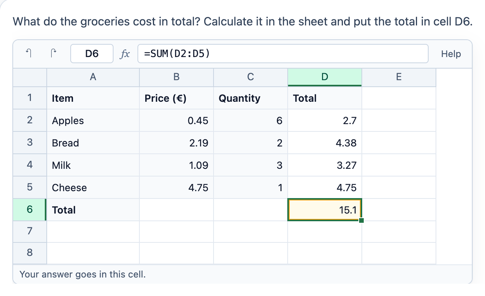

# @citolab/pci-spreadsheet

> [!WARNING]
> **Experimental (alpha). Just for inspiration.** This PCI is a technical showcase, made by software developers without
> much knowledge of the subject it could be used for. Its content, terms and scoring have not been checked by subject
> experts or assessment specialists, and it has never been used in an assessment. It is offered as is, without any
> warranty.

A QTI 3 Portable Custom Interaction (PCI) with a small spreadsheet: cells, formulas, a formula bar. The candidate puts
the answer in a cell ("calculate the total in D6"), or uses the sheet as a tool next to another interaction. The item
author sets up the sheet in the PCI itself. Made with [tspci](https://github.com/Citolab/tspci).

<p align="center">
  
</p>

## What it does

- **Like Excel**: select a cell and type to replace it, F2 or a double click to edit it; Enter, Tab and the arrow keys
  move; Delete empties a cell. The formula bar shows (and edits) what is in the cell, the name box which cell it is.
- **Formulas**: `=B2*C2`, `+ - * / ^`, `%`, `&` for text, comparisons (`= <> < > <= >=`), ranges (`A1:B3`) and
  `$A$1`. Functions: `SUM`, `AVERAGE`, `MIN`, `MAX`, `PRODUCT`, `MEDIAN`, `COUNT`, `COUNTA`, `ROUND`, `ROUNDUP`,
  `ROUNDDOWN`, `INT`, `ABS`, `SQRT`, `POWER`, `MOD`, `PI`, `IF`, `AND`, `OR`, `NOT`, `COUNTIF`, `SUMIF`. Errors as in
  Excel: `#DIV/0!`, `#VALUE!`, `#NAME?`, `#REF!`, `#NUM!`, a loop is `#CIRC!`, a formula that cannot be read `#ERROR!`.
  A small parser and evaluator (`src/formula.ts`), no `eval` and no library; `npm test` runs its tests in node.
- **While typing a formula**, a click on a cell inserts its name (after `=`, `(`, an operator or a separator); the next
  click replaces it.
- **Fill and paste**: drag the square at the corner of a cell down or to the right to copy it; Ctrl+C and Ctrl+V copy a
  cell. Relative references move along (`=B2*C2` becomes `=B3*C3`), `$` keeps them. Cells copied from another
  spreadsheet (tabs and new lines) are typed in from the selected cell on. Ctrl+Z and Ctrl+Y (and the buttons) undo and
  redo.
- **Dutch** (`data-language="nl"`): `1,5`, `=SOM(A1;B1)`, `ALS`, `AANTAL.ALS`, … and `WAAR`/`ONWAAR`, as in Excel in
  Dutch. The sheet keeps every input the English way, so a response does not depend on the language.
- **Locked cells**: what the author locks, the candidate cannot change.
- **Accessible**: the sheet is a grid with the focus on the table and the selected cell as its active descendant; a
  screen reader hears the cell, its value, its formula and whether it is the answer cell or locked.
- **Authoring mode**: the item author sets up the sheet in the PCI itself (`getAuthoringInstance`), via "Configure…"
  ("Set up the sheet…") in an authoring system that supports it (qti-construction, TAO with tspci-tao, the dev page):
  the number of columns (up to 26) and rows (up to 100), the cells (values and formulas, typed as the candidate would),
  locked, bold and coloured cells, the answer cell, and column widths (drag the edge of a column letter). Without a sheet of its
  own, the PCI shows the example sheet.
- **Delivery**: the candidate's changes are saved as the item's state (every change in the log) and restored. In review
  (`status: "solution"`) the PCI shows the correct response in the answer cell when the delivery system passes it.

## What can be configured

Every setting is a `data-` attribute of the interaction, as text. `dist/authoring.json` describes them for authoring
systems.

| setting                     | attribute               | default                 | what                                               |
| --------------------------- | ----------------------- | ----------------------- | -------------------------------------------------- |
| Instruction above the sheet | `data-prompt`           | the example's question  | also the sheet's accessible name                   |
| Use of the sheet            | `data-mode`             | `answer`                | `answer`: the answer goes in the answer cell; `tool`: a tool, the answer goes elsewhere |
| Sheet                       | `data-sheet`            | empty: the example sheet | written by the authoring mode, as JSON (below)    |
| Show the formula bar        | `data-show-formula-bar` | `true`                  | without it, the candidate still types in the cells |
| Language                    | `data-language`         | `en`                    | `en` or `nl`: numbers, formulas and the texts      |

```json
{
  "columns": 5, "rows": 8, "widths": [120, 96, 96, 96, 96],
  "cells": { "A1": { "input": "Item", "locked": true, "bold": true, "fill": "#ddebf7" }, "B2": { "input": "0.45", "locked": true } },
  "answer": "D6"
}
```

## Scoring

The PCI is made for `match_correct` in answer mode, and for `human` as a tool (`authoring.json`:
`"scoring": ["match_correct", "human"]`). The response is a string (`cardinality="single" base-type="string"`).

**Answer mode**: the value of the answer cell, as the sheet calculates it: `15.1`.

- **What counts**: the value, not how the candidate got it. Typing `15.1`, `15,10` (in Dutch) or `=SUM(D2:D5)` gives
  the same response. Numbers are written with a point and at most ten significant digits (`0.1+0.2` is `0.3`), `TRUE`
  and `FALSE` in English, text as it is (trimmed), an error as its code (`#DIV/0!`).
- **Setting the correct response**: answer the PCI. In TAO switch the interaction to *Response* and fill in the answer
  cell; in qti-construction or the dev page, fill it in and take it as the correct response. A string comparison then
  scores it, so `15.1` and `15.10` are the same but `15.1` and `15.2` are not: for a margin, declare the response
  `float` in the item and compare in its response processing.
- **No response**: until the answer cell has a value, `getResponse()` reports nothing.

**Tool mode** (`human`): the cells the candidate changed, in reading order, with their input and value, as JSON, for a
rater or for research:

```json
{ "D2": { "input": "=B2*C2", "value": "2.7" }, "D6": { "input": "=SUM(D2:D5)", "value": "15.1" } }
```

## Using it

```sh
npm install @citolab/pci-spreadsheet
```

| file                                       | what                                                                      |
| ------------------------------------------ | ------------------------------------------------------------------------- |
| `dist/index.js`                            | the PCI (AMD module, everything bundled: the package has no dependencies) |
| `dist/authoring.json`                      | settings, response, scoring and the authoring mode, for authoring systems |
| `dist/sbom.cdx.json`                       | CycloneDX SBOM of the bundle                                              |
| `dist/tao-pci-spreadsheet_<version>.zip`   | the PCI for TAO: Settings → Portable Custom Interactions → Add            |
| `spreadsheet.svg`, `example.png`           | icon and screenshot                                                       |

In a QTI 3 item, with `index.js` at `resources/pci/index.js` of the package:

```xml
<qti-response-declaration identifier="RESPONSE" cardinality="single" base-type="string">
  <qti-correct-response><qti-value>15.1</qti-value></qti-correct-response>
</qti-response-declaration>
…
<qti-portable-custom-interaction response-identifier="RESPONSE" module="pci" custom-interaction-type-identifier="spreadsheet"
  data-mode="answer" data-language="nl">
  <qti-interaction-modules>
    <qti-interaction-module id="pci" primary-path="../resources/pci/index"></qti-interaction-module>
  </qti-interaction-modules>
  <qti-interaction-markup></qti-interaction-markup>
</qti-portable-custom-interaction>
```

Source and the other examples: [Citolab/tspci-examples](https://github.com/Citolab/tspci-examples).
