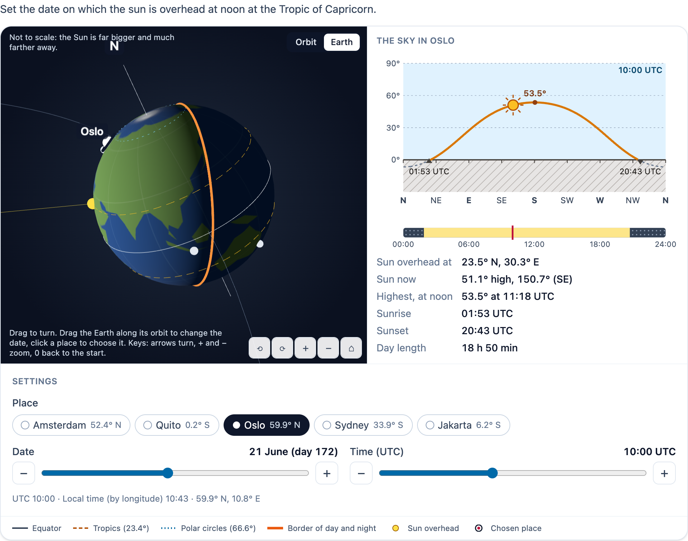

# @citolab/pci-sun-earth

> [!WARNING]
> **Experimental (alpha). Just for inspiration.** This PCI is a technical showcase, made by software developers without
> much knowledge of the subject it could be used for. Its content, terms and scoring have not been checked by subject
> experts or assessment specialists, and it has never been used in an assessment. It is offered as is, without any
> warranty.

A QTI 3 Portable Custom Interaction (PCI) about the Sun, the Earth and the seasons ("zon, aarde en seizoenen"), for
geography and physics: seasons, day length, the angle of the sun, time zones, and day and night. A 3D view shows the
Earth with its tilted axis (23.44°) on its orbit around the Sun, lit by the Sun, with the border of day and night, the
equator, the tropics, the polar circles and the places. A second panel shows the sky of the chosen place: the sun's
path through the sky that day, the noon height, sunrise, sunset and the day length. The candidate sets the date, the
time and the place. The PCI scores these against the author's targets, with a margin. The item author sets up the
places, the controls, the start, the targets and a solution in the PCI itself. Made with
[tspci](https://github.com/Citolab/tspci).

<p align="center">
  
</p>

## What it does

- **The 3D view** (three.js 0.180): the Sun in the middle, the Earth on its orbit. **Not to scale**, and the view says
  so: the real Sun is 109 times as wide as the Earth and 23 000 Earth radii away. The axis always leans the same way in
  space, so the north pole leans towards the Sun around 21 June and away from it around 21 December. Marks on the orbit
  show the equinoxes and solstices. On the globe:
  - the equator (solid), the tropics (dashed) and the polar circles (dotted);
  - the border of day and night (a thick orange ring);
  - where the sun is overhead (a yellow dot, with a ray from the Sun);
  - the places (dots); the chosen one has a ring and its name.

  The globe's land is drawn by hand in rough outlines: a recognisable globe, not a map. Two views: **Orbit** (the whole
  orbit, the Earth drawn bigger) and **Earth** (close by, turned with the Sun). Drag to turn, pinch or Ctrl + wheel to
  zoom (a plain wheel scrolls the page). The keyboard: the arrow keys turn, `+` and `−` zoom, `0` goes back to the start
  view, and there are buttons for all of these. In the orbit view, drag the Earth along its orbit to change the date.
  Click a place on the globe to choose it (raycasting: the place nearest to where the globe is hit, within 20°). The
  view renders on demand, with no animation loop. When the element leaves the page, the renderer and its WebGL context
  are freed. Without WebGL (or with `data-view="2d"`), the PCI shows **the Earth seen from the side** instead: the
  sunlight from the left, the axis leaning by the declination, the circles of latitude edge on, the night half dark and
  dotted, and the place on its circle of latitude (filled on the near side, open on the far side).
- **The sky** of the chosen place: a horizon diagram, direction along (N, E, S, W) and height up. It shows:
  - the sun's path for the day, solid above the horizon and dashed below it;
  - the noon height;
  - sunrise and sunset on the horizon;
  - the sun now (filled with rays above the horizon, open and dashed below it).

  The highest point of the path is in the middle: south, or north when the sun passes north of the place (Sydney,
  Quito in June). Drag along the path to set the time. Under it, the day in 24 hours, with night dotted and a mark at
  the time now. The values: where the sun is overhead, the sun now (height and direction), the noon height and time,
  sunrise, sunset and the day length. The author can hide these values (`data-show-info="false"`) when the candidate
  must read them from the picture. Midnight sun and polar night are named.
- **The controls**:
  - the place: a radio group, with the arrow keys moving the choice;
  - the date: day 1 to 365, shown as "21 June (day 172)";
  - the time: UTC or local by longitude (`data-time-base`).

  Each slider has − and + buttons. The arrow keys move a step (a day, or the author's time step), Page Up/Down a week
  or an hour, and Home/End go to the ends. Under the sliders: UTC, the local time by longitude, and the coordinates.
- **Accessible**: the 3D view is an `application` with a description of its keys. The diagrams are images with a text
  alternative that names the date, the noon height, sunrise and sunset. Every slider has a name and a value text. A live
  status reads out every change ("Date: 21 June. Day length 16 h 48 min, the sun at noon 61.1° high."). The lines differ
  in dash and thickness as well as colour, and the chosen place differs in shape. Transitions respect
  `prefers-reduced-motion`, and the PCI has no animation of its own.
- **Language**: `data-language` `en` or `nl`. In Dutch, numbers use a decimal comma and coordinates NB/ZB/OL/WL. The
  response is language independent.
- **Tool or answer**: in answer mode the targets are scored. As a tool, the candidate explores and the response
  records where they stopped.
- **Authoring mode**: "Set up the task…" (`getAuthoringInstance`) has three tabs:
  - **Places and controls**: the places (16 known ones by name, or your own with a name in English and Dutch,
    latitude and longitude); what the candidate controls (the date, the time, the place); the start; the time step. A
    drawing of the Earth from the side shows the start.
  - **Targets**: up to 4, each a value of the response with a margin and points, or the place. Each shows whether the
    solution meets it, and the tab gives the QTI response processing for the targets.
  - **Solution**: the candidate's view; set the date, time and place as a candidate should.

  `validate()` reports, in the author's language:
  - no places, a place without a name, or two places with the same identifier;
  - nothing the candidate controls, or a choice of place with only one place;
  - no targets, or a target naming a place that is not in the list;
  - a target that depends on nothing the candidate controls (a target on the day while only the place moves);
  - no solution, or a target the solution does not meet.
- **Delivery**: the setting is the item's state (every change in the log) and is restored. Several interactions of this
  type on one page each get their own object.

### How the sun is computed

`src/solar.ts` has no imports and is tested in node with `npm test`. It follows the general formulas of the NOAA solar
calculator ([solareqns.PDF](https://gml.noaa.gov/grad/solcalc/solareqns.PDF)), for a year of 365 days:

- the fractional year γ = 2π/365 · (day − 1 + (hour − 12)/24);
- the **equation of time** (minutes) and the **declination** (the latitude where the sun is overhead), as Fourier
  series in γ;
- the **solar time** = UTC + equation of time + 4 min per degree of longitude, and the **hour angle** = solar time/4 −
  180°;
- the **elevation** from sin h = sin φ sin δ + cos φ cos δ cos H, and the **azimuth** from north, clockwise;
- **sunrise and sunset** when the centre of the sun is 0.833° below the horizon (refraction and the sun's radius), as
  almanacs do: cos H₀ = cos 90.833° / (cos φ cos δ) − tan φ tan δ. The day length is 8 · H₀ minutes. Without a solution:
  midnight sun (24 h) or polar night (0 h).

The tests check known values. For Amsterdam (52.37° N) on 21 June, the day is 16 h 48 min, sunrise 03:18 UTC (05:18
summer time), sunset 20:06 UTC, and the noon height is 61.1° (90° − 52.37° + 23.44°). Other values tested:

- the declination ±23.44° at the solstices;
- the equation of time −14 min in February and +16 min in November;
- Oslo 18 h 50 min, Quito 12 h 07 min and Sydney 9 h 54 min on 21 June;
- midnight sun and polar night at Longyearbyen;
- solar noon in Jakarta at 04:54 UTC in June.

The accuracy is about a minute and a few tenths of a degree.

`src/setup.ts` (no imports at run time either) holds the task: parsing `data-setup`, the response's values, the margins
and the scoring, the authoring checks and the response processing.

## What can be configured

Every setting is a `data-` attribute of the interaction, as text. `dist/authoring.json` describes them for authoring
systems.

| setting                    | attribute        | default                | what                                                                |
| -------------------------- | ---------------- | ---------------------- | ------------------------------------------------------------------- |
| Instruction                | `data-prompt`    | the example's question |                                                                     |
| Task                       | `data-setup`     | empty: the example     | written by the authoring mode, as JSON (below)                      |
| Use                        | `data-mode`      | `answer`               | `answer` (targets scored) or `tool` (explore, not scored)           |
| Time the candidate sets    | `data-time-base` | `utc`                  | `utc`, or `local`: local time by longitude, UTC + longitude/15      |
| Views                      | `data-view`      | `both`                 | `both` (3D and the sky) or `2d` (the Earth from the side and the sky) |
| The sun's values           | `data-show-info` | `true`                 | the noon height, sunrise, sunset and day length as text             |
| Language                   | `data-language`  | `en`                   | `en` or `nl`                                                        |

```json
{
  "places": ["amsterdam", "quito", "oslo", "sydney", "jakarta", { "id": "denhelder", "name": { "en": "Den Helder", "nl": "Den Helder" }, "lat": 52.96, "lon": 4.76 }],
  "controls": { "day": true, "time": true, "place": true },
  "start": { "day": 80, "minutes": 720, "place": "amsterdam" },
  "timeStep": 10,
  "targets": [{ "field": "day", "value": 355, "margin": 3, "points": 1 }],
  "solution": { "day": 355, "minutes": 720, "place": "amsterdam" }
}
```

- `places`: a known place by its id, or `{ id, name, lat, lon }` (° north and ° east positive). The known ones:
  `amsterdam`, `quito`, `oslo`, `sydney`, `jakarta`, `reykjavik`, `longyearbyen`, `cairo`, `nairobi`, `capetown`,
  `newyork`, `paramaribo`, `willemstad`, `riodejaneiro`, `tokyo`, `singapore`. The id is the response's `place`.
- `controls`: what the candidate can change. The rest stays at the start.
- `start`: the day of the year (1 to 365), the time in minutes UTC, and the place.
- `timeStep`: the minutes per step of the time slider.
- `targets`: at most 4. `field` is a number field of the response (below), met when |value − `value`| ≤ `margin`.
  For `day`, the times and the directions the margin goes round the end of the year or the day (day 1 ± 3 includes day
  363). `field: "place"` with a place id is met by that place.
- `solution`: the author's setting, shown in review.

The example tasks:

- **"Set the date on which the sun is overhead at the Tropic of Capricorn"**: the example above, target `day` 355 ± 3.
  Equivalently, target `declination` −23.4 ± 0.2.
- **"Set the time when it is noon in Jakarta"**: only the time moves, with the place Jakarta and day 172 fixed. Target
  `solarTime` 12 ± 0.25: the solar time at the place, so the answer allows for the longitude and the equation of time
  (about 04:54 UTC). With `data-time-base="local"` the candidate sets local time by longitude instead.
- **"At which place is the day longest on 21 June?"**: only the place moves, at day 172. Target `place` `oslo`, and
  `data-show-info="false"` so the candidate compares the paths.
- **As a tool**: `data-mode="tool"`, everything movable, and no targets.

## Scoring

The PCI is made for `custom` scoring (`authoring.json`: `"scoring": ["custom", "human"]`) and can tell its correct
response from its settings (`"correctResponse": "properties"`: the record of the author's solution). The response is a
record (`cardinality="record"`):

| field                           | type         | what                                                                  |
| ------------------------------- | ------------ | --------------------------------------------------------------------- |
| `score`, `maxscore`             | `integer`    | answer mode: the points of the targets met, and of all targets        |
| `correct`                       | `integer`    | 1 when every target is met                                            |
| `check1` … `check4`             | `integer`    | 1 or 0 per target, in their order; only the targets there are         |
| `day`                           | `integer`    | the day of the year, 1 to 365                                         |
| `place`                         | `identifier` | the place's id                                                        |
| `latitude`, `longitude`         | `float`      | the place (°)                                                         |
| `time`                          | `float`      | UTC in hours (4.917 is 04:55), 3 decimals                             |
| `localTime`                     | `float`      | local time by longitude, UTC + longitude/15 (hours)                   |
| `solarTime`                     | `float`      | apparent solar time at the place (hours; 12 is the sun's highest)     |
| `declination`                   | `float`      | the latitude where the sun is overhead (°)                            |
| `subsolarLongitude`             | `float`      | the longitude where it is solar noon (°)                              |
| `sunElevation`, `sunAzimuth`    | `float`      | the sun now at the place: height (°) and direction from north (°)     |
| `noonElevation`                 | `float`      | the sun's height at solar noon at the place (°)                       |
| `dayLength`                     | `float`      | hours of daylight (24 with midnight sun, 0 in polar night)            |
| `sunrise`, `sunset`             | `float`      | UTC in hours; missing with midnight sun or polar night                |
| `tried`                         | `string`     | tool mode only: every setting the candidate stopped at (JSON, last 50) |

```json
{ "record": [
  { "name": "score", "base": { "integer": 1 } }, { "name": "maxscore", "base": { "integer": 1 } },
  { "name": "correct", "base": { "integer": 1 } }, { "name": "check1", "base": { "integer": 1 } },
  { "name": "day", "base": { "integer": 355 } }, { "name": "place", "base": { "identifier": "amsterdam" } },
  { "name": "latitude", "base": { "float": 52.37 } }, { "name": "longitude", "base": { "float": 4.9 } },
  { "name": "time", "base": { "float": 12 } }, { "name": "localTime", "base": { "float": 12.327 } },
  { "name": "solarTime", "base": { "float": 12.363 } }, { "name": "declination", "base": { "float": -23.42 } },
  { "name": "subsolarLongitude", "base": { "float": -0.54 } }, { "name": "sunElevation", "base": { "float": 14.06 } },
  { "name": "sunAzimuth", "base": { "float": 185.1 } }, { "name": "noonElevation", "base": { "float": 14.21 } },
  { "name": "dayLength", "base": { "float": 7.679 } }, { "name": "sunrise", "base": { "float": 7.797 } },
  { "name": "sunset", "base": { "float": 15.477 } }
] }
```

There are two ways to score:

- **The PCI's score**: copy `score` to `SCORE`. This is the simplest way, the targets live in `data-setup`, and
  margins go round the end of the year and the day.
- **Margins in the item**: test the fields yourself, with `qti-equal` and an absolute tolerance for a number and
  `qti-match` for the place. The authoring mode's Targets tab writes this for the author's targets. QTI cannot go round
  the end of the year or the day, so for a margin that crosses it (day 1 ± 3, 23:50 ± 0:20) take the PCI's score. For
  the example:

```xml
<qti-response-declaration identifier="RESPONSE" cardinality="record"/>
<qti-outcome-declaration identifier="SCORE" cardinality="single" base-type="float">
  <qti-default-value><qti-value>0</qti-value></qti-default-value>
</qti-outcome-declaration>
<qti-outcome-declaration identifier="MAXSCORE" cardinality="single" base-type="float">
  <qti-default-value><qti-value>1</qti-value></qti-default-value>
</qti-outcome-declaration>
<qti-response-processing>
  <!-- target 1: day = 355 ± 3 -->
  <qti-response-condition>
    <qti-response-if>
      <qti-equal tolerance-mode="absolute" tolerance="3 3">
        <qti-field-value field-identifier="day"><qti-variable identifier="RESPONSE"/></qti-field-value>
        <qti-base-value base-type="float">355</qti-base-value>
      </qti-equal>
      <qti-set-outcome-value identifier="SCORE">
        <qti-sum><qti-variable identifier="SCORE"/><qti-base-value base-type="float">1</qti-base-value></qti-sum>
      </qti-set-outcome-value>
    </qti-response-if>
  </qti-response-condition>
</qti-response-processing>
```

A place target is written as:

```xml
<qti-match>
  <qti-field-value field-identifier="place"><qti-variable identifier="RESPONSE"/></qti-field-value>
  <qti-base-value base-type="identifier">oslo</qti-base-value>
</qti-match>
```

Some notes on the scoring:

- **No response**: `getResponse()` reports nothing until the candidate changes something.
- **Why not `match_correct`**: QTI's `match` cannot compare records, and a date or a time needs a margin.
- **`human`**, or `data-mode="tool"`: not scored. The record still holds the setting, the sun's values and `tried`,
  for a human rater or for research.

**State and response.** `getState()` holds the setting (day, minutes UTC, place), whether the candidate changed
anything, the settings tried, and the log. `setResponse` (and `boundTo` without a state) reads `day`, `time` and
`place`, and the rest follows from those. What the candidate does not control stays at the start. In
`status: "solution"` the PCI shows the setting of the declared correct response (record values with `day`, `time`,
`place`), or else the author's solution, read-only, marked "Correct answer". `status: "review"` is read-only as well.

## Using it

```sh
npm install @citolab/pci-sun-earth
```

| file                                  | what                                                                      |
| ------------------------------------- | ------------------------------------------------------------------------- |
| `dist/index.js`                       | the PCI (AMD module, everything bundled: the package has no dependencies) |
| `dist/authoring.json`                 | settings, response, scoring and the authoring mode, for authoring systems |
| `dist/sbom.cdx.json`                  | CycloneDX SBOM of the bundle                                              |
| `dist/tao-pci-sunEarth_<version>.zip` | the PCI for TAO: Settings → Portable Custom Interactions → Add            |
| `sunEarth.svg`, `example.png`         | icon and screenshot                                                       |

In a QTI 3 item, with `index.js` at `resources/pci/index.js` of the package:

```xml
<qti-response-declaration identifier="RESPONSE" cardinality="record"/>
…
<qti-portable-custom-interaction response-identifier="RESPONSE" module="pci" custom-interaction-type-identifier="sunEarth"
  data-language="nl" data-setup="{&quot;places&quot;:[&quot;jakarta&quot;],&quot;controls&quot;:{…},…}">
  <qti-interaction-modules>
    <qti-interaction-module id="pci" primary-path="../resources/pci/index"></qti-interaction-module>
  </qti-interaction-modules>
  <qti-interaction-markup></qti-interaction-markup>
</qti-portable-custom-interaction>
```

Source and the other examples: [Citolab/tspci-examples](https://github.com/Citolab/tspci-examples).
