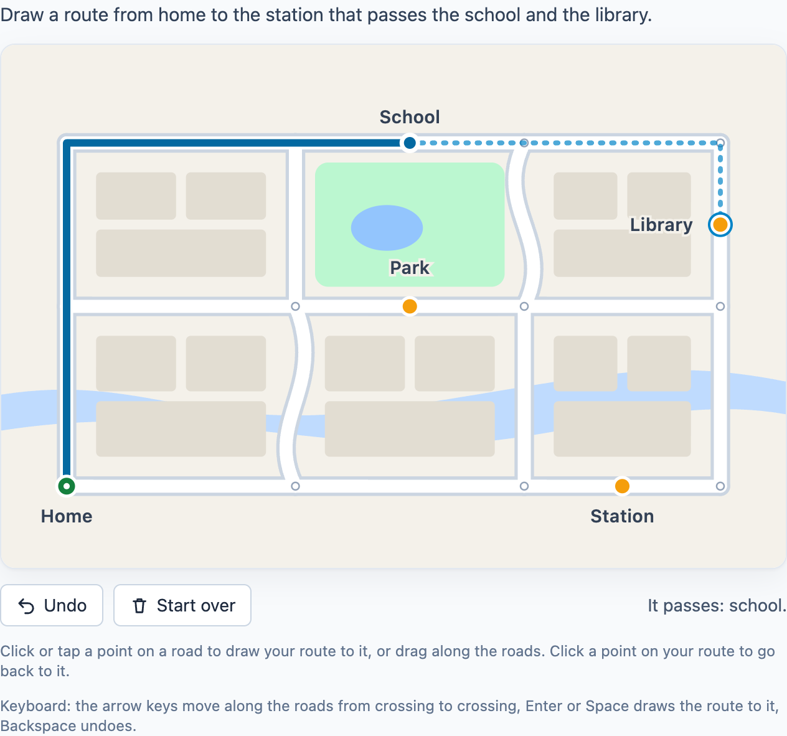

# @citolab/pci-svg-map

A QTI 3 Portable Custom Interaction (PCI) in which the candidate draws a route on a map: "draw a route from home to the
station that passes the school and the library". The map is an SVG; the candidate follows its roads from point to
point. Made with [tspci](https://github.com/Citolab/tspci).

<p align="center">
  
</p>

## Source and licence

This PCI is a port of **svgmap** from [openPCI/openPCIs](https://github.com/openPCI/openPCIs/tree/master/svgmap), the
"Svg map exercise from OpenPCI project of Aarhus University and Aalborg University" by Elias J.T. Hansen, Anna Rusmann
and Jeppe Bundsgaard. The original is licensed under the GNU General Public License version 3 (the `LICENSE` of that
repository, without an "or any later version" grant), so this port is too: **GPL-3.0-only**, see [`LICENSE`](./LICENSE).
The copyright of the original stays with its authors; the changes are © Stichting Cito Instituut voor
Toetsontwikkeling, 2026.

What changed:

- **Ported** from TAO's older PCI format (`qtiCustomInteractionContext` with jQuery and TAO's event manager, a TAO-only
  creator widget) to the IMS PCI v1.0 API with tspci, Preact and Tailwind: it runs in any QTI 3 player and is packaged
  for TAO by `npm run package-tao`.
- **Same points, same response.** The points along the roads are numbered as in the original, so its points of
  interest and its responses (`{"path": [...], "poi": [...], "score": ...}`) keep their meaning.
- **Scoring settings instead of a scoring function.** The original let the author write a JavaScript scoring function,
  which it ran with `eval`. For safety (no author code runs in the player) and for players whose content security
  policy forbids evaluating code, this port has fixed settings instead: the points of interest the route must pass,
  the point it must end at, and whether it must be a shortest route. `score` is now 1 or 0.
- **A new interface**: the route as a line instead of red dots, a dashed preview of the way to the point under the
  pointer, markers for the start and the points of interest (a check when passed), Undo and Start over, drawing by
  dragging, touch, a keyboard alternative and messages for screen readers, texts in English and Dutch.
- **Saving and restoring**: the original did not save its state (`getSerializedState` returned `{}`) and ignored
  `setResponse`; this port restores both, and shows the correct response in review.
- **Authoring mode** instead of TAO's creator widget: upload the SVG, click the map to place the start and the points
  of interest, and mark which ones the route must pass and where it must end, in every authoring system that supports
  it.
- **Fixes**: the first point of a route without a start is part of the route; a start on a path end that was joined
  into a crossing works; clicking a point of the route takes the route back to the last time it passed there; paths in
  transformed groups (`<g transform>`) line up with the map; scripts and event handlers in the SVG are removed.

## What it does

- **Draw**: click or tap a point on a road and the route goes there along the shortest way, without going back over
  the route (crossing it is fine). Or drag along the roads: the route follows the pointer, and dragging back takes back
  what that drag drew. Click a point of the route to take the route back to it.
- **Start**: when the author set a start (the point of interest `start`, a green marker), the route begins there;
  otherwise at the first point the candidate chooses.
- **Undo and Start over** (also Backspace or Ctrl+Z on the map).
- **Keyboard**: the map is one tab stop. The arrow keys move along the roads from crossing to crossing (and to points of
  interest), a dashed line shows the way there, and Enter or Space draws it. A screen reader hears where the keyboard is
  ("Point 4, on your route. Roads lead left, down.") and what the route passes.
- **Authoring mode** ("Map and points of interest…"): upload the SVG map (or use the example map), click a point of a
  road and name it as a point of interest, or make it the start; tick "must pass" or "end" behind a point of interest
  for the score. The map shows every point, so the author sees the density. The result is `data-backdrop`,
  `data-poi`, `data-requiredpoi` and `data-endpoi`.
- **Delivery**: the route is saved as the item's state and restored. In review (`status: "solution"`) the PCI shows the
  correct response when the delivery system passes it.

### The map

Any SVG with a viewBox (else its width and height). One group, the **path layer** (`data-pathlayer`, `path` by
default; Inkscape calls its first layer `layer1`), holds the roads as `<path>` elements. The rest of the SVG is the
picture: it is shown as it is.

- Every road between two crossings is a path of its own: paths are joined where their **ends** meet (closer than half
  the distance between points), never in the middle. "Lines must NOT be connected on junctions", as the original says.
- Points are placed every `data-dotresolution` SVG units along each path, plus one at its end. They are numbered over
  the paths of the layer in document order; where path ends are joined the crossing keeps the highest number.
- Changing the map, the path layer or the distance renumbers the points: place the points of interest again.

## What can be configured

Every setting is a `data-` attribute of the interaction, as text. `dist/authoring.json` describes them for authoring
systems. The first four are the original's settings, with the original's names; the scoring settings replace its
scoring function.

| setting                       | attribute             | default                    | what                                                       |
| ----------------------------- | --------------------- | -------------------------- | ---------------------------------------------------------- |
| Map (SVG)                     | `data-backdrop`       | empty: the example map     | the SVG text; written by the authoring mode                |
| Points of interest            | `data-poi`            | empty                      | JSON `{"start": 125, "school": 342}`: name → point number; written by the authoring mode |
| Id of the path layer          | `data-pathlayer`      | `path`                     | the id of the group with the roads                         |
| Distance between points       | `data-dotresolution`  | `5`                        | in SVG units                                               |
| Must pass                     | `data-requiredpoi`    | empty                      | names from `data-poi`, comma separated; written by the authoring mode; see Scoring |
| Must end at                   | `data-endpoi`         | empty                      | a name from `data-poi`; written by the authoring mode      |
| Must be a shortest route      | `data-shortest`       | `false`                    | `true` or `false`                                          |
| Instruction above the map     | `data-prompt`         | `Draw a route from home …` | also the map's accessible name                             |
| Points of interest on the map | `data-showpoi`        | `markers`                  | `markers`, `labels` (with their names) or `none` (hidden, only for scoring) |
| Language                      | `data-language`       | `en`                       | `en` or `nl`: the buttons and messages                     |

The start is always shown. Without a `data-poi` the example map has its own points of interest (`start`, `school`,
`library`, `station`, `park`).

## Scoring

The response is the original's: a string (`cardinality="single" base-type="string"`) holding JSON.

```json
{ "path": [298, 250, 249, "…", 43], "poi": ["school"], "score": 1 }
```

- `path`: the numbers of the points of the route, in order, from the start.
- `poi`: the names of the points of interest the route passes (not `start`), in the order of `data-poi`.
- `score`: 1 when the route meets every scoring setting, else 0; left out when none is set.
- **No response** until the route has a step: `getResponse()` reports nothing.

The PCI is made for `custom` scoring (`authoring.json`: `"scoring": ["custom", "match_correct", "human"]`): the response
processing, or a scoring step after the test, reads the JSON, for instance its `score`. The score follows from three
settings; any combination can be used:

- `data-requiredpoi`: the route passes every one of these points of interest (in any order).
- `data-endpoi`: the route ends at this point of interest.
- `data-shortest`: the route is no longer, along the roads, than the shortest way from the start (or the first point of
  the route), past the required points in the best order, to the end point (or to where the route ends). Every
  shortest route counts when there are several. With more than seven required points only the other conditions are
  checked.

On the example map, "from home to the station past the school and the library" is `data-requiredpoi="school,library"`
`data-endpoi="station"`, with `data-shortest="true"` for "the shortest route". A name that is not a point of interest
cannot be passed, so it gives 0; the authoring mode reports it.

- `match_correct` compares the whole text: only exactly that route is correct. Set it by drawing the
  route; in TAO switch the interaction to *Response*.
- `human`: use the PCI without automatic scoring, for instance for a human rater.

## Using it

```sh
npm install @citolab/pci-svg-map
```

| file                                  | what                                                                      |
| ------------------------------------- | ------------------------------------------------------------------------- |
| `dist/index.js`                       | the PCI (AMD module, everything bundled: the package has no dependencies) |
| `dist/authoring.json`                 | settings, response, scoring and the authoring mode, for authoring systems |
| `dist/sbom.cdx.json`                  | CycloneDX SBOM of the bundle                                              |
| `dist/tao-pci-svgMap_<version>.zip`   | the PCI for TAO: Settings → Portable Custom Interactions → Add            |
| `svgMap.svg`, `example.png`           | icon and screenshot                                                       |

In a QTI 3 item, with `index.js` at `resources/pci/index.js` of the package:

```xml
<qti-response-declaration identifier="RESPONSE" cardinality="single" base-type="string"/>
…
<qti-portable-custom-interaction response-identifier="RESPONSE" module="pci" custom-interaction-type-identifier="svgMap"
  data-pathlayer="path" data-dotresolution="5" data-showpoi="markers">
  <qti-interaction-modules>
    <qti-interaction-module id="pci" primary-path="../resources/pci/index"></qti-interaction-module>
  </qti-interaction-modules>
  <qti-interaction-markup></qti-interaction-markup>
</qti-portable-custom-interaction>
```

Source and the other examples: [Citolab/tspci-examples](https://github.com/Citolab/tspci-examples).
