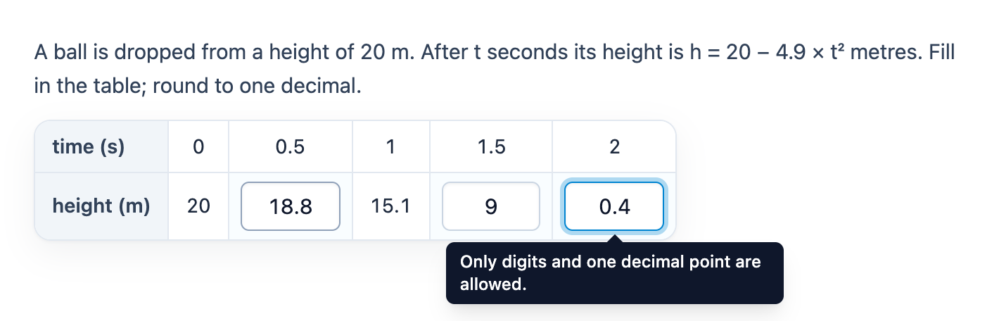

# @citolab/pci-table-entry

> [!WARNING]
> **Experimental (beta).** This PCI takes the idea of an interaction in an existing exam; it is not a copy of it. It is
> offered as is, without any warranty, and has never been used in an assessment. Try it out with candidates and check
> its content and scoring before you use it in one.

A QTI 3 Portable Custom Interaction (PCI) for "fill in the table": a small table with headers, some given cells and
some cells the candidate fills in, often followed by "now draw the graph". Each input cell has an expected value, with
an optional margin, so the table can be scored per cell ("1 point off for each missing or wrong value"). The item
author builds the table in the PCI itself. Made with [tspci](https://github.com/Citolab/tspci).

<p align="center">
  
</p>

## What it does

- **Given cells and input cells**: row headers on the left ("time (s)", "height (m)"), a header row on top, or both.
  Headers and given cells are text; input cells are fields.
- **Only what is allowed**: in number mode a field takes digits and one decimal separator (and a minus sign when the
  author allows negative numbers), up to a number of characters and decimals. Anything else is refused on the spot,
  with a message under the field that a screen reader hears too (`aria-live`). A typed `.` or `,` becomes the
  separator of the language: `3,5` in Dutch, `3.5` in English. Pasting is checked the same way. In text mode any text
  goes, up to the number of characters.
- **Keyboard**: Tab and Shift+Tab, Enter and Shift+Enter move to the next or previous field in reading order; the arrow
  keys move to the nearest field above, below, left or right (left and right only when the caret is at the edge of
  the text). Fields have `inputmode="decimal"` (or `numeric` for whole numbers), so a tablet shows a number pad.
- **Accessible**: a real table with `th` headers; every field is named after its row and column header ("height (m),
  time (s) 0.5 (field 1 of 3)"); clear focus rings.
- **Dutch** (`data-language="nl"`): decimal comma and Dutch texts. The response is the same in every language.
- **Authoring mode**: the item author builds the table in the PCI itself (`getAuthoringInstance`), via "Configure…"
  ("Build the table…") in an authoring system that supports it (qti-construction, TAO with tspci-tao, the dev page):
  add and remove rows and columns, row headers and a header row, and per cell a switch between *Given* (a text) and
  *Input* (the expected value and a margin ±). Cells copied from a spreadsheet (tabs and new lines) are pasted from the
  field on, and the table grows to fit; a value in brackets becomes an input: `[18,8]` expects 18,8, `[18,8 ± 0,1]`
  with a margin. The author sees what is still wrong (no inputs, no expected value, not a number, too many
  decimals or characters for the settings). Without a table of its own, the PCI shows the example.
- **Delivery**: the values are saved as the item's state (every change in the log) and restored. In review, closed and
  solution status the fields are read-only; in solution status (`status: "solution"`) the PCI fills in the correct
  response the delivery system passes, or else the expected values of the table.

## What can be configured

Every setting is a `data-` attribute of the interaction, as text. `dist/authoring.json` describes them for authoring
systems.

| setting                       | attribute             | default                  | what                                                             |
| ----------------------------- | --------------------- | ------------------------ | ---------------------------------------------------------------- |
| Instruction above the table   | `data-prompt`         | the example's question   | also the table's accessible name                                 |
| Table                         | `data-table`          | empty: the example table | written by the authoring mode, as JSON (below)                   |
| The candidate types           | `data-input-mode`     | `number`                 | `number`: digits and one decimal separator; `text`: any text     |
| Characters per cell at most   | `data-max-characters` | `6`                      | `0`: no limit                                                    |
| Decimals at most              | `data-decimals`       | empty: any               | `0`: whole numbers only; number mode                             |
| Allow negative numbers        | `data-allow-negative` | `false`                  | number mode                                                      |
| Scoring                       | `data-scoring`        | `list`                   | `list`: the item scores the values; `pci`: the PCI scores them (below) |
| Points                        | `data-max-score`      | `2`                      | PCI scoring only                                                 |
| Points off per error          | `data-penalty`        | `1`                      | PCI scoring only: per missing or wrong value, never below 0      |
| Language                      | `data-language`       | `en`                     | `en` or `nl`: the decimal separator and the texts                |

The table: a given cell is its text, an input cell an object with the expected value (as the author typed it) and an
optional absolute margin. Rows and columns keep their id when others are removed; a cell is `r2-c3`.

```json
{
  "columns": [{ "id": "c1" }, { "id": "c2" }, { "id": "c3" }, { "id": "c4" }],
  "rows": [
    { "id": "r1", "cells": ["time (s)", "0", "0.5", "1"] },
    { "id": "r2", "cells": ["height (m)", "20", { "kind": "input", "text": "18.8", "tolerance": "0.1" }, { "kind": "input", "text": "15.1" }] }
  ],
  "headerColumn": true,
  "headerRow": false
}
```

## Scoring

The response is one value per input cell, in reading order (row by row, left to right), as an ordered list of strings
(`cardinality="ordered" base-type="string"`), for example `["18.8", "9", "0.4"]`.

- **Normalized**: numbers with a point, without leading zeros or trailing decimal zeros (`09,50` → `9.5`, `,5` →
  `0.5`, `-0` → `0`); text trimmed, with single spaces. So `9`, `9,0` and `09` give the same response.
- **An empty cell** is `""`, so every value stays at its position. Until a cell has a value, `getResponse()` reports
  nothing.
- **The correct response from the settings**: the expected values are in the table, so the PCI has
  `getCorrectResponse(properties)` (`authoring.json`: `"correctResponse": "properties"`) and an authoring system fills
  the correct response from the table. Or answer the PCI in a preview and take that as the correct response.

`authoring.json` lists `"scoring": ["match_correct", "custom", "human"]`. There are three ways to score:

**1. All or nothing: `match_correct`.** The standard template: every value must be exactly the expected one.

**2. Points off per missing or wrong value, in the item.** The exam rule "1 point off for each missing or wrong value,
at most 2 points" is custom response processing: compare the values one by one with `qti-index` and count the
errors. Per input cell (n = 1, 2, 3, …):

```xml
<qti-outcome-declaration identifier="ERRORS" cardinality="single" base-type="integer">
  <qti-default-value><qti-value>0</qti-value></qti-default-value>
</qti-outcome-declaration>
…
<qti-response-processing>
  <!-- once per input cell: n="1", n="2", n="3" -->
  <qti-response-condition>
    <qti-response-if>
      <qti-or>
        <qti-is-null><qti-index n="1"><qti-variable identifier="RESPONSE"/></qti-index></qti-is-null>
        <qti-not><qti-match>
          <qti-index n="1"><qti-variable identifier="RESPONSE"/></qti-index>
          <qti-index n="1"><qti-correct identifier="RESPONSE"/></qti-index>
        </qti-match></qti-not>
      </qti-or>
      <qti-set-outcome-value identifier="ERRORS">
        <qti-sum><qti-variable identifier="ERRORS"/><qti-base-value base-type="integer">1</qti-base-value></qti-sum>
      </qti-set-outcome-value>
    </qti-response-if>
  </qti-response-condition>
  <!-- 2 points, 1 off per error, never below 0 -->
  <qti-set-outcome-value identifier="SCORE">
    <qti-max>
      <qti-base-value base-type="float">0</qti-base-value>
      <qti-subtract><qti-base-value base-type="float">2</qti-base-value><qti-variable identifier="ERRORS"/></qti-subtract>
    </qti-max>
  </qti-set-outcome-value>
</qti-response-processing>
```

The `qti-is-null` catches an empty cell (`""` is NULL in QTI) and a response without any value. This compares
strings, so it cannot use the margins: QTI has no operator that turns a string into a number.

**3. The PCI scores, with margins: `data-scoring="pci"` (`custom`).** A margin per cell can only be applied by the
PCI (or by a long hand-written response processing with a float response per cell). With `data-scoring="pci"` the
response is a record instead of the list: declare `RESPONSE` as `cardinality="record"`. The PCI checks every value
against the expected value within its margin (text: the same after normalizing) and reports:

| field      | base type | what                                                         |
| ---------- | --------- | ------------------------------------------------------------ |
| `values`   | `string`  | the values as a JSON array, as in the list: `["18.7","9",""]` |
| `correct`  | `integer` | the number of right values                                   |
| `errors`   | `integer` | the number of missing or wrong values                        |
| `score`    | `integer` | `max(0, data-max-score − data-penalty × errors)`             |
| `maxscore` | `integer` | `data-max-score`                                             |

The response processing copies the score:

```xml
<qti-response-processing>
  <qti-response-condition>
    <qti-response-if>
      <qti-not><qti-is-null><qti-variable identifier="RESPONSE"/></qti-is-null></qti-not>
      <qti-set-outcome-value identifier="SCORE">
        <qti-field-value field-identifier="score"><qti-variable identifier="RESPONSE"/></qti-field-value>
      </qti-set-outcome-value>
    </qti-response-if>
  </qti-response-condition>
</qti-response-processing>
```

Why both: the list is the plain QTI way that every authoring system and player understands, and it is the default.
PCI scoring is what makes margins possible, at the price of a record response and of trusting the PCI's verdict.
Either way, the expected values are in `data-table`, in the item's markup that the browser gets: a candidate who
reads the page source can find them. Use this PCI in a secure browser for high-stakes tests.

## Using it

```sh
npm install @citolab/pci-table-entry
```

| file                                      | what                                                                      |
| ----------------------------------------- | ------------------------------------------------------------------------- |
| `dist/index.js`                           | the PCI (AMD module, everything bundled: the package has no dependencies) |
| `dist/authoring.json`                     | settings, response, scoring and the authoring mode, for authoring systems |
| `dist/sbom.cdx.json`                      | CycloneDX SBOM of the bundle                                              |
| `dist/tao-pci-tableEntry_<version>.zip`   | the PCI for TAO: Settings → Portable Custom Interactions → Add            |
| `tableEntry.svg`, `example.png`           | icon and screenshot                                                       |

`npm test` runs the tests of the table model, the typing rules, normalizing and scoring (`src/table.ts`) in node.

In a QTI 3 item, with `index.js` at `resources/pci/index.js` of the package:

```xml
<qti-response-declaration identifier="RESPONSE" cardinality="ordered" base-type="string">
  <qti-correct-response>
    <qti-value>18.8</qti-value><qti-value>9</qti-value><qti-value>0.4</qti-value>
  </qti-correct-response>
</qti-response-declaration>
…
<qti-portable-custom-interaction response-identifier="RESPONSE" module="pci" custom-interaction-type-identifier="tableEntry"
  data-language="nl" data-max-characters="6" data-decimals="1">
  <qti-interaction-modules>
    <qti-interaction-module id="pci" primary-path="../resources/pci/index"></qti-interaction-module>
  </qti-interaction-modules>
  <qti-interaction-markup></qti-interaction-markup>
</qti-portable-custom-interaction>
```

Source and the other examples: [Citolab/tspci-examples](https://github.com/Citolab/tspci-examples).
