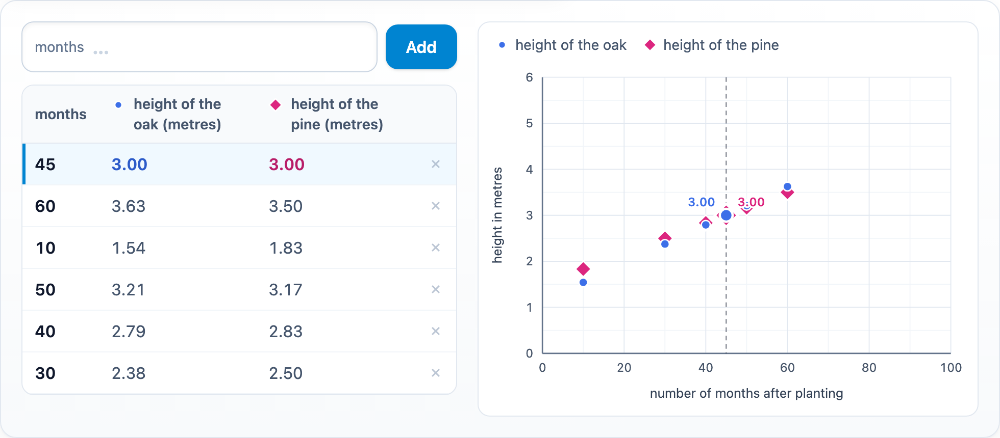

# @citolab/pci-table-graph

A QTI 3 Portable Custom Interaction (PCI) in which the candidate explores two formulas: they add numbers to a table,
the PCI calculates both formulas and plots the results in a graph, until they find where the two meet ("after how many
months are the oak and the pine equally tall?"). Made with [tspci](https://github.com/Citolab/tspci).

<p align="center">
  
</p>

An improved version of the "verbanden" PCI of the Dutch national assessment of mathematics (Peiling rekenen-wiskunde
2022), made to study the steps candidates take.

## What it does

- **Add a number**: type it and press *Add* (or Enter). A decimal point or comma both work; a number outside the
  horizontal axis, or one already in the table, gets a message.
- **The table**: a row per number, the newest first, with the result of both formulas. Click a row (or its number) to
  point it out in the graph; × removes it.
- **The graph**: a marker per number and formula, a circle and a diamond in colour-blind safe colours. The selected
  number gets a guide line and its results as labels; where the formulas meet, the circle sits inside the diamond.
  Optionally the points are connected.
- **Language**: the buttons and messages in English or Dutch (`data-language`); numbers follow it (`3,00` in Dutch).
- **Delivery**: the table is saved as the item's state, with every step in the log, and restored. In review the
  input and the remove buttons are disabled.

The PCI is a tool: the candidate gives the answer elsewhere in the item, for instance in a text entry interaction.

## What can be configured

Every setting is a `data-` attribute of the interaction, as text. `dist/authoring.json` describes them for authoring
systems. The texts of the item (formula names, units, axis labels) are settings, so write them in the item's language.

| setting | attribute | default | what |
| --- | --- | --- | --- |
| Formulas | `data-formula1`, `data-formula2` | `1.125 + x / 24`, `1.5 + x / 30` | `x` is the number added; numbers, `+ - × ÷ ^`, brackets, `3x` |
| Names of the formulas | `data-formula1-label`, `data-formula2-label` | `height of the oak`, `height of the pine` | column headers and legend |
| Unit of x | `data-x-unit` | `months` | above the first column and next to the input |
| Horizontal axis | `data-x-label`, `data-x-min`, `data-x-max` | `number of months after planting`, `0`, `100` | the label and the range; the candidate can add numbers in this range |
| Unit of the results | `data-y-unit` | `metres` | in the column headers |
| Vertical axis | `data-y-label`, `data-y-min`, `data-y-max` | `height in metres`, `0`, `6` | the label and the range |
| Start values | `data-start-values` | `30, 40, 50` | in the table at the start; may be empty. With decimal commas, separate by `;` |
| Decimals | `data-decimals` | `2` | of the results (0 to 6) |
| Connect the points | `data-connect-points` | `false` | `true`: a line per formula through its points |
| Language | `data-language` | `en` | `en` or `nl` |

## Response and scoring

The PCI is not scored (`"scoring": ["none"]`).

**The response** is the list of numbers in the table, oldest first (`cardinality="ordered" base-type="float"`):
`[30, 40, 50, 10, 60, 45]`. Until the candidate adds or removes a number, `getResponse()` reports nothing (the start
values alone are not an answer). The state's log has every step with its time.

## Using it

```sh
npm install @citolab/pci-table-graph
```

| file | what |
| --- | --- |
| `dist/index.js` | the PCI (AMD module, everything bundled: the package has no dependencies) |
| `dist/authoring.json` | settings and response, for authoring systems |
| `dist/sbom.cdx.json` | CycloneDX SBOM of the bundle |
| `dist/tao-pci-tableGraph_<version>.zip` | the PCI for TAO: Settings → Portable Custom Interactions → Add |
| `tableGraph.svg`, `example.png` | icon and screenshot |

In a QTI 3 item, with `index.js` at `resources/pci/index.js` of the package:

```xml
<qti-response-declaration identifier="VALUES" cardinality="ordered" base-type="float"/>
<qti-response-declaration identifier="RESPONSE" cardinality="single" base-type="integer"/>
…
<qti-portable-custom-interaction response-identifier="VALUES" module="pci" custom-interaction-type-identifier="tableGraph"
  data-formula1-label="hoogte eik" data-formula2-label="hoogte den" data-x-unit="maanden" data-y-unit="meter"
  data-x-label="aantal maanden na planten" data-y-label="hoogte in meter" data-language="nl">
  <qti-interaction-modules>
    <qti-interaction-module id="pci" primary-path="../resources/pci/index"></qti-interaction-module>
  </qti-interaction-modules>
  <qti-interaction-markup></qti-interaction-markup>
</qti-portable-custom-interaction>
<p>After <qti-text-entry-interaction response-identifier="RESPONSE"/> months the trees are equally tall.</p>
```

Source and the other examples: [Citolab/tspci-examples](https://github.com/Citolab/tspci-examples).
