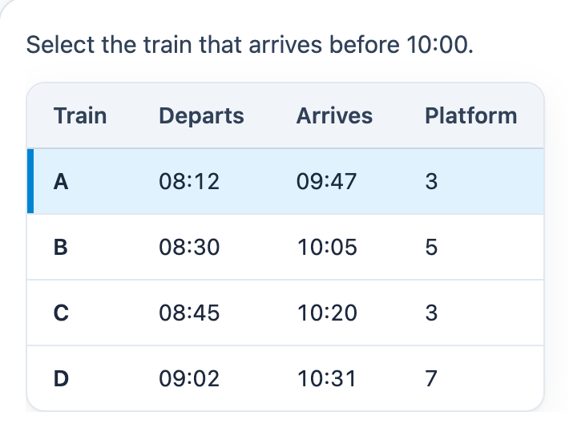

# @citolab/pci-table-select

> [!WARNING]
> **Experimental (alpha). Just for inspiration.** This PCI is a technical showcase, made by software developers without
> much knowledge of the subject it could be used for. Its content, terms and scoring have not been checked by subject
> experts or assessment specialists, and it has never been used in an assessment. It is offered as is, without any
> warranty.

A QTI 3 Portable Custom Interaction (PCI) in which the candidate selects a row or a cell of a table: "select the train
that arrives before 10:00". The item author builds the table in the PCI itself. Made with
[tspci](https://github.com/Citolab/tspci).

<p align="center">
  
</p>

## What it does

- **Select**: click a row (or a cell, see `data-selection-mode`) to select it; clicking it again takes the choice back.
  Every choice is a radio button behind the row or cell, so the arrow keys move between them and a screen reader
  hears the row with its headers ("Train: A; Departs: 08:12; …") or the cell with its column and row header.
- **Row headers**: the first column can hold row headers. In cell mode they cannot be selected.
- **Authoring mode**: the item author builds the table in the PCI itself (`getAuthoringInstance`), via "Configure…"
  ("Build the table…") in an authoring system that supports it (qti-construction, TAO with tspci-tao, the dev page).
  Type the headers and cells, add, remove and move rows, add and remove columns, or paste cells copied from a
  spreadsheet: the table grows to fit. Without a table of its own, the PCI shows an example timetable.
- **Delivery**: the choice is saved as the item's state and restored. In review (`status: "solution"`) the PCI shows the
  correct response when the delivery system passes it.

## What can be configured

Every setting is a `data-` attribute of the interaction, as text. `dist/authoring.json` describes them for authoring
systems.

| setting                    | attribute             | default                                       | what                                     |
| -------------------------- | --------------------- | --------------------------------------------- | ---------------------------------------- |
| Instruction above the table | `data-prompt`        | `Select the train that arrives before 10:00.` | also the table's accessible name         |
| The candidate selects      | `data-selection-mode` | `row`                                         | `row` or `cell`                          |
| Table                      | `data-table`          | empty: the example timetable                  | written by the authoring mode, as JSON (below) |
| Language                   | `data-language`       | `en`                                          | `en` or `nl`: the texts for screen readers |

```json
{
  "columns": [{ "id": "c1", "label": "Train" }, { "id": "c2", "label": "Departs" }],
  "rows": [{ "id": "r1", "cells": ["A", "08:12"] }, { "id": "r2", "cells": ["B", "08:30"] }],
  "rowHeaders": true
}
```

Rows and columns keep their id when others are added, removed or moved; a new one gets the next free number.

## Scoring

The PCI is made for `match_correct` (`authoring.json`: `"scoring": ["match_correct", "human"]`).

**The response** is an identifier (`cardinality="single" base-type="identifier"`): the id of the selected row, `r2`, or
of the selected cell, row and column, `r2-c3`.

- **What counts**: which row or cell, not its text. Correcting a typo in the table keeps the correct response; so does
  moving a row.
- **Setting the correct response**: answer the PCI. In TAO switch the interaction to *Response* and select the answer;
  in qti-construction or the dev page, select it and take it as the correct response.
- Removing the row or column the correct response refers to, or switching between row and cell mode, makes it
  invalid: set the correct response again.
- **No response**: until the candidate selects something, `getResponse()` reports nothing.
- `human`: use the PCI without automatic scoring, for instance as a tool or for a human rater.

## Using it

```sh
npm install @citolab/pci-table-select
```

| file                                       | what                                                                      |
| ------------------------------------------ | ------------------------------------------------------------------------- |
| `dist/index.js`                            | the PCI (AMD module, everything bundled: the package has no dependencies) |
| `dist/authoring.json`                      | settings, response, scoring and the authoring mode, for authoring systems |
| `dist/sbom.cdx.json`                       | CycloneDX SBOM of the bundle                                              |
| `dist/tao-pci-tableSelect_<version>.zip`   | the PCI for TAO: Settings → Portable Custom Interactions → Add            |
| `tableSelect.svg`, `example.png`           | icon and screenshot                                                       |

In a QTI 3 item, with `index.js` at `resources/pci/index.js` of the package:

```xml
<qti-response-declaration identifier="RESPONSE" cardinality="single" base-type="identifier">
  <qti-correct-response><qti-value>r1</qti-value></qti-correct-response>
</qti-response-declaration>
…
<qti-portable-custom-interaction response-identifier="RESPONSE" module="pci" custom-interaction-type-identifier="tableSelect"
  data-selection-mode="row">
  <qti-interaction-modules>
    <qti-interaction-module id="pci" primary-path="../resources/pci/index"></qti-interaction-module>
  </qti-interaction-modules>
  <qti-interaction-markup></qti-interaction-markup>
</qti-portable-custom-interaction>
```

Source and the other examples: [Citolab/tspci-examples](https://github.com/Citolab/tspci-examples).
