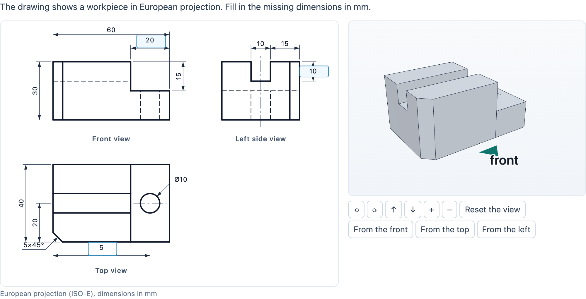

# @citolab/pci-technical-drawing

> [!WARNING]
> **Experimental (alpha). Just for inspiration.** This PCI is a technical showcase, made by software developers without
> much knowledge of the subject it could be used for. Its content, terms and scoring have not been checked by subject
> experts or assessment specialists, and it has never been used in an assessment. It is offered as is, without any
> warranty.

A QTI 3 Portable Custom Interaction (PCI) for reading and making technical drawings ("werktekening", "aanzichten"),
as in the vmbo technology profiles (PIE, BWI, M&T). A workpiece made of a block with steps, slots, holes and
chamfers is shown as a 3D model the candidate can turn, and as a drawing in European projection (ISO-E): the front
view, the top view under it and the left side view to its right, with visible lines, hidden lines (dashed), centre
lines and dimensions. The PCI computes the views itself. The candidate fills in missing dimensions, answers questions
about the drawing, draws the missing lines of a view on a grid, names a view, or picks the drawn workpiece out of
three or four. The item author builds the workpiece and the task in the PCI's authoring mode. Made with
[tspci](https://github.com/Citolab/tspci).

<p align="center">
  
</p>

## What it does

- **The workpiece**: a block (width x, depth y, height z, in mm) with features. A *step* is cut along a top edge
  (left, right, front or back), a *slot* is cut across the top (running along x or y), a *hole* is drilled into the
  top, the front or the left face (through, or blind to a depth), a *chamfer* (45°) is cut on any of the 12 edges, and
  a *box* is added (a rib, a boss) or cut out (a pocket). Each feature is a convex solid or a cylinder, added or cut.
  `src/model.ts`, tested in node with `npm test`.
- **The views**: computed from the features, not drawn by hand. Every line of a view lies where a feature starts or
  ends, on a chamfer's slanted edge or on a hole's circle; a piece of such a line is drawn when the surfaces a ray of
  sight meets just left and right of it differ: visible when the first surface differs, hidden (dashed) when the same
  surface lies in front of it on both sides. Visible lines win over hidden ones. Holes get centre lines (dash-dot), a
  cross where the hole is a circle.
- **Dimensions**: every feature brings its own (a step's width and depth, a slot's offset, width and depth, a hole's
  position, diameter Ø and depth, a chamfer's 5×45°), each in the view where it is seen best, and extra ones that are
  hidden by default: the material under a slot, a hole's distance from the other side. They are stacked outside the
  views: the shortest nearest, a chain (offset, width) on one line. The author shows, hides or asks each one.
- **The 3D model**: three.js, built with constructive solid geometry (BSP trees, `src/csg.ts`) from the same
  features, with its edges drawn and an arrow on the ground at the front. Turn it by dragging (one finger on a touch
  screen, two to zoom), with the arrow keys, + and −, 1/2/3 (from the front, the top, the left) and 0 (back), or with
  the buttons. It is drawn only when it moves, and moves at once with `prefers-reduced-motion`. Without WebGL (or with
  `data-model-view="2d"`) the same model in SVG, painted back to front. The WebGL context is freed when the PCI is
  unmounted (`destroy()`), or at its next draw when the page took it away.
- **The tasks** (`data-task`):
  - `dimensions`: the asked dimensions are empty fields on the drawing.
  - `read`: questions under the drawing ("How deep is the slot?"), each answered with a dimension that is not on the
    drawing but follows from the ones that are (the height minus the material under the slot).
  - `complete`: one view lacks lines (some, or all); the candidate draws them on a grid of the author's step, as
    visible or hidden lines. Mouse: click a grid point and another, or drag. Keyboard: the grid is one stop; the arrow
    keys move a cursor, Home goes to the corner, Enter or Space starts and ends a line, Escape cancels, Delete removes
    a line through the cursor. An eraser, undo, clear, and a list of the lines with a remove button each.
  - `view`: one view without its name; the candidate says which one it is.
  - `model`: the drawing and three or four workpieces (A–D) in one 3D picture; the candidate clicks one (raycasting)
    or chooses its radio button. The author's distractors are made by the PCI (a step mirrored, a slot turned, a hole
    through instead of blind, a feature left out) and only kept when they look different in at least one view.
- **Accessibility**: every action has a keyboard way and a button or field with a name; a live region tells what
  happened ("Added: hidden line from (0, 20) to (40, 20).", "Chosen: Workpiece B."). Hidden lines differ by their dash,
  not their colour; the candidate's lines are blue and also listed as text; a chosen workpiece stands on a ring and its
  label gets a check mark.
- **Dutch** (`data-language="nl"`): the texts (vooraanzicht, bovenaanzicht, linkerzijaanzicht, werkstuk …) and a
  decimal comma in the drawing and the fields (12,5). The response does not depend on the language.
- **Delivery**: what the candidate typed, drew or chose is the state (every step in the log) and is restored. Several
  interactions on one page each have their own state. In `status: "solution"` (and `"review"`) the fields and the grid
  are read-only and show the correct response.

## What can be configured

Every setting is a `data-` attribute of the interaction, as text. `dist/authoring.json` describes them for authoring
systems; `data-drawing` is written by the authoring mode ("Build the workpiece…").

| setting                 | attribute            | default      | what                                                                                       |
| ----------------------- | -------------------- | ------------ | ------------------------------------------------------------------------------------------ |
| Instruction             | `data-prompt`        | per task     | above the drawing; the default text depends on the task                                    |
| Task                    | `data-task`          | `dimensions` | `dimensions`, `read`, `complete`, `view` or `model` (above)                                 |
| Workpiece and task      | `data-drawing`       | the example  | JSON (below); empty: the example workpiece with an example task for every task              |
| 3D model                | `data-show-model`    | `true`       | the model next to the drawing; always shown for `view` and `model`                         |
| Names of the views      | `data-show-labels`   | `true`       | "Front view" … under the views (never in the `view` task)                                  |
| Model picture           | `data-model-view`    | `3d`         | `3d` (SVG without WebGL) or `2d`: always the SVG picture                                   |
| Scoring of the numbers  | `data-scoring`       | `match`      | `match`: an ordered list of floats; `pci`: a record scored by the PCI (below)              |
| Margin                  | `data-tolerance`     | `0`          | mm, for `data-scoring="pci"`                                                               |
| Language                | `data-language`      | `en`         | `en` or `nl`                                                                               |

`data-drawing`:

```json
{
  "features": [
    { "type": "block", "w": 60, "d": 40, "h": 30 },
    { "type": "step", "edge": "right", "width": 20, "depth": 15 },
    { "type": "slot", "along": "x", "offset": 15, "width": 10, "depth": 10 },
    { "type": "hole", "face": "top", "a": 50, "b": 20, "diameter": 10, "depth": 0 },
    { "type": "chamfer", "edge": "front-left", "size": 5 },
    { "type": "box", "op": "add", "x": 0, "y": 0, "z": 30, "w": 10, "d": 40, "h": 5 }
  ],
  "dims": { "1.width": "ask", "2.depth": "hide", "2.rest": "show" },
  "questions": [{ "text": "How deep is the slot?", "dim": "2.depth" }],
  "complete": { "view": "front", "grid": 5, "remove": ["hidden:0,20,40,20"], "points": { "visible": 1, "hidden": 1, "extra": 1 } },
  "identify": { "view": "left" },
  "options": [[…features…], […features…]],
  "correct": 1
}
```

- A hole's `a` and `b` are its centre on its face: top `x`, `y`; front `x`, `z`; left `y`, `z` (from the left, the
  front and the bottom). `depth` 0 is through. A slot's `offset` is from the front (`along: "x"`) or the left (`"y"`).
- A dimension's id is the feature's index and the dimension's name: `1.width`, `3.a`, `0.h`. `dims` holds only what
  differs from the default (standard dimensions shown, extra ones hidden); `ask` makes it a field (task `dimensions`).
- `complete.remove` is `"all"` (the candidate draws the whole view; circles stay) or the keys of the lines left out
  (`kind:x1,y1,x2,y2` in mm of the view, from its bottom left corner). Those lines must start and end on the grid.
- `options` are the other workpieces of the `model` task; `correct` is the drawn one's place (0 = A). Without
  `options` the PCI makes three.
- What the authoring mode reports as a problem (`validate()`, in the author's language): a feature that cuts through
  or sticks out, no asked dimension, a question without its dimension, no line left out or one off the grid, a
  distractor that looks the same as the drawn workpiece.
- Not supported: a hole through a chamfer (the curve where they meet is not drawn), holes in other faces than top,
  front and left, slanted faces other than 45° chamfers.

## Scoring

`authoring.json`: `"scoring": ["match_correct", "custom", "human"]` with `"correctResponse": "properties"`:
`getCorrectResponse(properties)` gives the correct response of every task, so an authoring system fills it in.

**`dimensions` and `read`** (`match_correct`): the numbers in order (the asked dimensions in drawing order, or the
questions), as floats in mm: `{ "list": { "float": [20, 10, 50] } }`. Declare `cardinality="ordered" base-type="float"`.
The margin is 0 by default: the numbers on a drawing are exact. Until every field holds a number, `getResponse()`
reports nothing (the state keeps what was typed). For a margin, or partial credit, use `data-scoring="pci"`: a record
with `score` (the values right within `data-tolerance`), `maxscore`, `correct`, `value1` … `value8` (floats, the filled
ones) and `values` (`"20;;50"`), scored as `custom` (copy `score`).

**`view` and `model`** (`match_correct`): `{ "base": { "identifier": "left" } }` (`front`, `top`, `left`) or the
workpiece's letter (`A` … `D`). Declare `cardinality="single" base-type="identifier"`.

**`complete`** (`custom`): the PCI compares the candidate's lines with the computed view, grid step by grid step (so a
line drawn in two pieces, or the other way round, is the same line):

| field       | type      | what                                                                                          |
| ----------- | --------- | --------------------------------------------------------------------------------------------- |
| `score`     | `integer` | the points of the checks that pass                                                            |
| `maxscore`  | `integer` | the points of the checks there are                                                            |
| `correct`   | `integer` | 1 when every check passes                                                                     |
| `visibleOk` | `integer` | every visible line left out is drawn, as a visible line (1 when no visible line was left out) |
| `hiddenOk`  | `integer` | every hidden line left out is drawn, as a hidden line (1 when none was left out)              |
| `noExtra`   | `integer` | every line drawn is a line of the view of the same kind, and at least one was drawn           |
| `lines`     | `string`  | the candidate's lines, merged and sorted: `H0,20,40,20;V40,15,40,30` (V visible, H hidden)    |

The points per check are in `complete.points`; a check with nothing to check (no hidden line left out) does not count.
Declare `cardinality="record"` and copy `score`:

```xml
<qti-response-processing>
  <qti-response-condition>
    <qti-response-if>
      <qti-not><qti-is-null><qti-variable identifier="RESPONSE"/></qti-is-null></qti-not>
      <qti-set-outcome-value identifier="SCORE">
        <qti-field-value field-identifier="score"><qti-variable identifier="RESPONSE"/></qti-field-value>
      </qti-set-outcome-value>
    </qti-response-if>
  </qti-response-condition>
</qti-response-processing>
```

**State and response.** `setResponse` (and `boundTo` without a state) takes the same responses back: a list of
floats (or the `values` field), an identifier, or the `lines` field (or lines as a string). In `status: "solution"` the
declared correct response is shown (an ordered list of values, an identifier, or the `lines`); without one, the
correct response from the settings.

## Using it

```sh
npm install @citolab/pci-technical-drawing
```

| file                                           | what                                                                       |
| ---------------------------------------------- | -------------------------------------------------------------------------- |
| `dist/index.js`                                | the PCI (AMD module, everything bundled, three.js too: no dependencies)    |
| `dist/authoring.json`                          | settings, response, scoring and the authoring mode, for authoring systems  |
| `dist/sbom.cdx.json`                           | CycloneDX SBOM of the bundle                                               |
| `dist/tao-pci-technicalDrawing_<version>.zip`  | the PCI for TAO: Settings → Portable Custom Interactions → Add             |
| `technicalDrawing.svg`, `example.png`          | icon and screenshot                                                        |

In a QTI 3 item, with `index.js` at `resources/pci/index.js` of the package:

```xml
<qti-response-declaration identifier="RESPONSE" cardinality="ordered" base-type="float">
  <qti-correct-response><qti-value>20</qti-value><qti-value>10</qti-value><qti-value>50</qti-value></qti-correct-response>
</qti-response-declaration>
…
<qti-portable-custom-interaction response-identifier="RESPONSE" module="pci" custom-interaction-type-identifier="technicalDrawing"
  data-language="nl" data-task="dimensions" data-drawing="{&quot;features&quot;:[…],&quot;dims&quot;:{…}}">
  <qti-interaction-modules>
    <qti-interaction-module id="pci" primary-path="../resources/pci/index"></qti-interaction-module>
  </qti-interaction-modules>
  <qti-interaction-markup></qti-interaction-markup>
</qti-portable-custom-interaction>
```

Source and the other examples: [Citolab/tspci-examples](https://github.com/Citolab/tspci-examples).
