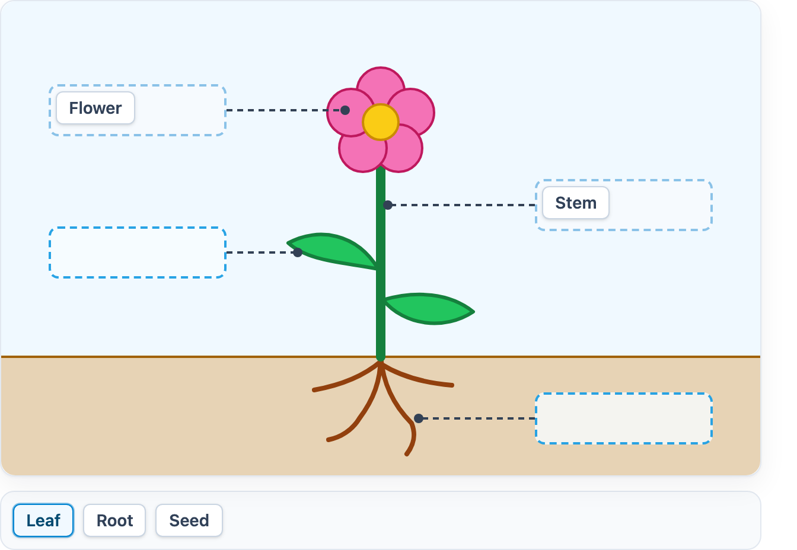

# @citolab/pci-text-gap-match

A QTI 3 Portable Custom Interaction (PCI) in which the candidate drags text labels onto drop zones on an image: "label
the parts of the plant". The item author chooses the image and draws the drop zones in the PCI itself. Made with
[tspci](https://github.com/Citolab/tspci).

<p align="center">
  
</p>

## Source and licence

This PCI is a port of [textgapmatch](https://github.com/openPCI/openPCIs/tree/master/textgapmatch) from
[openPCI](https://github.com/openPCI/openPCIs), made at Aarhus University and Aalborg University by Elias J.T. Hansen,
Anna Rusmann and Jeppe Bundsgaard. The original is licensed under the GNU General Public License version 3
([LICENSE](https://github.com/openPCI/openPCIs/blob/master/LICENSE)); this port is a derivative work and carries the
same licence, **GPL-3.0-only** (see [LICENSE](LICENSE)), not the MIT licence of the other examples in this repository.

What changed (Stichting Cito Instituut voor Toetsontwikkeling, 2026):

- **IMS PCI v1.0 instead of TAO's older PCI format**, via tspci: `getInstance`, `getResponse`, `getState`, the
  `qti-interaction-changed` event, review with the correct response. It runs in any QTI 3 delivery system, and in TAO
  (`npm run package-tao`).
- **A new UI**, Preact and Tailwind instead of jQuery: smooth drag and drop with pointer events (mouse, pen and touch:
  no separate touch polyfill), visible drop zones that show whether they take a label, a keyboard and tap alternative
  (pick a label, then a zone), screen reader names and announcements, English and Dutch texts.
- **The same settings and response.** The response is still the original's JSON string; state of the original
  (`{ response: … }`) is restored too. Labels in a numbered zone no longer get their number in the response.
- **Authoring mode** instead of TAO's creator widget: upload an image or give a URL, draw zones on it (as in the
  original), and move, resize, rename and remove them with the mouse, the keyboard or as numbers.

## What it does

- **Drag**: drag a label from the list onto a zone. Dropped on a label in another zone, it changes places with that
  label; dropped anywhere outside a zone, it goes back to the list. Within a zone the labels keep the order they are
  dropped in.
- **Keyboard and tap**: press a label (Enter, Space, or a tap) to pick it up, then press a zone. Press a label in a
  zone to put the picked one before it (or, from another zone, to swap). *Put back* or Delete returns a label in a zone
  to the list; Escape cancels. A screen reader hears each zone with its number and contents ("Drop zone 2 of 4,
  contains Leaf") and every move.
- **Rules, as the original**: a zone takes a label only once, and no more than *Labels per drop zone*. With *Labels can
  be used more than once* a label stays in the list after it is dropped.
- **Authoring mode**: "Image and drop zones…" in an authoring system that supports it (qti-construction, TAO with
  tspci-tao, the dev page). Without an image and zones of its own, the PCI shows the example plant.
- **Delivery**: the placement is saved as the item's state and restored. In review (`status: "solution"`) the PCI shows
  the correct response when the delivery system passes it.

## What can be configured

Every setting is a `data-` attribute of the interaction, as text. `dist/authoring.json` describes them for authoring
systems. The names are those of the original.

| setting                         | attribute                | default                     | what                                                        |
| ------------------------------- | ------------------------ | --------------------------- | ----------------------------------------------------------- |
| Labels, one per line            | `data-strings`           | `Flower`, `Leaf`, `Stem`, `Root`, `Seed` | empty lines are skipped                        |
| Image                           | `data-backdrop`          | empty: the example plant    | an image URL or `data:` URL, written by the authoring mode  |
| Drop zones                      | `data-dropzones`         | empty: the example's zones  | written by the authoring mode, as JSON (below)              |
| Description of the image        | `data-image-description` | empty                       | the image's alt text for screen readers                     |
| Labels can be used more than once | `data-infinite-texts`  | `false`                     | a label stays in the list when it is dropped                |
| Labels per drop zone            | `data-max-dropped`       | `1`                         | `0`: no maximum (the original's default)                    |
| Number the labels in a drop zone | `data-numbering`        | `false`                     | shows 1., 2., … before the labels in a zone                 |
| Extra CSS for labels in a zone  | `data-dropped-style`     | empty                       | declarations, such as `color: #b91c1c; font-size: 18px`     |
| Language                        | `data-language`          | `en`                        | `en` or `nl`: the texts for screen readers                  |

An `` in the interaction markup goes before `data-backdrop`: an authoring system with a media bank puts the image
there (`config.tspci.markup`), so it travels in the package as a file.

The drop zones, as the original stores them: per zone left, top, width and height in percentages of the image, and its
id.

```json
[[6.25, 17.5, 23.44, 11, "dropzone_1"], [6.25, 47.5, 23.44, 11, "dropzone_2"]]
```

## Scoring

The PCI is made for `match_correct` (`authoring.json`: `"scoring": ["match_correct", "human"]`).

**The response** is a string (`cardinality="single" base-type="string"`), the original's format: JSON with, for every
zone id in the order of `data-dropzones`, the texts of the labels in it, in order, without spaces:

```json
{"dropzone_1":["Flower"],"dropzone_2":["Leaf"],"dropzone_3":["Stem"],"dropzone_4":["Root"]}
```

- **What counts**: the text of a label and the id of a zone, and with more labels in a zone their order. Match correct
  compares the whole string, so every zone has to be right.
- **Setting the correct response**: answer the PCI. In TAO switch the interaction to *Response* and place the labels;
  in qti-construction or the dev page, place them and take it as the correct response.
- Changing the text of a label, the id of a zone, or adding or removing a zone changes the response: set the correct
  response again.
- **No response**: until a label lies in a zone, `getResponse()` reports nothing.
- For partial credit per zone, score the string with custom response processing, or `human` and a human rater.

## Using it

```sh
npm install @citolab/pci-text-gap-match
```

| file                                       | what                                                                      |
| ------------------------------------------ | ------------------------------------------------------------------------- |
| `dist/index.js`                            | the PCI (AMD module, everything bundled: the package has no dependencies) |
| `dist/authoring.json`                      | settings, the image slot, response, scoring and the authoring mode        |
| `dist/sbom.cdx.json`                       | CycloneDX SBOM of the bundle                                              |
| `dist/tao-pci-textGapMatch_<version>.zip`  | the PCI for TAO: Settings → Portable Custom Interactions → Add            |
| `textGapMatch.svg`, `example.png`          | icon and screenshot                                                       |

In a QTI 3 item, with `index.js` at `resources/pci/index.js` of the package:

```xml
<qti-response-declaration identifier="RESPONSE" cardinality="single" base-type="string">
  <qti-correct-response>
    <qti-value>{"dropzone_1":["Flower"],"dropzone_2":["Leaf"],"dropzone_3":["Stem"],"dropzone_4":["Root"]}</qti-value>
  </qti-correct-response>
</qti-response-declaration>
…
<qti-portable-custom-interaction response-identifier="RESPONSE" module="pci" custom-interaction-type-identifier="textGapMatch"
  data-strings="Flower&#10;Leaf&#10;Stem&#10;Root&#10;Seed" data-max-dropped="1">
  <qti-interaction-modules>
    <qti-interaction-module id="pci" primary-path="../resources/pci/index"></qti-interaction-module>
  </qti-interaction-modules>
  <qti-interaction-markup></qti-interaction-markup>
</qti-portable-custom-interaction>
```

Source and the other examples: [Citolab/tspci-examples](https://github.com/Citolab/tspci-examples).
