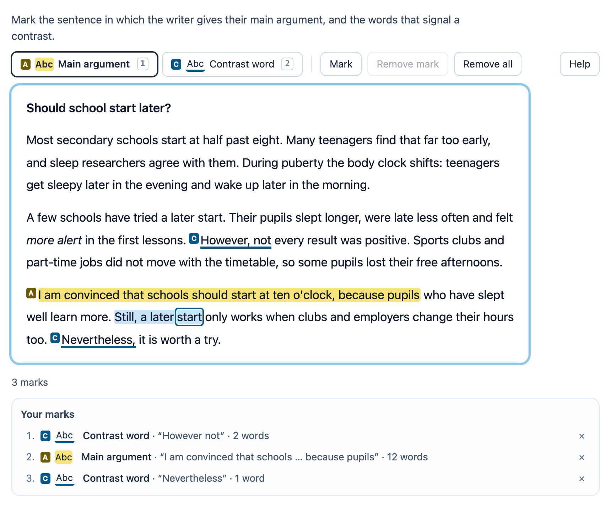

# @citolab/pci-text-marker

> [!WARNING]
> **Experimental (alpha). Just for inspiration.** This PCI is a technical showcase, made by software developers without
> much knowledge of the subject it could be used for. Its content, terms and scoring have not been checked by subject
> experts or assessment specialists, and it has never been used in an assessment. It is offered as is, without any
> warranty.

A QTI 3 Portable Custom Interaction (PCI) for reading skills in language subjects: the candidate marks text in a
source text ("mark the sentence in which the writer gives their main argument", "mark the words that signal a
contrast"). Unlike QTI's hottext, the candidate marks spans of their own choosing. The spans snap to whole words, or to
whole sentences. There can be several marker categories, each with a name, a label, a colour and a pattern. The PCI
scores every correct span of the author's key with a tolerance in words. The item author writes the text, the
categories, the key and the scoring rules in the PCI itself. Made with [tspci](https://github.com/Citolab/tspci).

<p align="center">
  
</p>

## What it does

- **The text**: paragraphs (separated by an empty line), line breaks, `**bold**` and `*italic*`. It is set as a
  reading text: a measure of about 68 characters, generous line height and the `lang` of the source text. The words
  are numbered through the whole text from 0. They are found with `Intl.Segmenter` (any script, right to left
  included), or with a Unicode regular expression without it. Both treat `well-known`, `l'école`, `don't` and `8.30`
  as one word, so the numbering is the same either way. Sentences come from `Intl.Segmenter` too, or else from `.`,
  `!`, `?` and `…`.
- **Direction**: `data-direction="auto"` takes it from the first strong letter (Hebrew, Arabic and the like give
  `rtl`). In right-to-left text the arrow keys follow the reading direction.
- **Categories**: up to 6. Each has a name, a short label shown in front of every mark, a colour and a pattern:
  highlight, underline, box, double line, stripes or dotted line. The colours are Okabe–Ito hues, so they are safe for
  colour blindness. With the pattern and the label, colour is never the only cue.
- **Marking with the mouse**: drag over the words, or double-click a word. Or click a word, Shift-click another and
  press Mark.
- **Touch**: tap the first word, tap the last word, then tap inside the selection (or press Mark).
- **Keyboard**: the text is one focusable `application` with a word cursor. Its accessible name is the prompt.
  - The arrow keys move from word to word; up and down go to the nearest word on the line above or below.
  - `Home`/`End` go to the start and end of the paragraph, `Ctrl` + `Home`/`End` to the start and end of the text.
  - `Shift` + arrow selects, `Enter` or `Space` marks, `Delete` removes the mark under the cursor.
  - `Escape` cancels a selection, `1`–`9` choose the marker.
  - A polite live region reads the word under the cursor ("“However”, word 70 of 131, marked as Contrast word"), and
    a status line reads every change. Screen readers also hear "start Main argument" and "end Main argument" around
    the marks.
- **Marks**: a new mark joins the marks of its own category that it overlaps. It cuts its words out of marks of other
  categories, so marks never overlap. Enter (or a double-click) on a marked word gives that mark the chosen category.
  The list below the text shows every mark with its category, words and length. It has a button to go to a mark and
  one to remove it.
- **Limits**: a maximum number of marks and a maximum length in words. A mark beyond a limit is refused, with a
  message that says why.
- **Authoring mode**: "Text, categories and key…" opens the PCI's own editor (`getAuthoringInstance`), with four tabs:
  - **Text**: Bold and Italic buttons. Pasting from a word processor or a web page keeps paragraphs, bold and italic.
    When the text changes, the key moves along with the words that stayed.
  - **Categories**: name, label, colour, pattern.
  - **Correct marks**: mark them as a candidate would.
  - **Scoring**: the rule, the tolerance, the minimum overlap and the points.

  `validate()` reports problems in the author's language: no words, no categories or no key; a key span past the end
  of the text or with a category that no longer exists; more key spans than the candidate may mark, or a span longer
  than the candidate may mark; and partial points above the full points.
- **Delivery**: the marks are saved as the item's state (every change in the log) and restored. In review
  (`status: "solution"`) the PCI shows the declared correct response, or else the author's key, read-only. Several
  interactions of this type on one page each get their own object. `prefers-reduced-motion` turns off the small
  transitions, and forced colours (Windows high contrast) get outlines.

## What can be configured

Every setting is a `data-` attribute of the interaction, as text. `dist/authoring.json` describes them for authoring
systems.

| setting                      | attribute              | default           | what                                                              |
| ---------------------------- | ---------------------- | ----------------- | ----------------------------------------------------------------- |
| Instruction above the text   | `data-prompt`          | the example's     | also the accessible name of the text                              |
| Source text                  | `data-text`            | empty: example    | the markup above; written by the authoring mode                   |
| Marker categories            | `data-categories`      | empty             | JSON from the authoring mode, or names (below); empty: one marker |
| Correct marks                | `data-key`             | empty             | the key, in the format of the response: `69-69:b 93-110:a`        |
| Scoring rules                | `data-scoring`         | empty: defaults   | JSON (below)                                                      |
| Marks snap to                | `data-snap`            | `word`            | `word` or `sentence`                                              |
| Maximum number of marks      | `data-max-marks`       | `0`               | 0: no limit                                                       |
| Maximum words per mark       | `data-max-length`      | `0`               | 0: no limit                                                       |
| Show the category label      | `data-show-labels`     | `true`            | the short label in front of every mark                            |
| Language of the source text  | `data-text-language`   | empty             | `de`, `fr`, `ar`…: the `lang` and the word splitting; empty: `data-language` |
| Direction of the text        | `data-direction`       | `auto`            | `auto`, `ltr` or `rtl`                                            |
| Maximum height of the text   | `data-height`          | `0`               | px; a longer text scrolls. 0: no limit                            |
| Language                     | `data-language`        | `en`              | `en` or `nl`: the texts of the PCI                                |

Without a text the PCI shows the example: an opinion text with the categories "Main argument" and "Contrast word"
and its key. With a text of your own and no categories there is one marker ("Marked" / "Gemarkeerd").

**Categories** as JSON, as the authoring mode writes them:

```json
[
  { "id": "a", "name": "Main argument", "short": "A", "color": "yellow", "pattern": "highlight" },
  { "id": "b", "name": "Contrast word", "short": "C", "color": "blue", "pattern": "underline" }
]
```

Or as names, one per line or separated by `;`, optionally with a pattern and a colour:
`Argument; Example | box | green`. Ids are `a`, `b`, `c`… in that order. Colours: `yellow`, `blue`, `orange`,
`purple`, `green`, `red`. Patterns: `highlight`, `underline`, `box`, `double`, `stripes`, `dotted`.

**Scoring** (`data-scoring`), every field optional:

```json
{ "tolerance": 1, "rule": "overlap", "minOverlap": 75, "points": 1, "partial": 0, "penalty": 0 }
```

## Scoring

The PCI is made for `custom` scoring (`authoring.json`: `"scoring": ["custom", "human"]`). It scores the marks against
the key, and the item's response processing copies the score. Every correct span of the key (a *target*, at most 10)
is scored on its own:

- **correct (2)**: the mark has the target's category and meets the rule:
  - `overlap`: it covers at least `minOverlap` % of the target's words and sticks out at most `tolerance` words on
    each side;
  - `all`: it covers all of the target's words and sticks out at most `tolerance` words on each side;
  - `exact`: its first and last words are at most `tolerance` words from the target's.
- **partly (2 → 1)**: the mark overlaps the target, but does not meet the rule or has another category. It earns
  `partial` points (never more than `points`).
- **missed (0)**: no mark overlaps it.

Every mark counts for one target at most. The best pairs are matched first: correct before partly, then the most
overlap, then the closest boundaries. A mark that counts for no target is *extra* and costs `penalty` points. So
"However, not" for "However" is correct with tolerance 1. A mark over two separate targets counts for one of them.

`score` = points of the correct targets + partial points − penalties, and never below 0. `maxscore` = targets ×
`points`. The response is a record (`cardinality="record"`):

| field                  | type      | what                                                                     |
| ---------------------- | --------- | ------------------------------------------------------------------------ |
| `score`                | `integer` | as above                                                                 |
| `maxscore`             | `integer` | the points of all targets                                                |
| `correct`              | `integer` | 1 when every target is correct and there are no extra marks, else 0      |
| `extra`                | `integer` | the marks that belong to no target                                       |
| `target1` … `target10` | `integer` | 2 correct, 1 partly, 0 missed, in the order of the key (by position)     |
| `marks`                | `string`  | the candidate's marks: `start-end:category`, word indexes from 0, sorted |

```json
{ "record": [
  { "name": "score", "base": { "integer": 2 } }, { "name": "maxscore", "base": { "integer": 4 } },
  { "name": "correct", "base": { "integer": 0 } }, { "name": "extra", "base": { "integer": 1 } },
  { "name": "target1", "base": { "integer": 2 } }, { "name": "target2", "base": { "integer": 1 } },
  { "name": "target3", "base": { "integer": 2 } }, { "name": "target4", "base": { "integer": 0 } },
  { "name": "marks", "base": { "string": "20-21:b 69-70:b 93-101:a 111-111:b" } }
] }
```

- **The PCI's score**: copy `score` to `SCORE`, as below.
- **Your own response processing**: test the target fields, for example "1 point when `target2` is 2, and 1 point
  when `target1`, `target3` and `target4` are all 2", or leave out the penalty by testing `extra`.
- `match_correct` is not offered: QTI's `match` cannot compare records, and a tolerance in words cannot be written
  as one correct response.
- `human`: for a human rater, `marks` has every mark.
- **No response**: without marks, `getResponse()` reports nothing.
- **Word numbering**: the indexes depend on the word splitting. `Intl.Segmenter` and the fallback give the same
  words for ordinary text in Latin, Greek, Cyrillic, Hebrew and Arabic scripts. Check the key in the authoring mode
  after you edit a text.

```xml
<qti-response-declaration identifier="RESPONSE" cardinality="record"/>
<qti-outcome-declaration identifier="SCORE" cardinality="single" base-type="float">
  <qti-default-value><qti-value>0</qti-value></qti-default-value>
</qti-outcome-declaration>
<qti-outcome-declaration identifier="MAXSCORE" cardinality="single" base-type="float">
  <qti-default-value><qti-value>4</qti-value></qti-default-value>
</qti-outcome-declaration>
…
<qti-response-processing>
  <qti-response-condition>
    <qti-response-if>
      <qti-not><qti-is-null>
        <qti-field-value field-identifier="score"><qti-variable identifier="RESPONSE"/></qti-field-value>
      </qti-is-null></qti-not>
      <qti-set-outcome-value identifier="SCORE">
        <qti-field-value field-identifier="score"><qti-variable identifier="RESPONSE"/></qti-field-value>
      </qti-set-outcome-value>
    </qti-response-if>
  </qti-response-condition>
</qti-response-processing>
```

**State and response.** `getState()` holds the marks (and the log). `setResponse` (and `boundTo` without a state)
reads the `marks` field, or the marks as a string; the other fields follow from them. Marks outside the text or with
an unknown category are left out. In `status: "solution"` the PCI shows the marks of the declared correct response (a
string, or a record value with the field `marks`); without one, the author's key.

## Using it

```sh
npm install @citolab/pci-text-marker
```

| file                                      | what                                                                      |
| ----------------------------------------- | ------------------------------------------------------------------------- |
| `dist/index.js`                           | the PCI (AMD module, everything bundled: the package has no dependencies) |
| `dist/authoring.json`                     | settings, response, scoring and the authoring mode, for authoring systems |
| `dist/sbom.cdx.json`                      | CycloneDX SBOM of the bundle                                              |
| `dist/tao-pci-textMarker_<version>.zip`   | the PCI for TAO: Settings → Portable Custom Interactions → Add            |
| `textMarker.svg`, `example.png`           | icon and screenshot                                                       |

In a QTI 3 item, with `index.js` at `resources/pci/index.js` of the package:

```xml
<qti-response-declaration identifier="RESPONSE" cardinality="record"/>
…
<qti-portable-custom-interaction response-identifier="RESPONSE" module="pci" custom-interaction-type-identifier="textMarker"
  data-language="nl" data-text-language="de" data-max-marks="4"
  data-text="Ich lese gern. **Aber** heute nicht…" data-categories="Signalwort" data-key="3-3:a">
  <qti-interaction-modules>
    <qti-interaction-module id="pci" primary-path="../resources/pci/index"></qti-interaction-module>
  </qti-interaction-modules>
  <qti-interaction-markup></qti-interaction-markup>
</qti-portable-custom-interaction>
```

Development: `npm test` runs the logic (`src/marker.ts`) in node. The stories (`src/textMarker.stories.ts`) run with
the repository's Storybook and Vitest.

Source and the other examples: [Citolab/tspci-examples](https://github.com/Citolab/tspci-examples).
