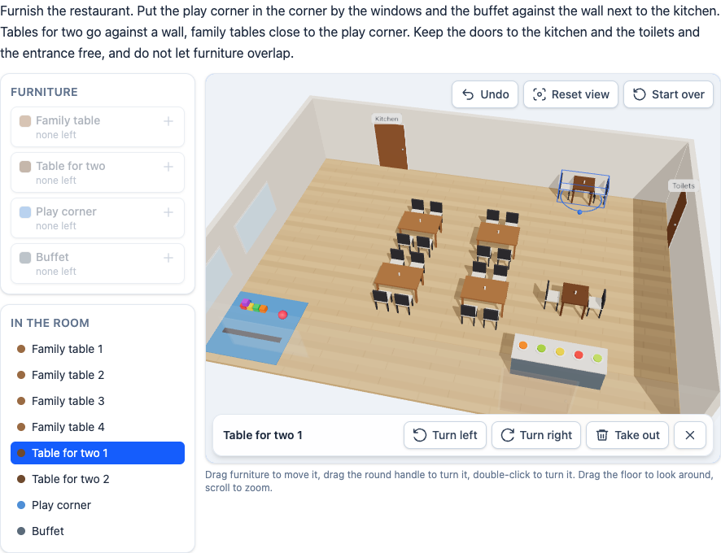

# @citolab/pci-the-room

A QTI 3 Portable Custom Interaction (PCI) in which the candidate furnishes a room in 3D: "put the play corner in the
corner by the windows, keep the doors free, …". The candidate places, moves and turns furniture; the exercise's scoring
rules score the layout. A port of **The Room 3D** of [openPCI](https://github.com/openPCI/openPCIs/tree/master/theroom),
made with [tspci](https://github.com/Citolab/tspci).

<p align="center">
  
</p>

## Source and licence

- **Original**: [The Room 3D](https://github.com/openPCI/openPCIs/tree/master/theroom) in
  [openPCI/openPCIs](https://github.com/openPCI/openPCIs), by Elias J.T. Hansen, Anna Rusmann and Jeppe Bundsgaard,
  openPCI project of Aarhus University and Aalborg University.
- **Licence**: GNU General Public License version 3 (`GPL-3.0-only`), as the original: its repository carries the GPL
  version 3 text as `LICENSE` and does not say "or any later version". This port is a derivative work and has the same
  licence ([LICENSE](LICENSE)), not the MIT licence of the other examples in this repository. Every source file says so
  in its header.
- **What changed** (Stichting Cito Instituut voor Toetsontwikkeling, 2026):
  - from TAO's older PCI format (an AMD module with a jQuery iframe around a separately hosted game folder) to the
    IMS PCI v1.0 API with tspci: one bundle, no iframe, state save and restore;
  - built-in exercises drawn from shapes, so the PCI needs nothing outside its bundle; the original's glTF exercises
    still load from a game folder (`data-gameurl`);
  - a new interface: Preact and Tailwind, orbit/pan/zoom camera, selection ring with a turn handle, walls that fade
    when they are in the way, snapping to a grid, undo, reset view, start over, a list of furniture, keyboard control,
    screen reader announcements, English and Dutch texts;
  - **JavaScript scoring replaced by declarative rules**, for safety and CSP compatibility: the original ran the
    author's `scoringFunction` with `eval`; this port runs no author code (no `eval` or `new Function`). The checks of
    the original's Scoring API are TypeScript, and an exercise lists rules that use them (below);
  - three.js 0.180 (ES modules) instead of the bundled three.js of 2019.

## What it does

- **Furnish**: the furniture list shows what can still be added ("2 left"); a new piece lands in a free spot in the
  middle of the view. As in the original, an exercise usually starts with all its furniture in the room, to be
  rearranged.
- **Move and turn**: drag a piece over the floor; drag the round handle on its selection ring to turn it, or
  double-click it (the original's gesture), or use *Turn left* / *Turn right*. It turns in steps of 90° (setting) and
  moves on a 25 cm grid (setting). Pieces with a snap side snap against a wall within 40 cm, pieces with object-snap sides snap to each other,
  as in the original. A piece always stays inside the room. A piece that overlaps another gets a red ring.
- **Look around**: drag the floor to orbit, right-drag to pan, scroll or pinch to zoom; walls between the camera and
  the room fade. *Reset view* goes back to the start view.
- **Undo** the last changes, **start over** from the exercise's layout, or **take out** a piece (back to the list).
- **Keyboard and screen readers**: the room is one focusable element. With a piece selected (in the list, with N, or by
  clicking), the arrow keys move it (Shift: 5 cm), R / Shift+R turn it, Delete takes it out, Escape deselects; without a
  selection the arrow keys orbit and tilt the view, + and − zoom, 0 resets it; Ctrl/Cmd+Z undoes. Every change is
  announced ("Table for two 1 moved, against the wall").
- **Delivery**: the layout is saved as the item's state (with the undo history) and restored; `setResponse` and the
  correct response in review (`status: "solution"`) lay the room out from a response.

## What can be configured

Every setting is a `data-` attribute of the interaction, as text. `dist/authoring.json` describes them for authoring
systems.

| setting                    | attribute                | default        | what                                                                       |
| -------------------------- | ------------------------ | -------------- | -------------------------------------------------------------------------- |
| Instruction above the room | `data-prompt`            | empty          | empty: the exercise's own instruction (the restaurant has one)             |
| Exercise                   | `data-exercise`          | `restaurant`   | a built-in exercise, a file of the original (with `data-gameurl`), or JSON |
| Game URL                   | `data-gameurl`           | empty          | the original's game folder, with `exercises/` in it (glTF exercises)       |
| Scoring rules              | `data-scoring-rules`     | empty          | a JSON list of rules (below); empty: the exercise's own                    |
| Turn in steps of           | `data-rotation-step`     | `90`           | `90` (the original), `45` or `15` degrees                                  |
| Snap to a grid of          | `data-grid-size`         | `0.25`         | metres: `0` (no grid, the original), `0.1`, `0.25`, `0.5`                  |
| Show the scoring zones     | `data-show-zones`        | `false`        | shows the zones with their names, to check an exercise                     |
| Height of the room         | `data-height`            | `480`          | pixels; the width follows the item                                         |
| Language                   | `data-language`          | `en`           | `en` or `nl`: the texts of the PCI                                         |

### An exercise of your own

`data-exercise` can hold an exercise as JSON. The room is drawn from simple shapes (`box`, `table`, `chair`, `sofa`,
`shelf`, `counter`, `rug`, `playcorner`, `plant`, `person`, `showcase`, `bed`); measures are metres, x runs west to
east, z north to south, and a piece's front faces +z. The built-in restaurant, shortened:

```json
{
  "id": "restaurant",
  "prompt": { "en": "Furnish the restaurant. …", "nl": "Richt het restaurant in. …" },
  "room": {
    "width": 14, "depth": 10, "height": 2.8,
    "fixtures": [
      { "kind": "door", "wall": "north", "at": -4, "width": 1.2, "label": { "en": "Kitchen", "nl": "Keuken" } },
      { "kind": "window", "wall": "west", "at": 0.5, "width": 2.2 }
    ],
    "zones": [{ "name": "playarea_zone", "x": -5.5, "z": 3.5, "width": 3, "depth": 3 }]
  },
  "assets": [
    { "id": "tablefortwo", "label": { "en": "Table for two", "nl": "Tafel voor twee" }, "shape": "table", "seats": 2,
      "width": 0.8, "depth": 0.8, "height": 0.75, "count": 2, "wallSnap": true }
  ],
  "objects": [{ "id": "tablefortwo", "pos": [3.8, 0, -1.2], "rot": [0, 0, 0, "XYZ"] }],
  "rules": [{ "name": "tables_for_two_at_wall", "object": "tablefortwo", "nearWall": true, "value": "count" }]
}
```

- `count`: how many of an asset can be in the room, including those there at the start. `"static": true` on an object
  fixes it in place (the original's guards in the museum).
- `wallSnap`: the back snaps against a wall (the original's `snap` plane); `objectSnap: ["left", "right"]`: those sides
  snap to the same sides of other pieces (`obj_snap`); `zones: [{ "name": "front", "side": "front", "depth": 1 }]`: an
  object zone for the `zoneClear` rule.
- Fixtures: `door` and `window` on a wall (`at`: metres from its middle), `block`: a fixed box on the floor.

### The original's glTF exercises

With `data-gameurl` set to a folder that holds the original's `exercises/` (with CORS for the item's origin),
`data-exercise="museum.json"` loads that exercise as the original did: the glTF scene with its `boundingbox`, `zone`,
`glass` and `snap` / `obj_snap` names, the glTF assets and their counts, the objects. The furniture of a glTF scene keeps
its centre inside the bounding box, as in the original. **The file's JavaScript `scoringFunction` is ignored** (no
author code runs); give the file a `rules` list, or set `data-scoring-rules` on the interaction.

## Scoring

The PCI is made for `custom` scoring (`authoring.json`: `"scoring": ["custom", "human"]`): like the original, it scores
the layout itself with scoring rules and puts the result in the response.

**The response** is a string (`cardinality="single" base-type="string"`) with the JSON of the original:

```json
{
  "exercise": "restaurant",
  "scene": null,
  "objects": [{ "id": "tablefortwo", "pos": [3.8, 0, -4.6], "rot": [0, 0, 0, "XYZ"] }, …],
  "score": { "playcorner_in_corner": 1, "no_collisions": 1, "tables_for_two_at_wall": 1, … }
}
```

`scene` is the glTF scene of a glTF exercise (null for a built-in one); every piece in the room is listed, also fixed
ones. **No response**: until the candidate changes something, `getResponse()` reports nothing.

**The scoring rules** are a JSON list, in the exercise (`rules`) or in `data-scoring-rules`. Each rule has a `name`
(its key in `score`), an `object` (a regular expression on the asset id, default every piece) and one check. A check
counts pieces and compares that number with `count` (`">=3"`, `"==0"`, `"<2"`, `"3"` or `"all"`); the rule scores 1 or
0, or the number itself with `"value": "count"`.

| check                                | counts / is 1 when                                                       | default `count` | original Scoring API     |
| ------------------------------------ | ------------------------------------------------------------------------ | --------------- | ------------------------ |
| (none, only `count`)                 | pieces of the type                                                       | `">=1"`         | `find`                   |
| `"inZone": "playarea"`               | pieces in the zone; `"count": "==0"` keeps a zone free                   | `">=1"`         | `areaTest`               |
| `"nearWall": true`                   | pieces against a wall                                                    | `"all"`         | `wallSnapTest`           |
| `"snapped": true`                    | pieces against a wall or snapped to another piece                        | `"all"`         | `wallSnapTest`, `objectSnapTest` |
| `"noOverlap": true`                  | 1 when no two pieces overlap                                             |                 | `collisionTest`          |
| `"connected": true`                  | 1 when no object-snap side is left open (a closed track)                 |                 | `noSnap`                 |
| `"closerTo": "target", "than": "B"`  | 1 when the closest piece is at least as close to the target as any B     |                 | `ACloserThanB`, `closerThanOthers` |
| `"zoneClear": "front"`               | pieces with something (`others`, or the room) in their object zone       | `"==0"`         | `objZoneTest`            |

The built-in restaurant is scored with the checks of the original `restaurant.json`:

```json
[
  { "name": "playcorner_in_corner", "object": "playcorner", "inZone": "playarea" },
  { "name": "no_collisions", "noOverlap": true },
  { "name": "tables_for_two_at_wall", "object": "tablefortwo", "nearWall": true, "value": "count" },
  { "name": "family_tables_near_playcorner", "object": "^table$", "closerTo": "playcorner", "than": "tablefortwo" },
  { "name": "buffet_in_zone", "object": "buffet", "inZone": "buffetzone", "value": "count" },
  { "name": "toilet_free", "object": "table", "inZone": "toilet", "count": "==0" },
  { "name": "kitchen_free", "object": "table", "inZone": "doortable", "count": "==0" },
  { "name": "entrance_free", "object": "table", "inZone": "entrance", "count": "==0" }
]
```

And the original museum, for `data-exercise="museum.json"` (shortened):

```json
[
  { "name": "vagter_fri", "object": "montre", "inZone": "guard", "count": "==0" },
  { "name": "svaerd_naer_oekser", "object": "svaerd", "closerTo": "oekse", "than": "montre" },
  { "name": "svaerd_snappet", "object": "svaerd", "snapped": true },
  { "name": "montrer_fri_front", "object": "montre", "zoneClear": "front", "others": "montre" }
]
```

A rule that cannot be checked (a zone the room does not have) scores `null`; without rules the response has no
`score`. Not carried over from the original API: `zoneRotationCheck`, `closestDistance` and `lineOfSight` (none of the
original exercises used them).

One difference with the original: the box of a piece leaves out its snap planes and object zones. The partial scores
are in the response; standard QTI response processing cannot read JSON, so a delivery system with custom response
processing, or a separate step (openPCI has a [rescore](https://github.com/openPCI/openPCIs/tree/master/rescore) tool),
turns them into an outcome. `human`: use the PCI without automatic scoring, for instance for a human rater.

## Using it

```sh
npm install @citolab/pci-the-room
```

| file                                    | what                                                                      |
| --------------------------------------- | ------------------------------------------------------------------------- |
| `dist/index.js`                         | the PCI (AMD module, everything bundled: the package has no dependencies) |
| `dist/authoring.json`                   | settings, response and scoring, for authoring systems                     |
| `dist/sbom.cdx.json`                    | CycloneDX SBOM of the bundle                                              |
| `dist/tao-pci-theroom_<version>.zip`    | the PCI for TAO: Settings → Portable Custom Interactions → Add            |
| `theroom.svg`, `example.png`            | icon and screenshot                                                       |
| `LICENSE`                               | GPL version 3                                                             |

In a QTI 3 item, with `index.js` at `resources/pci/index.js` of the package:

```xml
<qti-response-declaration identifier="RESPONSE" cardinality="single" base-type="string"/>
…
<qti-portable-custom-interaction response-identifier="RESPONSE" module="pci" custom-interaction-type-identifier="theroom"
  data-exercise="restaurant" data-rotation-step="90" data-grid-size="0.25">
  <qti-interaction-modules>
    <qti-interaction-module id="pci" primary-path="../resources/pci/index"></qti-interaction-module>
  </qti-interaction-modules>
  <qti-interaction-markup></qti-interaction-markup>
</qti-portable-custom-interaction>
```

Source and the other examples: [Citolab/tspci-examples](https://github.com/Citolab/tspci-examples).
