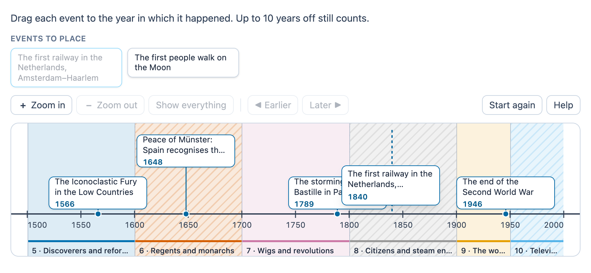

# @citolab/pci-timeline

> [!WARNING]
> **Experimental (alpha). Just for inspiration.** This PCI is a technical showcase, made by software developers without
> much knowledge of the subject it could be used for. Its content, terms and scoring have not been checked by subject
> experts or assessment specialists, and it has never been used in an assessment. It is offered as is, without any
> warranty.

A QTI 3 Portable Custom Interaction (PCI) for history and social studies: the candidate places event cards on a
timeline (a *tijdbalk*). They place each one **at its date** (scored with a margin in years), **in a period** (the ten
Dutch *tijdvakken* or the author's own), or **in order**, where only the order counts. The axis counts years BC and AD
with no year 0, in years, decades or centuries, and it zooms and pans for long ranges. The item author sets up the
axis, the periods, the events and their answers in the PCI itself. Made with [tspci](https://github.com/Citolab/tspci).

<p align="center">
  
</p>

## What it does

- **The axis**: from `start` to `end` in historical years (`-44` is 44 BC). There is no year 0: 1 BC is followed by
  AD 1, and they are one year apart. Ticks are labelled `1648`, or, when the axis has years BC, `44 v.Chr.` /
  `800 n.Chr.` (`44 BC` / `AD 800`). The unit is **years** (snapping to `snap` years), **decades** (`jaren 1640`,
  `the 1640s`) or **centuries** (`17e eeuw`, `5th century BC`).
- **Periods** as coloured bands behind the axis: the ten Dutch tijdvakken as a preset (`"periods": "tijdvakken"`, ids
  `t1` … `t10`, in the candidate's language: *jagers en boeren* until 3000 BC, *Grieken en Romeinen* until AD 500,
  then *monniken en ridders*, *steden en staten*, *ontdekkers en hervormers* (1500), *regenten en vorsten* (1600),
  *pruiken en revoluties* (1700), *burgers en stoommachines* (1800), *de wereldoorlogen* (1900) and *televisie en
  computer* (from 1950)), or the author's own list. A boundary year belongs to the later period. The bands use the
  Okabe–Ito colours, every other band is hatched, and each band carries its number and name, so colour never carries
  the information alone.
- **Placing**: drag a card from the list onto the timeline, or click a card and then the timeline. Drag a placed card
  to move it, or off the timeline to put it back (or use its × button). While dragging, a dashed guide shows where the
  card lands and the card shows the year (or the period).
- **Modes**: `date`: the card stays at its year (snapped to the unit); `period`: it drops into the band under it;
  `order`: no year labels, only "earlier" and "later"; the arrow keys move a card past its neighbour.
- **Keyboard**: Enter or Space on a card puts it in the middle of the view (in order mode after the last card) and
  focuses it. A placed card is a `slider`: the arrow keys move it by one step (a year or `snap` years, a decade, a
  century, a period), Page Up / Page Down ten steps, Home / End to the ends, Delete or Backspace puts it back. + and −
  zoom when the focus is on the timeline. A screen reader hears the event and its value ("Peace of Münster: 1648",
  "Greeks and Romans", "place 2 of 4"), and every change in a live status line.
- **Zoom and pan**: buttons (zoom in, zoom out, show everything, earlier, later), Ctrl/⌘ + scroll or a trackpad pinch to zoom
  around the pointer, sideways scroll or dragging the background to pan. A card moved out of view by keyboard pulls
  the view along; a card outside the view sits at the edge with an arrow.
- **Pictures**: an event can have a picture (`image`, with `alt`) next to its text.
- **Motion**: the cards glide into place only without `prefers-reduced-motion`.
- **Logic** (`src/timeline.ts`, no imports, tested in node with `npm test`): years and the missing year 0, snapping,
  periods, parsing the settings, the evaluation, the response fields, the response processing and the author's
  problems.
- **Authoring mode** (`getAuthoringInstance`, "Make the timeline…" in an authoring system that supports it): four
  tabs, **Events** (text, year, period, picture; reorder, add up to 12), **Axis** (from, to, unit, step), **Periods**
  (none, the tijdvakken, or own periods, starting from the tijdvakken when you switch) and **Answer and scoring** (the
  mode, the margin, the scoring, the maximum score). Below them: what still has to be fixed, the answer on the timeline,
  and the response processing for the item. Years can be typed as `-44`, `44 v.Chr.` or `44 BC`. `validate()` reports
  the problems in the author's language.
- **Delivery**: the placements are saved as the item's state (every step in the log) and restored. In review
  (`status: "solution"`) the PCI shows the correct response from the declaration, or else the author's answers,
  read-only. Several interactions of this type on one page each get their own object.

## What can be configured

Every setting is a `data-` attribute of the interaction, as text. `dist/authoring.json` describes them for authoring
systems.

| setting                        | attribute         | default                | what                                                          |
| ------------------------------ | ----------------- | ---------------------- | ------------------------------------------------------------- |
| Instruction above the timeline | `data-prompt`     | the example's question | also part of the timeline's accessible name                   |
| Timeline                       | `data-timeline`   | empty: the example     | written by the authoring mode, as JSON (below)                |
| Show the year on a placed card | `data-show-value` | `true`                 | date mode; `false` makes the candidate read the axis          |
| Least height of the timeline   | `data-height`     | `0`                    | in px; 0: as high as the cards need                           |
| Language                       | `data-language`   | `en`                   | `en` or `nl`: the texts, the year format and the tijdvakken   |

```json
{
  "start": -3000, "end": 2000, "unit": "year", "snap": 1,
  "mode": "date", "margin": 25, "scoring": "each",
  "periods": "tijdvakken",
  "events": [
    { "id": "e1", "text": "Julius Caesar is murdered", "year": -44 },
    { "id": "e2", "text": "Charlemagne is crowned emperor", "year": 800, "image": "charlemagne.jpg", "alt": "A coin with Charlemagne" },
    { "id": "e3", "text": "The Dutch Revolt", "period": "t5" }
  ]
}
```

- **`start`, `end`**: historical years (negative is BC; `"44 v.Chr."` also works).
- **`unit`**: `year`, `decade` or `century`; **`snap`**: the step in years for `year`. With centuries the response is
  the first year of the century: 1600 for the 17th century (1600–1699), -500 for the 5th century BC (500–401 BC); with
  decades the year that names it (1640, -40).
- **`mode`**: `date`, `period` or `order`. **`margin`** (date mode): how many years off still counts.
  **`scoring`**: `each` (a point per event, per pair in order mode) or `all` (1 point when everything is right).
- **`periods`**: `"tijdvakken"`, or a list of `{ "id", "label", "start", "end" }` (end is where the next begins). A
  period mode without periods gets the tijdvakken.
- **`events`**: at most 12. `year` is the answer in date and order mode; in period mode `period`, or else the period
  the year lies in. Ids are made (`e1`, …) when missing.

## Scoring

The PCI is made for `custom` scoring (`authoring.json`: `"scoring": ["custom", "human"]`): it scores the placements
against `data-timeline` itself, and the year fields can also be scored by the item's response processing with a margin.
The response is a record (`cardinality="record"`); field numbers follow the order of the events.

| field                 | type         | what                                                                             |
| --------------------- | ------------ | -------------------------------------------------------------------------------- |
| `score`               | `integer`    | the events that are right; in order mode the pairs in the right order; `all`: 0 or 1 |
| `maxscore`            | `integer`    | the events; in order mode the pairs (pairs with the same year don't count); `all`: 1 |
| `correct`             | `integer`    | 1 when every event is right                                                      |
| `check1` … `check12`  | `integer`    | per event 1 or 0: within the margin, in the right period, or (order) all its pairs right |
| `year1` … `year12`    | `float`      | date mode: the year where the event is (BC negative, no 0); only the placed ones |
| `period1` … `period12`| `identifier` | the period the event is in (period mode, or the period of its year in date mode) |
| `order`               | `string`     | date and order mode: the placed ids from early to late, `e3 e1 e2`               |
| `pairs`               | `integer`    | order mode: the pairs in the right order (Kendall)                               |
| `placements`          | `string`     | every placed event with its year or period, JSON: `{"e1":-44,"e3":"t5"}`         |

```json
{ "record": [
  { "name": "score", "base": { "integer": 2 } }, { "name": "maxscore", "base": { "integer": 6 } },
  { "name": "correct", "base": { "integer": 0 } },
  { "name": "check1", "base": { "integer": 1 } }, { "name": "check2", "base": { "integer": 0 } }, …,
  { "name": "year1", "base": { "float": 1570 } }, { "name": "year2", "base": { "float": 1700 } },
  { "name": "period1", "base": { "identifier": "t5" } }, { "name": "period2", "base": { "identifier": "t7" } },
  { "name": "order", "base": { "string": "e1 e2" } },
  { "name": "placements", "base": { "string": "{\"e1\":1570,\"e2\":1700}" } }
] }
```

- **The PCI's score**: copy `score` (and `maxscore`) to the outcomes, as below. This works in every mode.
- **Your own response processing, date mode**: a `qti-equal` with `tolerance-mode="absolute"` on each `yearN` field;
  the authoring mode writes it for you (Answer and scoring, "Response processing for the item"). A margin that reaches
  over the start of the era gets two tolerances (`tolerance="10 11"` around 5 BC), because the response has no year 0.
- **Period mode**: a `qti-match` of each `periodN` field with the period's identifier (also written by the authoring
  mode).
- **Order mode**: use `score` (pairs) or `correct`; QTI has no operator for counting pairs.
- `match_correct` is not offered: QTI's `match` cannot compare records. `human`: a human rater reads `placements`.
- **No response**: until a card is on the timeline, `getResponse()` reports nothing.

```xml
<qti-response-declaration identifier="RESPONSE" cardinality="record"/>
<qti-outcome-declaration identifier="SCORE" cardinality="single" base-type="float">
  <qti-default-value><qti-value>0</qti-value></qti-default-value>
</qti-outcome-declaration>
<qti-outcome-declaration identifier="MAXSCORE" cardinality="single" base-type="float">
  <qti-default-value><qti-value>6</qti-value></qti-default-value>
</qti-outcome-declaration>
…
<qti-response-processing>
  <!-- the PCI's own score -->
  <qti-response-condition>
    <qti-response-if>
      <qti-not><qti-is-null>
        <qti-field-value field-identifier="score"><qti-variable identifier="RESPONSE"/></qti-field-value>
      </qti-is-null></qti-not>
      <qti-set-outcome-value identifier="SCORE">
        <qti-field-value field-identifier="score"><qti-variable identifier="RESPONSE"/></qti-field-value>
      </qti-set-outcome-value>
    </qti-response-if>
  </qti-response-condition>
  <!-- or per event, with the margin in the item (event 2: 1648 ± 10) -->
  <qti-response-condition>
    <qti-response-if>
      <qti-equal tolerance-mode="absolute" tolerance="10">
        <qti-field-value field-identifier="year2"><qti-variable identifier="RESPONSE"/></qti-field-value>
        <qti-base-value base-type="float">1648</qti-base-value>
      </qti-equal>
      <qti-set-outcome-value identifier="SCORE">
        <qti-sum><qti-variable identifier="SCORE"/><qti-base-value base-type="float">1</qti-base-value></qti-sum>
      </qti-set-outcome-value>
    </qti-response-if>
  </qti-response-condition>
</qti-response-processing>
```

**State and response.** `getState()` holds the placements (and the log), so the timeline can be restored.
`setResponse` (and `boundTo` without a state) reads the `placements` field, or else the `yearN` / `periodN` fields, or
the placements as a JSON string. `getCorrectResponse(properties)` gives the response for the author's answers
(`"correctResponse": "properties"`); in `status: "solution"` the PCI shows the declared correct response, or else those
answers.

## Using it

```sh
npm install @citolab/pci-timeline
```

| file                                    | what                                                                      |
| --------------------------------------- | ------------------------------------------------------------------------- |
| `dist/index.js`                         | the PCI (AMD module, everything bundled: the package has no dependencies) |
| `dist/authoring.json`                   | settings, response, scoring and the authoring mode, for authoring systems |
| `dist/sbom.cdx.json`                    | CycloneDX SBOM of the bundle                                              |
| `dist/tao-pci-timeline_<version>.zip`   | the PCI for TAO: Settings → Portable Custom Interactions → Add            |
| `timeline.svg`, `example.png`           | icon and screenshot                                                       |

In a QTI 3 item, with `index.js` at `resources/pci/index.js` of the package:

```xml
<qti-response-declaration identifier="RESPONSE" cardinality="record"/>
…
<qti-portable-custom-interaction response-identifier="RESPONSE" module="pci" custom-interaction-type-identifier="timeline"
  data-language="nl" data-prompt="Zet elke gebeurtenis in het goede tijdvak."
  data-timeline="{&quot;start&quot;:-3000,&quot;end&quot;:2000,&quot;mode&quot;:&quot;period&quot;,&quot;periods&quot;:&quot;tijdvakken&quot;,…}">
  <qti-interaction-modules>
    <qti-interaction-module id="pci" primary-path="../resources/pci/index"></qti-interaction-module>
  </qti-interaction-modules>
  <qti-interaction-markup></qti-interaction-markup>
</qti-portable-custom-interaction>
```

Source and the other examples: [Citolab/tspci-examples](https://github.com/Citolab/tspci-examples).
