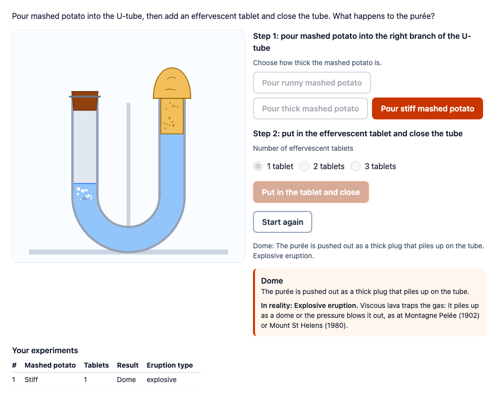

# tspci-volcano-model

A classroom volcano model: a U-tube with water, mashed potato poured into the right branch, an effervescent tablet
dropped into the left branch and a stopper on top. The gas pushes the water down on the left, so the purée rises on the
right: runny purée overflows and runs down the tube (a lava flow, the model of an effusive eruption), stiff purée is
pushed out as a plug (a dome) or, with more gas, blobs are thrown out (an explosion). The candidate runs experiments
and can be asked to link each outcome to a thickness or to an eruption type. A port of the DEPP PCI *Volcanisme*
("Densité et pression").

<p align="center">
  
</p>

## Source and licence

This PCI is a derivative work of
[`Volcanismepci`](https://github.com/janfix/extension-wiquid-depp/tree/master/views/js/pciCreator/ims/Volcanismepci)
in [janfix/extension-wiquid-depp](https://github.com/janfix/extension-wiquid-depp), © DEPP (Ministère de l'Éducation
nationale) / Jean-Philippe Rivière (Wiquid). That extension is licensed under the GNU General Public License version 2
only (`GPL-2.0-only`, as stated in its `composer.json` and in the headers of its files), so this PCI is too: see
[LICENSE](LICENSE). This differs from the MIT licence of the other examples in this repository.

What changed, by Stichting Cito Instituut voor Toetsontwikkeling (2026):

- Rewritten from jQuery and Raphael to an IMS PCI v1.0 module built with tspci (TypeScript, Preact, Tailwind, shadow
  DOM). The drawing is new inline SVG; none of the original's images are used, and there is no text in the picture.
- The steps are real buttons, the number of tablets is a group of radio buttons, and an `aria-live` status narrates
  what happens in the tube. The picture has a text alternative that follows the experiment.
- The animation is smooth; with `prefers-reduced-motion` (or the setting `animation: steps`) the eruption goes stage by
  stage with a "Next step" button: the tablet and the stopper, the gas, the purée rising, the outcome.
- Richer, but still a model: two or three thicknesses, one to three tablets, and an outcome per combination from a rule
  table the author edits. After an experiment the PCI can show which real eruption type it models.
- An optional matching task, scored by the PCI against the author's key.
- English, Dutch and French (the original was French only); the settings are described in `src/config.json`.
- A structured response (a `record`), the full state and an event log saved with `getState` and restored, review
  status, `qti-interaction-changed` events. The original saved click counters as a JSON string and did not restore.

## What the candidate does

1. **Step 1**: pour runny, thick or stiff mashed potato (one button each). The jar pours it into the right branch.
2. **Step 2**: choose 1, 2 or 3 tablets (when the author allows more than one) and press "Put in the tablet and close".
   The experiment is recorded straight away; the animation shows the tablet, the stopper, the bubbles, the rising
   purée and the outcome. The outcome appears in a panel, with the eruption type it models and real examples
   (Kīlauea, Piton de la Fournaise; Montagne Pelée, Mount St Helens) when `showEruptionType` is on.
3. **Start again** empties the tube (water only). Every experiment stays in the table "Your experiments".
4. With a task: for each outcome the candidate can get, choose a thickness or an eruption type from a list.

In review (any status other than `interacting`) everything is shown and nothing can be changed.

## What can be configured

| setting | editor | default | meaning |
| --- | --- | --- | --- |
| `prompt` | textarea | an instruction | text above the simulation (HTML) |
| `viscosityLevels` | enum | `3` | `2`: runny and stiff, as in the original; `3`: runny, thick, stiff |
| `maxTablets` | integer | `3` | 1 to 3; `1`: always one tablet, no choice (as in the original) |
| `rules` | textarea | see below | the rule table: which outcome each combination gives |
| `showEruptionType` | boolean | `true` | after an experiment, show the eruption type it models |
| `eruptionTypes` | text | `flow = effusive; dome = explosive; explosion = explosive` | the eruption type per outcome |
| `task` | enum | `none` | `none`, `viscosity` (link each outcome to a thickness), `eruption` (to an eruption type) |
| `key` | textarea | empty | the key of the task; empty: derived from `rules` and `eruptionTypes` |
| `animation` | enum | `auto` | `auto`: smooth, step by step with reduced motion; `steps`: always step by step |
| `language` | enum | `en` | `en`, `nl` or `fr` |

### The rule table

One rule per entry, separated by `;` or a new line: `thickness [tablets] = outcome`, with the thicknesses `fluid`,
`medium`, `compact`, the outcomes `flow`, `dome`, `explosion`, and tablets as `2` (exactly two) or `2+` (two or more).
The most specific matching rule wins: an exact number before `n+` (a higher `n` first), before a rule without a number.
Without a matching rule, runny purée flows and the others make a dome. The default:

```
fluid = flow; medium = flow; medium 3+ = explosion; compact = dome; compact 2+ = explosion
```

| | 1 tablet | 2 tablets | 3 tablets |
| --- | --- | --- | --- |
| runny (`fluid`) | flow | flow | flow |
| thick (`medium`) | flow | flow | explosion |
| stiff (`compact`) | dome | explosion | explosion |

With `viscosityLevels: 2` and `maxTablets: 1` the default gives the original: runny flows, stiff makes a dome.

### The task and its key

The task lists the outcomes the candidate can get with the settings. The key is `outcome = answer`, separated by `;`,
with `|` between accepted answers: `flow = fluid; dome = compact; explosion = medium | compact`, or
`flow = effusive; dome = explosive | effusive`. Answers are thicknesses (`fluid`, `medium`, `compact`) for
`task: viscosity`, eruption types (`effusive`, `explosive`) for `task: eruption`. An outcome without an entry gets the
derived key: every thickness that gives it with some number of tablets, or its type from `eruptionTypes`.

## Response

A `record` (declared in `package.json`, `config.tspci.response`):

| field | base type | value |
| --- | --- | --- |
| `experiments` | string | JSON list of `{ viscosity, tablets, outcome, eruption }`, oldest first (at most 200) |
| `count` | integer | the number of experiments run |
| `outcomes` | string | the outcomes seen, `;`-separated: `flow;dome` |
| `resets` | integer | how often the candidate pressed "Start again" |
| `answers` | string | with a task: `flow=fluid;dome=compact` |
| `score` | integer | with a task: the outcomes matched as in the key |
| `maxscore` | integer | with a task: the number of outcomes in the task |
| `correct` | integer | with a task: 1 when every outcome is matched as in the key |

There is no response until the candidate ran an experiment or answered. Scoring is `custom` (use `score`, `maxscore`
or `correct` in the response processing; the PCI computes them) or `human` (a rater looks at the experiments, for
instance whether the candidate varied one factor at a time).

**Relation to the original.** The original logged four click counters as a JSON string:
`{"exp_pfluide": n, "exp_pcompacte": n, "animCachet": n, "retourInit": n}` (pours of runny and of compact purée,
tablet clicks, resets). Here `experiments` lists each completed run with its choices and outcome, so
`exp_pfluide`/`exp_pcompacte` correspond to the number of entries with `viscosity` `fluid`/`compact` (a pour without
a tablet is only in the event log), `animCachet` to `count`, and `retourInit` to `resets`. Every click, including
pours and tablet choices, is in the event log of `getState()`.

## State

`getState()` returns `{ state, log }`: the tube (phase, purée, tablets), the experiments, the answers and the resets,
and every action of the candidate. A restored state shows the tube as the candidate left it (an eruption at its end).
`setResponse` restores the experiments and answers from a record.

## Development

```sh
npm i
npm test               # the model (src/model.ts) in node
npm run test:stories   # the stories, headless in Chromium
npm run prod           # dist/index.js
```
