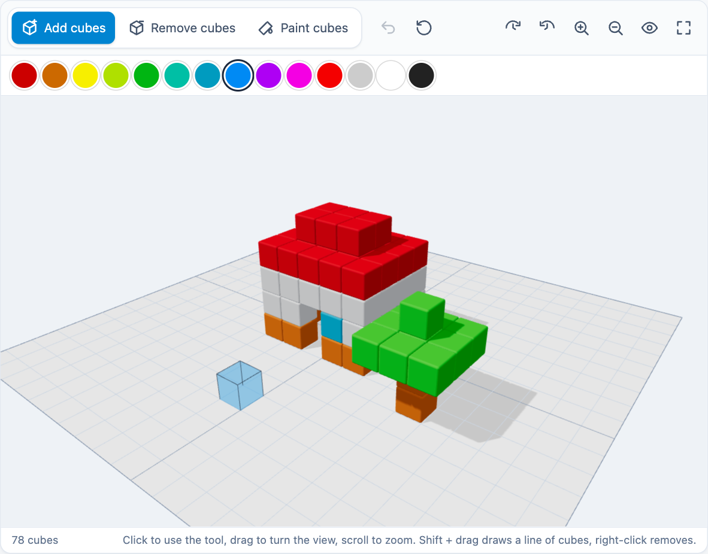

# @citolab/pci-voxelcraft

A QTI 3 Portable Custom Interaction (PCI) in which the candidate builds anything out of cubes in 3D: place, remove and
paint cubes on a 20 × 20 grid, and turn the view to look at the building from every side. The item author can give a
starting figure and a target shape the building is scored on. A port of openPCI's
[Voxelcraft](https://github.com/openPCI/openPCIs/tree/master/voxelcraft), made with
[tspci](https://github.com/Citolab/tspci).

<p align="center">
  
</p>

## Source and licence

- **Original**: [Voxelcraft](https://github.com/openPCI/openPCIs/tree/master/voxelcraft) in
  [openPCI/openPCIs](https://github.com/openPCI/openPCIs), by OpenPCI, Aarhus University and Aalborg University
  (Elias J.T. Hansen, Anna Rusmann and Jeppe Bundsgaard).
- **Licence**: the original is licensed under the GNU General Public License version 3 (the repository's `LICENSE`,
  without an "or any later version" notice). This port is a derivative work and is licensed the same way:
  `GPL-3.0-only`, see [LICENSE](./LICENSE). It is not MIT like the other examples in this repository.
- **What changed**, by Stichting Cito Instituut voor Toetsontwikkeling, 2026:
  - Ported from TAO's older (pre-IMS) PCI format, with the game in a separate iframe on a server, to the IMS PCI v1.0
    API with tspci: one bundle, no game URL, works in any QTI 3 delivery system and in TAO.
  - Rewritten with Preact, Tailwind and a current three.js (0.180): orbit controls, a see-through preview of the cube a
    click places (or removes or paints), rounded cubes, soft light and shadows, undo, reset view, full screen,
    responsive, keyboard and screen-reader accessible, texts in English and Dutch.
  - The response keeps the original's format. The author's JavaScript scoring function (run with `eval`) is replaced
    by settings for the original's scoring API, `Scoring.find(shape, useColor, wsColor)`; see Scoring.
  - An authoring mode to build the starting figure and the target shape in 3D, instead of copying JSON out of the game.

## What it does

- **Add cubes**: click the ground or a face of a cube to place a cube of the chosen colour there; the see-through cube
  shows where it goes. **Shift + drag** draws a line of cubes on one level, as in the original.
- **Remove cubes**: click a cube (or right-click with the add tool, as in the original).
- **Paint cubes**: click a cube to give it the chosen colour (the original's palette tool).
- **The view**: drag to turn it, scroll (or pinch) to zoom, right-drag to pan; buttons turn, zoom and reset it, and
  show the building area full screen.
- **Undo** takes back the last step; **Start over** (after a confirmation) goes back to the starting figure.
- **Keyboard**: the 3D view takes the focus. The arrow keys move a cursor over the ground (up is away from the
  viewer, whichever side that is), to the top of the column; Page Up and Page Down change its level; Enter or Space
  uses the tool there. Shift + arrow keys turn and zoom the view, + and − zoom, Ctrl+Z undoes. A live region says what
  is at the cursor and what happened. The tools and colours are radio buttons, the rest buttons.
- **Delivery**: the building is saved as the item's state and restored, and restored from a response. In review and
  solution status the building can be viewed but not changed.
- **Authoring mode**: "Build the figures…" opens two tabs, the starting figure and the target shape, each in the same
  3D editor; the JSON can still be copied or pasted, as in the original.

## What can be configured

Every setting is a `data-` attribute of the interaction, as text. `dist/authoring.json` describes them for authoring
systems.

| setting                                    | attribute           | default                    | what                                                       |
| ------------------------------------------ | ------------------- | -------------------------- | ---------------------------------------------------------- |
| Colours to choose from                     | `data-colors`       | the original's 14 colours  | `#rrggbb`, one per line (as in the original) or separated by commas |
| Starting figure                            | `data-scene`        | empty                      | written by the authoring mode; JSON, format below          |
| Target shape (scoring)                     | `data-target-shape` | empty: no score            | written by the authoring mode; JSON, format below          |
| The target shape must match in colour too  | `data-match-colors` | `false`                    | `useColor` of `Scoring.find`                               |
| Colour that marks empty space              | `data-empty-color`  | empty                      | `wsColor` of `Scoring.find`: cells of the target shape in this colour must stay empty |
| Language                                   | `data-language`     | `en`                       | `en` or `nl`                                               |

A figure is the original's format: a list of cubes, each with its position `p` and its colour `c` as a number
(`0xcc0000` = `13369344`). A cube is 50 wide and its position is its centre, so on the ground `y` is 25 and `x` and
`z` are 25 + 50·n, from −475 to 475. A figure the original's editor copied with Ctrl+C can be pasted as it is.

```json
[{ "p": [25, 25, 25], "c": 13369344 }, { "p": [25, 75, 25], "c": 13369344 }]
```

## Scoring

**The response** is a string (`cardinality="single" base-type="string"`), the original's format: the building as
JSON, with the cubes sorted bottom to top (so the same building is always the same string), and the score:

```json
{"data":[{"p":[25,25,25],"c":13369344},{"p":[25,75,25],"c":13369344}],"score":1}
```

- **`score`**: with a target shape, `1` when the shape stands somewhere in the building (as it is, or turned a quarter,
  half or three quarters around the vertical axis), `0` when not; this is the original's `Scoring.find`, as a score
  function `return Scoring.find(shape, useColor, wsColor).length > 0 ? 1 : 0` would give it. Without a target shape
  the response has no `score`, as with the original's default (empty) scoring function. QTI response processing
  cannot read a field of a JSON string: use it in custom response processing or when rescoring the responses.
- `match_correct` (the default, `authoring.json`: `"scoring": ["match_correct", "human"]`) gives a point for exactly the
  correct building: the same cubes in the same colours on the same places. Set it by building it in a preview.
- `human`: use the PCI without automatic scoring, for instance for a human rater, or rescore the responses with the `score` field.
- **No response**: until the candidate does something, `getResponse()` reports nothing. After "start over" the
  response is the starting figure.
- Not ported: the original ran an arbitrary JavaScript scoring function from the item (`eval`) and gave it the
  three.js scene. That is not possible in a PCI that runs in any delivery system; the target-shape settings cover the
  original's scoring API.

## Using it

```sh
npm install @citolab/pci-voxelcraft
```

| file                                      | what                                                                      |
| ----------------------------------------- | ------------------------------------------------------------------------- |
| `dist/index.js`                           | the PCI (AMD module, everything bundled, three.js too: the package has no dependencies) |
| `dist/authoring.json`                     | settings, response, scoring and the authoring mode, for authoring systems |
| `dist/sbom.cdx.json`                      | CycloneDX SBOM of the bundle                                              |
| `dist/tao-pci-voxelcraft_<version>.zip`   | the PCI for TAO: Settings → Portable Custom Interactions → Add            |
| `voxelcraft.svg`, `example.png`           | icon and screenshot                                                       |

In a QTI 3 item, with `index.js` at `resources/pci/index.js` of the package:

```xml
<qti-response-declaration identifier="RESPONSE" cardinality="single" base-type="string"/>
…
<qti-portable-custom-interaction response-identifier="RESPONSE" module="pci" custom-interaction-type-identifier="voxelcraft"
  data-target-shape='[{"p":[25,25,25],"c":13369344},{"p":[25,75,25],"c":13369344}]' data-match-colors="true">
  <qti-interaction-modules>
    <qti-interaction-module id="pci" primary-path="../resources/pci/index"></qti-interaction-module>
  </qti-interaction-modules>
  <qti-interaction-markup></qti-interaction-markup>
</qti-portable-custom-interaction>
```

Source and the other examples: [Citolab/tspci-examples](https://github.com/Citolab/tspci-examples).
