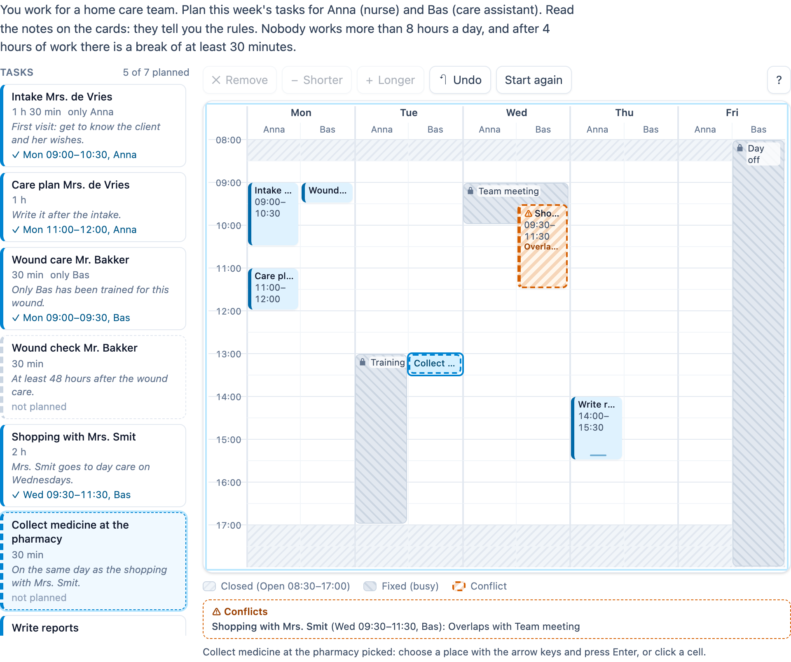

# @citolab/pci-week-planner

> [!WARNING]
> **Experimental (alpha). Just for inspiration.** This PCI is a technical showcase, made by software developers without
> much knowledge of the subject it could be used for. Its content, terms and scoring have not been checked by subject
> experts or assessment specialists, and it has never been used in an assessment. It is offered as is, without any
> warranty.

A QTI 3 Portable Custom Interaction (PCI) in which the candidate plans tasks in a week agenda: days × time slots, with
a column per resource (a person, a room, a vehicle). They drag task cards into the agenda, move them and make them
longer or shorter, around the busy blocks the author fixed. The PCI checks the author's rules itself: task A before
task B, not on Wednesday, at most 8 hours a day, a break after 4 hours, everything planned, no overlaps, within
opening hours, on the same day, hours in between. Made for vocational education ("plan the shifts", "plan the client
appointments", "make a work schedule"). The item author sets up everything in the PCI itself. Made with
[tspci](https://github.com/Citolab/tspci).

A second task, the **staff rota** (*dienstrooster*), is for praktijkonderwijs and working life (`data-mode`, see
[The staff rota](#the-staff-rota)): **read** a given rota and answer questions about it ("When does Sam work on
Friday?", "Who closes on Saturday?"), **make** a rota for a small shop that keeps to the author's rules (people at work
during opening hours, contract hours, days off, the longest shift, breaks, rest between shifts, weekend days), or work
out the **hours and pay** of everyone in a given or an own rota (hourly wage, Sunday and evening surcharges).

<p align="center">
  
</p>

## What it does

- **The agenda**: the days the author chose (Monday to Sunday), from a start to an end time in rows of 5 to 60
  minutes, a column per resource in every day. Time outside the opening hours is hatched. Fixed blocks (a meeting, a
  training, a day off) are hatched grey with a lock and their text; a fixed block can be for one resource or everyone.
- **Task cards** show the text, the duration (or "1 h to 2 h" when the candidate can resize it), "only Anna" when one
  resource must do it, the author's notes and where the task is planned. Each task is planned once.
- **Mouse and touch**: drag a card into the agenda; or click a card (it stays picked, with a dashed preview) and click
  a cell. Drag a task to move it, drag its lower edge to resize it, drag it out of the agenda to remove it. Remove,
  Shorter, Longer, Undo and Start again in the toolbar. A task for one resource does not go in another resource's
  column; the status line says why.
- **Keyboard**: the agenda is a grid with the cursor as its active descendant. A card is a button: Enter picks it and
  moves the focus to the agenda (to the task's place, or the first column it may go in). The arrow keys move the
  cursor and the preview, Enter places. In the agenda, Enter picks up the task in the cell, `Shift` + arrow up/down
  makes it shorter/longer, `Delete` removes it, `Ctrl+Z` undoes, `Escape` drops a picked card. A screen reader hears
  every cell ("Wednesday, Bas, 09:30: Team meeting (fixed) 09:00–10:00") and every step in a live status line
  ("Shopping with Mrs. Smit planned: Wednesday 09:00–11:00, Bas. Overlaps with Team meeting.").
- **Live feedback** (`data-feedback`, on by default): a task that overlaps another task or a fixed block in its
  column, or lies outside opening hours, gets a dashed border, stripes, a warning sign and the text ("Overlaps with
  Team meeting", "Outside opening hours"), and is listed under the agenda. Colour is never the only sign; the colours
  are blue and vermillion (Okabe-Ito), apart for every colour vision. The author can turn this off: the checks still
  count.
- **Analysis** (`src/planner.ts`, no imports, tested in node with `npm test`): placing snaps to the rows and keeps a
  task within the day; conflicts per column; the checks below.
- **Authoring mode**: the item author sets up everything in the PCI (`getAuthoringInstance`), via "Configure…"
  ("Make the agenda or rota…") in an authoring system that supports it (qti-construction, TAO with tspci-tao, the dev page),
  in six tabs: **Agenda** (days, times, minutes per row, opening hours), **Resources**, **Fixed blocks** (text,
  resource or everyone, day, start, end, counts as work), **Tasks** (text, duration, at least and at most, resource,
  notes), **Checks** (each with points and a mark whether the example solution passes it, and its rubric line) and
  **Example solution** (plan it as a candidate would). `validate()` reports no tasks, no checks, empty opening hours,
  a check about a task that does not exist, and every check the example solution fails, in the author's language.
- **Delivery**: the candidate's schedule is saved as the item's state (every change in the log) and restored. In
  review (`status: "solution"`) the PCI shows the correct response from the response declaration, or else the author's
  example solution, read-only. Several interactions of this type on one page each get their own object.
- **Languages**: `data-language` `en` or `nl`: the texts, day names and durations ("1 uur 30 min"); the author's
  numbers take a decimal comma in Dutch (7,5 hours). The example is in the language of the item. The response is the
  same in every language.

## What can be configured

Every setting is a `data-` attribute of the interaction, as text. `dist/authoring.json` describes them for authoring
systems.

| setting                       | attribute       | default                | what                                                          |
| ----------------------------- | --------------- | ---------------------- | ------------------------------------------------------------- |
| Task                          | `data-mode`     | `plan`                 | `plan` (the week agenda), `readRota`, `makeRota`, `hoursAndPay` (the staff rota) |
| Instruction above the agenda  | `data-prompt`   | the example's question | also part of the agenda's accessible name; in a rota mode the default is the rota example's |
| Agenda, tasks and checks      | `data-planner`  | empty: the example     | written by the authoring mode, as JSON (below)                |
| Staff rota                    | `data-rota`     | empty: the example     | the rota modes: written by the authoring mode, as JSON ([The staff rota](#the-staff-rota)) |
| Show conflicts while planning | `data-feedback` | `true`                 | overlaps and tasks outside opening hours, in text and pattern; in a rota the author's rules |
| Language                      | `data-language` | `en`                   | `en` or `nl`: the texts of the PCI                            |

```json
{
  "days": ["mon", "tue", "wed", "thu", "fri"], "start": "08:00", "end": "18:00", "slot": 30,
  "open": { "start": "08:30", "end": "17:00" },
  "resources": [{ "id": "anna", "name": "Anna" }, { "id": "bas", "name": "Bas" }],
  "fixed": [
    { "id": "f1", "label": "Team meeting", "resource": "", "day": "wed", "start": "09:00", "end": "10:00", "work": true },
    { "id": "f3", "label": "Day off", "resource": "bas", "day": "fri", "start": "08:00", "end": "18:00", "work": false }
  ],
  "tasks": [
    { "id": "t1", "label": "Intake Mrs. de Vries", "duration": 90, "min": 90, "max": 90, "resource": "anna", "notes": "First visit." },
    { "id": "t7", "label": "Write reports", "duration": 60, "min": 60, "max": 120, "resource": "", "notes": "" }
  ],
  "solution": [{ "task": "t1", "day": "mon", "start": "09:00", "end": "10:30", "resource": "anna" }],
  "checks": [
    { "type": "allPlanned", "points": 1 },
    { "type": "before", "a": "t1", "b": "t2", "points": 1 },
    { "type": "maxHours", "hours": 8, "points": 1 }
  ]
}
```

- **Days**: `mon` … `sun`. **Times**: `"HH:MM"` (or minutes since midnight); start, end and blocks snap to the rows.
  **Slot**: 5, 10, 15, 20, 30 or 60 minutes. **Opening hours** within start and end.
- **Resources**: at most 6, each a column of every day. `resource` `""` is everyone (a fixed block) or anyone (a task).
- **Tasks**: at most 24; lengths in minutes, rounded to the rows. `min` = `max`: a fixed length.
- **Fixed blocks**: `work: false` (a day off) does not count towards hours and breaks; it still blocks the time.

### The checks

At most 12, each worth `points` (default 1).

| check          | passes when                                                                                        | rubric line                                 |
| -------------- | -------------------------------------------------------------------------------------------------- | ------------------------------------------- |
| `allPlanned`   | every task is in the agenda                                                                        | "everything planned"                        |
| `noOverlap`    | no task overlaps another task or a fixed block in the same resource's column                       | "no double bookings"                        |
| `openingHours` | every task starts and ends within opening hours                                                    | "within opening hours"                      |
| `before`       | `a` and `b` are planned and `a` ends before (or when) `b` starts, over the week                     | "the intake before the care plan"           |
| `notOnDay`     | `task` is planned and not on `day`; with `task` `""`: no task at all on that day                    | "not on Wednesday"                          |
| `sameDay`      | `a` and `b` are planned on the same day                                                            | "the pharmacy on the same day as shopping"  |
| `gap`          | `a` and `b` are planned with at least `hours` between the end of the first and the start of the other | "at least 48 hours between"              |
| `maxHours`     | no resource works more than `hours` on a day (tasks and fixed work, overlaps once)                  | "at most 8 hours per person per day"        |
| `break`        | no resource works more than `hours` without a gap of at least `minutes` (shorter gaps are no break)  | "a break of 30 min after 4 hours"          |

## Scoring

The PCI is made for `custom` scoring (`authoring.json`: `"scoring": ["custom", "human"]`): it evaluates the author's
checks, the item's response processing turns them into points. The response is a record (`cardinality="record"`); in
`plan` mode it has these fields (the rota modes: [their response](#the-response-of-the-rota-modes)):

| field                | type      | what                                                                         |
| -------------------- | --------- | ---------------------------------------------------------------------------- |
| `score`              | `integer` | the points of the checks that pass                                           |
| `maxscore`           | `integer` | the points of all checks                                                     |
| `correct`            | `integer` | 1 when every check passes (and there is at least one), else 0                |
| `check1` … `check12` | `integer` | 1 or 0 per check, in the order of the checks; only the checks there are      |
| `planned`            | `integer` | how many tasks are in the agenda                                             |
| `schedule`           | `string`  | every planned task as JSON: `[{ task, day, start, end, resource }]`          |

```json
{ "record": [
  { "name": "score", "base": { "integer": 7 } }, { "name": "maxscore", "base": { "integer": 9 } },
  { "name": "correct", "base": { "integer": 0 } },
  { "name": "check1", "base": { "integer": 1 } }, { "name": "check2", "base": { "integer": 1 } },
  { "name": "check3", "base": { "integer": 1 } }, { "name": "check4", "base": { "integer": 1 } },
  { "name": "check5", "base": { "integer": 0 } }, { "name": "check6", "base": { "integer": 0 } },
  { "name": "check7", "base": { "integer": 1 } }, { "name": "check8", "base": { "integer": 1 } },
  { "name": "check9", "base": { "integer": 1 } },
  { "name": "planned", "base": { "integer": 7 } },
  { "name": "schedule", "base": { "string": "[{\"task\":\"t1\",\"day\":\"mon\",\"start\":\"09:00\",\"end\":\"10:30\",\"resource\":\"anna\"},…]" } }
] }
```

- **One point per rubric line**: make a check per line and copy `score` to the outcome, as below.
- **Your own response processing**: test single fields, `<qti-field-value field-identifier="check2">` equal to 1, and
  give points as you like (for example: the hours only count when everything is planned).
- `match_correct` is not offered: QTI's `match` cannot compare records, and many schedules are right.
- `human`: use the PCI as a tool or for a human rater; `schedule` has the whole plan.
- **No response**: while the agenda is empty, `getResponse()` reports nothing.

```xml
<qti-response-declaration identifier="RESPONSE" cardinality="record"/>
<qti-outcome-declaration identifier="SCORE" cardinality="single" base-type="float">
  <qti-default-value><qti-value>0</qti-value></qti-default-value>
</qti-outcome-declaration>
<qti-outcome-declaration identifier="MAXSCORE" cardinality="single" base-type="float">
  <qti-default-value><qti-value>9</qti-value></qti-default-value>
</qti-outcome-declaration>
…
<qti-response-processing>
  <qti-response-condition>
    <qti-response-if>
      <qti-not><qti-is-null>
        <qti-field-value field-identifier="score"><qti-variable identifier="RESPONSE"/></qti-field-value>
      </qti-is-null></qti-not>
      <qti-set-outcome-value identifier="SCORE">
        <qti-field-value field-identifier="score"><qti-variable identifier="RESPONSE"/></qti-field-value>
      </qti-set-outcome-value>
    </qti-response-if>
  </qti-response-condition>
</qti-response-processing>
```

**State and response.** `getState()` holds the candidate's placements (and the log), so the agenda can be restored.
`setResponse` (and `boundTo` without a state) reads the `schedule` field, or a schedule as a string; the other fields
follow from it. Tasks, days and resources that are not in the agenda are left out. In `status: "solution"` the
schedule of the declared correct response is shown (a string, or a record value with the field `schedule`); without
one, the author's example solution.

## The staff rota

`data-mode` `readRota`, `makeRota` or `hoursAndPay`. The example (`data-rota` empty) is a corner shop from Thursday
(late-night shopping until 21:00) to Sunday, with five employees, four shift cards, seven rules and six questions. Its
rota passes every rule; in `hoursAndPay` it gives € 316,80 to € 110,00 a week, with 50 % extra on Sunday.

- **Reading a rota** (`readRota`): the rota as a table (an employee per row, a day per column, the times and the break
  in every cell), and the author's questions below it. A time is typed in two boxes ("13", "13:00", "13.00" and
  "1300" are all 13:00), with a button *Does not work*; a number in a box ("16,5", "16.5 hours"); names are tapped
  (toggle buttons, 44 px). The answers follow from the rota:

  | kind      | question the PCI makes of it (or the author's own text)     | answer                          |
  | --------- | ----------------------------------------------------------- | ------------------------------- |
  | `shift`   | When does Sam work on Friday?                               | start and end, or does not work |
  | `hours`   | How many hours does Noor work this week, without breaks?    | a number                        |
  | `opens`   | Who opens on Thursday? (Who starts first?)                  | the names                       |
  | `closes`  | Who closes on Saturday? (Who works until the end?)          | the names                       |
  | `whoAt`   | Who works on Friday at 12:00?                               | the names                       |
  | `staffAt` | How many people work on Thursday at 13:00?                  | a number                        |
  | `number`  | the author's own question                                   | the author's number             |

- **Making a rota** (`makeRota`): the employees (contract hours, days they cannot work) and the rules above the rota.
  The rota is the week planner's agenda turned on its side: a row per employee in every day, time to the right in
  columns of 15, 30 or 60 minutes, closed time hatched, a day someone cannot work hatched with the text *cannot work*.
  One shift per employee per day; a shift shows its times and its break as text.
  - **Mouse and touch**: drag a shift card onto a day of an employee (it keeps its times; a shift already there is
    replaced, the status line says so), or pick a card and tap a row. Drag a shift to move it (to another time, day or
    employee), drag its right edge to make it longer or shorter (8 px with a mouse, 24 px with a finger), drag it out
    of the rota to remove it. The toolbar: Remove, Shorter, Longer, Shorter break, Longer break (15 minutes a step),
    Undo, Start again. Only cards and shifts take the finger (`touch-action: none`): a swipe over the cells scrolls
    the page. A tap may move up to 10 px; a second finger and a cancelled touch do nothing. While dragging near the
    edge of the rota's box or of the screen, the rota scrolls (as far as the rota goes).
  - **Keyboard**: as in the agenda. A card is a button: Enter picks it and moves the focus to the rota. The arrow
    keys move the cursor, Enter places the card on the cursor's row. In the rota, Enter picks up the row's shift (the
    arrow keys and Enter move it), `Shift` + arrow left/right makes it shorter/longer, `B` makes the break longer
    (after 60 minutes back to none) and `Shift` + `B` shorter, `Delete` removes it, `Ctrl+Z` undoes, `Escape` drops a
    picked card. A screen reader hears every cell ("Friday, Sam, 14:00: 13:00–18:30, no break") and every step in the
    status line ("Lisa, Thursday: 13:00–21:30, break 30 min. Lisa cannot work on Thursday.").
  - **Live feedback** (`data-feedback`): a row *At work* per day with the number of people per column (fewer than the
    rule asks: the number with `!`, stripes and bold), the hours per employee against the contract, a shift that
    breaks a rule dashed and striped with a warning sign and the text, and a list of the problems under the rota (from
    the first shift on). Without feedback none of it shows; the rules still count.
- **Hours and pay** (`hoursAndPay`): the rota as a table, or (`"own": true`) the pupil makes one first with the shift
  cards (no rules, no feedback on hours). Under it the pay rules ("Breaks are not paid.", "On Sunday you earn 50%
  extra per hour.") and a row per employee with the hourly wage and boxes for the hours and the pay (`"askPay":
  false`: only the hours). Amounts as "215,60", "215.60", "€ 215,60" or "110,-".

### `data-rota`

```json
{
  "days": [{ "day": "thu", "open": "09:00", "close": "21:00" }, { "day": "sun", "open": "12:00", "close": "17:00" }],
  "start": "08:00", "end": "22:00", "slot": 30,
  "employees": [{ "id": "sam", "name": "Sam", "min": 20, "max": 24, "wage": 14.4, "unavailable": ["sun"] }],
  "templates": [{ "id": "s1", "label": "Opening", "start": "08:00", "end": "13:30", "break": 0 }],
  "shifts": [{ "employee": "sam", "day": "thu", "start": "13:00", "end": "21:30", "break": 30 }],
  "own": false,
  "rules": [{ "type": "coverage", "staff": 2, "points": 1 }, { "type": "rest", "hours": 11, "points": 1 }],
  "questions": [{ "kind": "shift", "text": "", "employee": "sam", "day": "thu", "time": "12:00", "answer": 0, "points": 1 }],
  "pay": { "sunday": 50, "evening": 0, "eveningFrom": "20:00", "askPay": true }
}
```

- **Days** with their opening hours; `start`, `end` and `slot` (15, 30, 60) are the time axis of the rota.
- **Employees**: at most 8; contract hours per week without breaks, the hourly wage in euros, the days they cannot work.
- **Templates**: the shift cards (at most 8), with their break in minutes (steps of 15, at most 120).
- **Shifts**: the rota the pupil reads (`readRota`, `hoursAndPay`), or the example solution (`makeRota`, an own rota):
  the rules' preview in the authoring mode and the solution status.
- **Rules** (at most 12, each worth `points`), checked by the PCI:

  | rule            | passes when                                                                                  |
  | --------------- | -------------------------------------------------------------------------------------------- |
  | `coverage`      | at every moment of every day's opening hours at least `staff` people work                    |
  | `contractHours` | every employee works (without breaks) between their `min` and `max` hours                    |
  | `available`     | nobody works on a day they cannot                                                            |
  | `maxShift`      | no shift lasts longer than `hours`, from start to end                                        |
  | `break`         | a shift longer than `hours` (from start to end) has a break of at least `minutes`            |
  | `rest`          | at least `hours` between the end of a shift and the start of the same employee's next one   |
  | `weekend`       | nobody works more than `days` of Saturday and Sunday                                         |

  A shift counts as at work from its start to its end: breaks are taken in turn and do not leave the shop short.
- **Pay**: the minutes worked (without breaks) times the hourly wage; `sunday` % extra on every hour worked on Sunday,
  `evening` % extra on the hours after `eveningFrom` on other days (a break is taken before the evening). Rounded to
  whole cents once per week.

### The response of the rota modes

A record, as in `plan` mode: `score`, `maxscore` and `correct` in every mode (so the same response processing copies
`score`), then

| mode          | fields                                                                                                                              |
| ------------- | ----------------------------------------------------------------------------------------------------------------------------------- |
| `readRota`    | `question1` … `question10` (`integer` 1 or 0, the points of the question), `answers` (`string`, JSON: `{ start, end }`, `"free"`, a number or employee ids per question) |
| `makeRota`    | `check1` … `check12` (`integer` 1 or 0 per rule, as the agenda's checks), `rota` (`string`, JSON: `[{ employee, day, start, end, break }]`) |
| `hoursAndPay` | `hours1` … `hours8`, `pay1` … `pay8` (`float`, the pupil's numbers per employee in the order of the employees; a blank box is left out), `hoursCorrect`, `payCorrect`, `payFollows` (`boolean`), `rota` |

- **Hours and pay are checked against the rota's own numbers**, as the ratio table checks the working: an hours box
  is right when it equals the rota's hours; a pay box *follows* when it is the pupil's own hours times the wage plus
  the rota's surcharges, so a wrong number of hours does not cost the pay as well. `score` is a point per right hours
  box and per pay box that follows (`maxscore` 2 per employee, 1 without pay); `payCorrect` says whether every pay is
  the rota's own; `correct` is 1 when all hours and pay are right.
- **Nothing is reported** until the pupil answered: a question with a whole answer (a start *and* an end), a shift in
  the rota, a box with something in it.
- **`getCorrectResponse`** (`"correctResponse": "properties"`): `readRota`, and `hoursAndPay` with a given rota,
  where the answers follow from the rota. `undefined` for `plan`, `makeRota` and an own rota: many answers are right.
- **State and review**: `getState()` keeps what the pupil typed (also half a time); `setResponse` and `boundTo` read
  `answers`, `rota` and `hours1` …/`pay1` …. In `status: "solution"` the declared correct response is shown, or the
  correct answers, or the author's example solution (`makeRota`, with its hours and pay for an own rota).
- **Authoring mode** with a rota mode: tabs **Shop** (days, opening hours, time axis), **Employees**, **Shift cards**
  (`makeRota`, own rota), **Rules** (with a mark whether the example solution passes it), **Questions** (with the
  answer that follows from the rota), **Pay** (surcharges, only hours, a preview of every employee's hours and pay) and
  **Rota** / **Example solution** (made with the pupil's editor). `validate()` reports empty opening hours, no rules,
  no shift cards, no questions, an empty rota, a question nobody fits, and every rule the example solution fails.

## Using it

```sh
npm install @citolab/pci-week-planner
```

| file                                       | what                                                                      |
| ------------------------------------------ | ------------------------------------------------------------------------- |
| `dist/index.js`                            | the PCI (AMD module, everything bundled: the package has no dependencies) |
| `dist/authoring.json`                      | settings, response, scoring and the authoring mode, for authoring systems |
| `dist/sbom.cdx.json`                       | CycloneDX SBOM of the bundle                                              |
| `dist/tao-pci-weekPlanner_<version>.zip`   | the PCI for TAO: Settings → Portable Custom Interactions → Add            |
| `weekPlanner.svg`, `example.png`           | icon and screenshot                                                       |

In a QTI 3 item, with `index.js` at `resources/pci/index.js` of the package:

```xml
<qti-response-declaration identifier="RESPONSE" cardinality="record"/>
…
<qti-portable-custom-interaction response-identifier="RESPONSE" module="pci" custom-interaction-type-identifier="weekPlanner"
  data-language="nl" data-feedback="true" data-planner="{&quot;days&quot;:[&quot;mon&quot;,…],…}">
  <qti-interaction-modules>
    <qti-interaction-module id="pci" primary-path="../resources/pci/index"></qti-interaction-module>
  </qti-interaction-modules>
  <qti-interaction-markup></qti-interaction-markup>
</qti-portable-custom-interaction>
```

**Next to `tspci-gantt-chart`**: the Gantt chart marks one time line per task (which days or weeks). The week planner
is an agenda of days × clock time with resources, fixed blocks, durations and rule checks.

Source and the other examples: [Citolab/tspci-examples](https://github.com/Citolab/tspci-examples).
