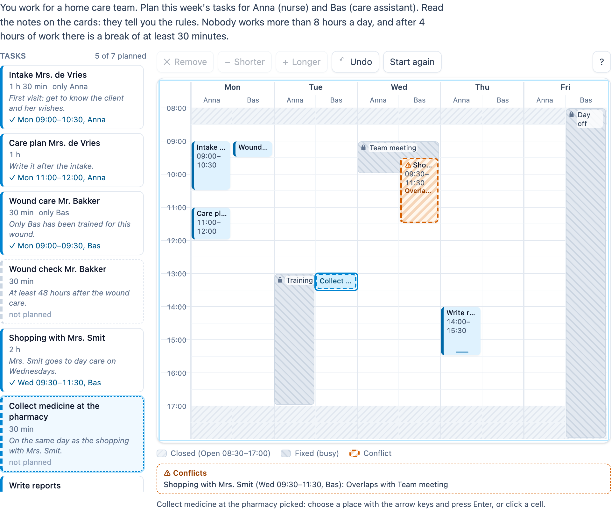

# @citolab/pci-week-planner

> [!WARNING]
> **Experimental (alpha). Just for inspiration.** This PCI is a technical showcase, made by software developers without
> much knowledge of the subject it could be used for. Its content, terms and scoring have not been checked by subject
> experts or assessment specialists, and it has never been used in an assessment. It is offered as is, without any
> warranty.

A QTI 3 Portable Custom Interaction (PCI) in which the candidate plans tasks in a week agenda: days × time slots, with
a column per resource (a person, a room, a vehicle). They drag task cards into the agenda, move them and make them
longer or shorter, around the busy blocks the author fixed. The PCI checks the author's rules itself: task A before
task B, not on Wednesday, at most 8 hours a day, a break after 4 hours, everything planned, no overlaps, within
opening hours, on the same day, hours in between. Made for vocational education ("plan the shifts", "plan the client
appointments", "make a work schedule"). The item author sets up everything in the PCI itself. Made with
[tspci](https://github.com/Citolab/tspci).

<p align="center">
  
</p>

## What it does

- **The agenda**: the days the author chose (Monday to Sunday), from a start to an end time in rows of 5 to 60
  minutes, a column per resource in every day. Time outside the opening hours is hatched. Fixed blocks (a meeting, a
  training, a day off) are hatched grey with a lock and their text; a fixed block can be for one resource or everyone.
- **Task cards** show the text, the duration (or "1 h to 2 h" when the candidate can resize it), "only Anna" when one
  resource must do it, the author's notes and where the task is planned. Each task is planned once.
- **Mouse and touch**: drag a card into the agenda; or click a card (it stays picked, with a dashed preview) and click
  a cell. Drag a task to move it, drag its lower edge to resize it, drag it out of the agenda to remove it. Remove,
  Shorter, Longer, Undo and Start again in the toolbar. A task for one resource does not go in another resource's
  column; the status line says why.
- **Keyboard**: the agenda is a grid with the cursor as its active descendant. A card is a button: Enter picks it and
  moves the focus to the agenda (to the task's place, or the first column it may go in). The arrow keys move the
  cursor and the preview, Enter places. In the agenda, Enter picks up the task in the cell, `Shift` + arrow up/down
  makes it shorter/longer, `Delete` removes it, `Ctrl+Z` undoes, `Escape` drops a picked card. A screen reader hears
  every cell ("Wednesday, Bas, 09:30: Team meeting (fixed) 09:00–10:00") and every step in a live status line
  ("Shopping with Mrs. Smit planned: Wednesday 09:00–11:00, Bas. Overlaps with Team meeting.").
- **Live feedback** (`data-feedback`, on by default): a task that overlaps another task or a fixed block in its
  column, or lies outside opening hours, gets a dashed border, stripes, a warning sign and the text ("Overlaps with
  Team meeting", "Outside opening hours"), and is listed under the agenda. Colour is never the only sign; the colours
  are blue and vermillion (Okabe-Ito), apart for every colour vision. The author can turn this off: the checks still
  count.
- **Analysis** (`src/planner.ts`, no imports, tested in node with `npm test`): placing snaps to the rows and keeps a
  task within the day; conflicts per column; the checks below.
- **Authoring mode**: the item author sets up everything in the PCI (`getAuthoringInstance`), via "Configure…"
  ("Make the agenda…") in an authoring system that supports it (qti-construction, TAO with tspci-tao, the dev page),
  in six tabs: **Agenda** (days, times, minutes per row, opening hours), **Resources**, **Fixed blocks** (text,
  resource or everyone, day, start, end, counts as work), **Tasks** (text, duration, at least and at most, resource,
  notes), **Checks** (each with points and a mark whether the example solution passes it, and its rubric line) and
  **Example solution** (plan it as a candidate would). `validate()` reports no tasks, no checks, empty opening hours,
  a check about a task that does not exist, and every check the example solution fails, in the author's language.
- **Delivery**: the candidate's schedule is saved as the item's state (every change in the log) and restored. In
  review (`status: "solution"`) the PCI shows the correct response from the response declaration, or else the author's
  example solution, read-only. Several interactions of this type on one page each get their own object.
- **Languages**: `data-language` `en` or `nl`: the texts, day names and durations ("1 uur 30 min"); the author's
  numbers take a decimal comma in Dutch (7,5 hours). The example is in the language of the item. The response is the
  same in every language.

## What can be configured

Every setting is a `data-` attribute of the interaction, as text. `dist/authoring.json` describes them for authoring
systems.

| setting                       | attribute       | default                | what                                                          |
| ----------------------------- | --------------- | ---------------------- | ------------------------------------------------------------- |
| Instruction above the agenda  | `data-prompt`   | the example's question | also part of the agenda's accessible name                     |
| Agenda, tasks and checks      | `data-planner`  | empty: the example     | written by the authoring mode, as JSON (below)                |
| Show conflicts while planning | `data-feedback` | `true`                 | overlaps and tasks outside opening hours, in text and pattern |
| Language                      | `data-language` | `en`                   | `en` or `nl`: the texts of the PCI                            |

```json
{
  "days": ["mon", "tue", "wed", "thu", "fri"], "start": "08:00", "end": "18:00", "slot": 30,
  "open": { "start": "08:30", "end": "17:00" },
  "resources": [{ "id": "anna", "name": "Anna" }, { "id": "bas", "name": "Bas" }],
  "fixed": [
    { "id": "f1", "label": "Team meeting", "resource": "", "day": "wed", "start": "09:00", "end": "10:00", "work": true },
    { "id": "f3", "label": "Day off", "resource": "bas", "day": "fri", "start": "08:00", "end": "18:00", "work": false }
  ],
  "tasks": [
    { "id": "t1", "label": "Intake Mrs. de Vries", "duration": 90, "min": 90, "max": 90, "resource": "anna", "notes": "First visit." },
    { "id": "t7", "label": "Write reports", "duration": 60, "min": 60, "max": 120, "resource": "", "notes": "" }
  ],
  "solution": [{ "task": "t1", "day": "mon", "start": "09:00", "end": "10:30", "resource": "anna" }],
  "checks": [
    { "type": "allPlanned", "points": 1 },
    { "type": "before", "a": "t1", "b": "t2", "points": 1 },
    { "type": "maxHours", "hours": 8, "points": 1 }
  ]
}
```

- **Days**: `mon` … `sun`. **Times**: `"HH:MM"` (or minutes since midnight); start, end and blocks snap to the rows.
  **Slot**: 5, 10, 15, 20, 30 or 60 minutes. **Opening hours** within start and end.
- **Resources**: at most 6, each a column of every day. `resource` `""` is everyone (a fixed block) or anyone (a task).
- **Tasks**: at most 24; lengths in minutes, rounded to the rows. `min` = `max`: a fixed length.
- **Fixed blocks**: `work: false` (a day off) does not count towards hours and breaks; it still blocks the time.

### The checks

At most 12, each worth `points` (default 1).

| check          | passes when                                                                                        | rubric line                                 |
| -------------- | -------------------------------------------------------------------------------------------------- | ------------------------------------------- |
| `allPlanned`   | every task is in the agenda                                                                        | "everything planned"                        |
| `noOverlap`    | no task overlaps another task or a fixed block in the same resource's column                       | "no double bookings"                        |
| `openingHours` | every task starts and ends within opening hours                                                    | "within opening hours"                      |
| `before`       | `a` and `b` are planned and `a` ends before (or when) `b` starts, over the week                     | "the intake before the care plan"           |
| `notOnDay`     | `task` is planned and not on `day`; with `task` `""`: no task at all on that day                    | "not on Wednesday"                          |
| `sameDay`      | `a` and `b` are planned on the same day                                                            | "the pharmacy on the same day as shopping"  |
| `gap`          | `a` and `b` are planned with at least `hours` between the end of the first and the start of the other | "at least 48 hours between"              |
| `maxHours`     | no resource works more than `hours` on a day (tasks and fixed work, overlaps once)                  | "at most 8 hours per person per day"        |
| `break`        | no resource works more than `hours` without a gap of at least `minutes` (shorter gaps are no break)  | "a break of 30 min after 4 hours"          |

## Scoring

The PCI is made for `custom` scoring (`authoring.json`: `"scoring": ["custom", "human"]`): it evaluates the author's
checks, the item's response processing turns them into points. The response is a record (`cardinality="record"`):

| field                | type      | what                                                                         |
| -------------------- | --------- | ---------------------------------------------------------------------------- |
| `score`              | `integer` | the points of the checks that pass                                           |
| `maxscore`           | `integer` | the points of all checks                                                     |
| `correct`            | `integer` | 1 when every check passes (and there is at least one), else 0                |
| `check1` … `check12` | `integer` | 1 or 0 per check, in the order of the checks; only the checks there are      |
| `planned`            | `integer` | how many tasks are in the agenda                                             |
| `schedule`           | `string`  | every planned task as JSON: `[{ task, day, start, end, resource }]`          |

```json
{ "record": [
  { "name": "score", "base": { "integer": 7 } }, { "name": "maxscore", "base": { "integer": 9 } },
  { "name": "correct", "base": { "integer": 0 } },
  { "name": "check1", "base": { "integer": 1 } }, { "name": "check2", "base": { "integer": 1 } },
  { "name": "check3", "base": { "integer": 1 } }, { "name": "check4", "base": { "integer": 1 } },
  { "name": "check5", "base": { "integer": 0 } }, { "name": "check6", "base": { "integer": 0 } },
  { "name": "check7", "base": { "integer": 1 } }, { "name": "check8", "base": { "integer": 1 } },
  { "name": "check9", "base": { "integer": 1 } },
  { "name": "planned", "base": { "integer": 7 } },
  { "name": "schedule", "base": { "string": "[{\"task\":\"t1\",\"day\":\"mon\",\"start\":\"09:00\",\"end\":\"10:30\",\"resource\":\"anna\"},…]" } }
] }
```

- **One point per rubric line**: make a check per line and copy `score` to the outcome, as below.
- **Your own response processing**: test single fields, `<qti-field-value field-identifier="check2">` equal to 1, and
  give points as you like (for example: the hours only count when everything is planned).
- `match_correct` is not offered: QTI's `match` cannot compare records, and many schedules are right.
- `human`: use the PCI as a tool or for a human rater; `schedule` has the whole plan.
- **No response**: while the agenda is empty, `getResponse()` reports nothing.

```xml
<qti-response-declaration identifier="RESPONSE" cardinality="record"/>
<qti-outcome-declaration identifier="SCORE" cardinality="single" base-type="float">
  <qti-default-value><qti-value>0</qti-value></qti-default-value>
</qti-outcome-declaration>
<qti-outcome-declaration identifier="MAXSCORE" cardinality="single" base-type="float">
  <qti-default-value><qti-value>9</qti-value></qti-default-value>
</qti-outcome-declaration>
…
<qti-response-processing>
  <qti-response-condition>
    <qti-response-if>
      <qti-not><qti-is-null>
        <qti-field-value field-identifier="score"><qti-variable identifier="RESPONSE"/></qti-field-value>
      </qti-is-null></qti-not>
      <qti-set-outcome-value identifier="SCORE">
        <qti-field-value field-identifier="score"><qti-variable identifier="RESPONSE"/></qti-field-value>
      </qti-set-outcome-value>
    </qti-response-if>
  </qti-response-condition>
</qti-response-processing>
```

**State and response.** `getState()` holds the candidate's placements (and the log), so the agenda can be restored.
`setResponse` (and `boundTo` without a state) reads the `schedule` field, or a schedule as a string; the other fields
follow from it. Tasks, days and resources that are not in the agenda are left out. In `status: "solution"` the
schedule of the declared correct response is shown (a string, or a record value with the field `schedule`); without
one, the author's example solution.

## Using it

```sh
npm install @citolab/pci-week-planner
```

| file                                       | what                                                                      |
| ------------------------------------------ | ------------------------------------------------------------------------- |
| `dist/index.js`                            | the PCI (AMD module, everything bundled: the package has no dependencies) |
| `dist/authoring.json`                      | settings, response, scoring and the authoring mode, for authoring systems |
| `dist/sbom.cdx.json`                       | CycloneDX SBOM of the bundle                                              |
| `dist/tao-pci-weekPlanner_<version>.zip`   | the PCI for TAO: Settings → Portable Custom Interactions → Add            |
| `weekPlanner.svg`, `example.png`           | icon and screenshot                                                       |

In a QTI 3 item, with `index.js` at `resources/pci/index.js` of the package:

```xml
<qti-response-declaration identifier="RESPONSE" cardinality="record"/>
…
<qti-portable-custom-interaction response-identifier="RESPONSE" module="pci" custom-interaction-type-identifier="weekPlanner"
  data-language="nl" data-feedback="true" data-planner="{&quot;days&quot;:[&quot;mon&quot;,…],…}">
  <qti-interaction-modules>
    <qti-interaction-module id="pci" primary-path="../resources/pci/index"></qti-interaction-module>
  </qti-interaction-modules>
  <qti-interaction-markup></qti-interaction-markup>
</qti-portable-custom-interaction>
```

**Next to `tspci-gantt-chart`**: the Gantt chart marks one time line per task (which days or weeks). The week planner
is an agenda of days × clock time with resources, fixed blocks, durations and rule checks.

Source and the other examples: [Citolab/tspci-examples](https://github.com/Citolab/tspci-examples).
