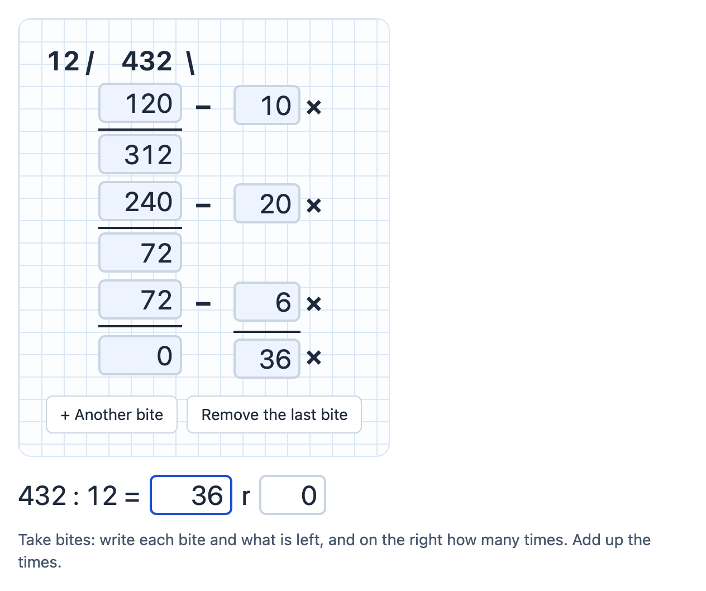

# @citolab/pci-written-calculation

> [!WARNING]
> **Experimental (alpha). Just for inspiration.** This PCI is a technical showcase, made by software developers without
> much knowledge of the subject it could be used for. Its content, terms and scoring have not been checked by subject
> experts or assessment specialists, and it has never been used in an assessment. It is offered as is, without any
> warranty.

A QTI 3 Portable Custom Interaction (PCI) for written calculation as Dutch primary schools teach it: chunking division
(Dutch: *de hapmethode*) and column-wise adding and subtracting (*kolomsgewijs rekenen*). The pupil writes every number
in a box, laid out on squared paper like the method on paper, and the answer after the sum. The PCI reports the answer
and whether the working is correct, whatever route the pupil took. Made with [tspci](https://github.com/Citolab/tspci).

<p align="center">
  
</p>

## What it does

### The hapmethode (`mode` `chunking`)

432 : 12. The pupil takes bites of the number: 10 × 12 = 120 off 432 leaves 312, another 20 × 12 = 240 leaves 72, and
6 × 12 = 72 leaves 0. The answer is the number of times taken together, 10 + 20 + 6 = 36.

- **The question** is written as on paper: `12 / 432 \`.
- **A row per bite**: the bite (120) with a line under it and a minus sign, the factor on the right (10 ×), and under
  the line what is left (312). The author sets how many rows there are at the start (`chunks`); **Another bite** adds
  a row (up to 12), **Remove the last bite** takes the last one away (down to 1). Rows left empty do not count.
- **The factors added up** at the bottom of their column, under a line (36 ×). A pupil may leave it empty.
- **The answer** after the sum, `432 : 12 = [36] r [0]` (`rest` in Dutch). An empty remainder is 0.

### Kolomsgewijs (`mode` `columns`)

345 + 278. The pupil adds per place value, starting on the left: 300 + 200 = 500, 40 + 70 = 110, 5 + 8 = 13, and adds
the partial results up: 623.

- **The two numbers** under each other, the operator on the right and a line under them.
- **A box per place value** (as many as the digits of the longer number) for the partial results, a line, and a box
  for the total. Subtracting may give a negative partial: 432 − 178 is 300, −40 and −6, together 254. `-40` and `−40`
  both work.
- **The answer** after the sum, `345 + 278 = [623]`.

### For both

- **Numbers** as a pupil writes them: `36`, `−40`, `1 200`; in Dutch (`language` `nl`) a decimal comma and a point
  between thousands (`36,5`, `1.200`), in English the other way around. A box with text that is not a number gets a
  thick red border, is marked invalid for a screen reader, and a message under the working says what to write.
- **Keyboard**: the boxes are in the order a pupil writes them, so Tab goes through the working from the top down, and
  Enter goes on to the next box as well. Every box has its own accessible name ("Bite 2", "Bite 2: how many times 12",
  "Left after bite 2", "Partial result 1").
- **A hint** in one line under the working says how the method works (`hint`, on by default).
- In review and solution the boxes are read-only and read as writing on the paper. In status `solution` the PCI shows
  a worked solution: a bite per digit of the quotient (432 : 12 as 30 × 12 = 360 and 6 × 12 = 72), or the partial
  results from the left, with the correct answer (the item's correct response, or else the one of the settings).
- When the settings make no calculation (a divisor of 0, a number that is not whole or has more than 7 digits), the
  PCI says so instead of showing a working.

## Settings

| setting | editor | what it does |
| --- | --- | --- |
| `title`, `question` | `text`, `textarea` | above the working (both empty by default: the sum is the question) |
| `mode` | `enum` | `chunking` (default): the hapmethode; `columns`: kolomsgewijs |
| `operation` | `enum` | `add` (default) or `subtract`, for kolomsgewijs |
| `first`, `second` | `integer` | the two numbers: for the hapmethode the number to divide and the divisor (`432`, `12`) |
| `chunks` | `integer` (1–12) | rows for bites at the start (hapmethode) |
| `hint` | `boolean` | one line under the working on how the method works |
| `language` | `enum` | `en` or `nl`: the PCI's own texts (labels, buttons, screen reader names) and how numbers are read |

## Response and scoring

The PCI does not score: it reports a `record`, and the item's scoring decides what counts. Nothing is reported until
the answer box holds a number (and, for the hapmethode, the remainder box is empty or holds a whole number).

| field | type | mode | what it is |
| --- | --- | --- | --- |
| `answer` | `float` | both | the number in the answer box (`36,5` is reported as `36.5`) |
| `remainder` | `integer` | `chunking` | the number in the remainder box (empty: 0) |
| `working` | `boolean` | both | the working is correct, whatever the route (below) |
| `answerCorrect` | `boolean` | both | the answer (and remainder) is the correct one for the two numbers of the settings |

**The working is checked against the pupil's own numbers**, as a teacher reads it on paper, so any route passes when it
is a correct working:

- **Hapmethode**: every bite is factor × divisor, with a whole factor above 0; every row's "left" is what was left
  before (432 at the start) minus the bite, and not below 0; what is left at the end is less than the divisor; the
  factors added up are the answer, and what is left at the end is the remainder; the total under the factor column, if
  written, is the sum of the factors. Big bites or small ones, in any order: 30 × and 6 ×, or 10 ×, 10 ×, 10 ×, 5 × and
  1 ×, are both correct. When the divisor does not fit at all (5 : 12) no bite is needed: 0 rest 5.
- **Kolomsgewijs**: every partial result is the one for its place value (300 + 200 = 500, 40 + 70 = 110, 5 + 8 = 13),
  from the left, or all of them from the right; a partial that is 0 may be left empty; the total, if written, is the
  sum of the pupil's partials; and the answer is that sum. The partials can only be checked against the two numbers
  of the question, the rest is checked against the pupil's own numbers.

So `working` can be true while `answerCorrect` is false (a correct working, then a slip in the answer box), and the
other way around (the right answer, but a bite of 10 × 12 = 100 on the way).

- **`getCorrectResponse`** gives the correct response from the settings: the answer (and remainder), `working` and
  `answerCorrect` true. So `match_correct` means "right answer, correct working".
- **`custom`** response processing can give part of the score per field, e.g. 1 point for `answerCorrect` and 1 for
  `working`, or score `answer` alone.
- The working itself (every box) is saved in the state, so a human rater (`human`) can look at it.

## Development

```bash
npm install
npm run dev           # the dev page, with the settings
npm test              # the methods and their checks (src/calculation.ts), in node
npm run test:stories  # the Storybook tests
```
